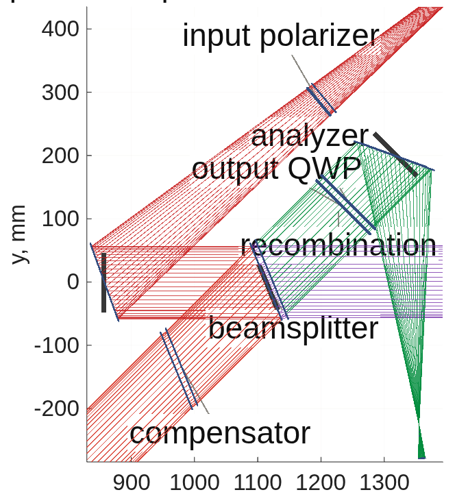

<!--
deck_cophi.md -- COPHI (Feng Zhao's heterodyne camera interferometer) as the fifth DM gauge,
scored on the same bench as the four others.  DRAFT -- pending Dave's sign-off.
Build: python3 make_brief_slides.py deck_cophi.md
Sources: macos/BRIEF_cophi_campaign.md (plan, rulings, sec. 8 stage records); the template
MACOS_resources/mmacos/templates/40_benches/cophi_dm96/ (cophi_params, README, runs/<tag>/);
dm_gauge_lib/dmg_cophi_*.m + dmg_converge.m; gates tCophi 8/8, tCophiBench 9/9, tConvergedEst 4/4;
surveys macos/NOTE_detectors_survey.md, NOTE_lockin_arrays_survey.md (web, unverified).
Every number is a record's (run tags in the footnotes).  Figures are the tools' own PNGs
(figs/cophi_stations_oap.png = runs/figs_oap_plain/figs_oap_plain_stations.png; the block
diagrams from make_cophi_block_fig.py).  American English.  Structure = the gauge deck's
(reads / frames / reconstruction / gets right / gets wrong / scored) so it drops into the
composite deck unchanged.
-->

# COPHI as the Fifth DM Gauge
Feng Zhao's heterodyne camera interferometer, scored on the same bench, the same 30 nm surface and the same rows as the interferometer, the Zernike sensors and the pinhole
D. C. Redding, with Claude Code (TO: the bench stages).
October 2026.  Working record.
DRAFT — pending review.
~ Feng's proposal (COPHI_for_DM_gauge.pptx, 2026-05-19): a single-frequency laser split to two AOMs at 80 MHz and 80 MHz + 7.5 Hz on a Rb standard, a fiber LO combined before a 30 fps camera imaging the DM, four frames per beat, the four-frame phase.  Purpose: to hold each DM in a local loop against drift, to << 10 pm.  What does that read on our bench, and what does it cost?

## Feng's proposal, in one slide | A heterodyne interferometer whose phase steps are set by frequency, not by a piezo, with a fiber-fed local oscillator at the camera, and an array detector providing many parallel channels to resolve 96 × 96 actuators
::: left
- **The layout:** laser → 1×2 coupler → AOM-1 (80 MHz) and AOM-2 (80 MHz + 7.5 Hz), both synthesizers on a 10 MHz Rb standard; the measurement beam to the DM, the LO fiber to a splitter before the camera; the ×4 multipliers mixed to a 30 Hz camera trigger: four frames per 7.5 Hz fringe cycle.
- **The algorithm:** I = I₀ (1 + γ cos(φ + 2π f t)); frames at α = 0, π/2, π, 3π/2; φ = atan2(I₄ − I₂, I₁ − I₃); surface = ½ (φ/2π) λ (double pass).  Backup: the N-frame least-squares solution (Zygo's four-step is N = 4).
- **The purpose: stabilize the DM!**  Run each DM in a local loop to hold it — our job 3.  Not stated: the camera, the photon budget, the error terms, a number.
::: right
- **What transfers from the gauge deck unchanged:** the bench (both rigs), the 96 × 96 DM truth, the 30 nm working surface, the response matrix measured through the reading, the hold loop, the capture ladder, the photon rows.
- **What is new:** the LO arm (a fiber tip and collimator where the reference flat sat); frequency-set steps; each frame integrating a quarter of the beat; the LO's wavefront drift; the differential fiber phase within a scan; trigger jitter; a camera chosen for the job.
- **What is absent by construction:** the polarizing train — no analyzer, no quarter-wave plates, the same polarization in both arms — so the polarization gain the record's interferometer carries (0.983–1.004) does not exist here.
~ Feng's slide 8 is the implementation example this deck's block diagrams follow; TOM3 (SPIE 6268) is the photodiode heritage.

## COPHI on the DM Gauge bench: the four-step run continuously | The record interferometer's piezo four-step with the steps set by a Rb-clocked beat, a quarter-cycle integrating bucket per frame, and a fiber LO; the reconstruction is the same
::: full
{h=5.7}
~ Our implementation of Feng's four-frame method, one-color version, for the hold job.  Every box is a component of the TG96 DM Gauge bench; blue = RF/timing, red = PM fiber, green = free-space beam, gray = data (`make_cophi_block_fig.py`; the lock-in camera is the dashed alternative, slide 10).

## The reading's algebra, pinned before the bench | What the camera records, how the phase and the surface come out of it, and what the gate measured: the quarter-cycle integration costs 10 % of contrast, a step error is not cured by more frames, and the photon law carries read noise
::: full
{h=3.5}
::: left
- **"Integrating bucket" (1)–(2):** a frame cannot sample the beat at an instant; it *integrates* while the LO phase advances through a quarter of the cycle.  Averaging a cosine over a window D = 2π/N keeps its phase (referred to the window's center ᾱ_k) and shrinks its amplitude by sinc(D/2): **0.900 for four frames per beat** — nothing else changes.
- **The phase (3)** is a least-squares fit of the N frames to a + b cos ᾱ_k + c sin ᾱ_k; for N = 4 it reduces exactly to the four-step atan2, the same algorithm as Feng's (his sign is for cos(φ + 2πft)).
::: right
- **A step error (5)** — every step D(1 + ε) — puts the textbook (ε/2) sin 2φ on the four-bucket phase.  **Measured: more buckets do not cure it** (the plain 8-bucket fit with the same per-step error is 1.43× *worse*; the ramp accumulates); **knowing the steps does** (the fit at the true ᾱ_k is exact) — a Rb-clocked scan knows them.
- **Photons (6):** shot noise ∝ 1/√I₀ (slope −0.500 ± 0.02 over two decades), read noise in quadrature.  A fiber walk or trigger jitter *within* a scan is a fixed fraction of its size (0.13 w), no better with 8 buckets — no algorithmic cure.
~ Gate `tCophi` (8 tests) pins each line; `dm_gauge_lib/dmg_cophi_*`; TeX source `deck_cophi_equations.tex`.

## The LO on the DM Gauge bench replaces the IFO's reference flat | The LO is a fiber tip and collimator with its powered face at the reference flat's seat; it registers on both rigs to a pixel and the flat-DM null is sub-nanometer
::: left
{h=2.9}
- **Registration:** chief ray 0.000 px on both rigs; the LO covers the test pupil 1.000 and overfills it by 34 px (radius ratio 1.215), so an offset under that is a fill question, not a registration one.
- **Null on the flat DM:** lens rig 0.000 nm; mirror rig 0.746 nm rms after piston, mostly tilt — the LO collimator's wavefront against the test arm, frozen into the null as the interferometer freezes its reference; its *motion* is the LO-drift row (slide 8).
- **Contrast:** 0.982 at an LO/test power ratio of 1.47, as 2√r/(1 + r) says; the vector-mode field phase measures −kW on both decks (the known conjugate).
::: right
{h=2.9}
- **Two findings that matter for any traced LO:** the geometric tail places the detector field by *ray index*, not camera position — the LO's own collimator makes the per-index null 681 nm where the by-position null is 0.45 nm, so the LO is placed on the test pixels by position; and the plain mirror train had inherited a source trim solved *with* the polarizer plate — without it OAP1 was fed off focus (an 84 nm defocus null), now trimmed to zero.
- **Two trains priced:** the record's polarizing train (input polarizer, analyzer) and Feng's plain splitter.  Picometers identical — the camera is well-bound; the record's train costs light only (test throughput 0.271 vs 0.408, ×1.5 laser).  The plain splitter is the layout scored.
~ Stage bench (`runs/bench_{lens,oap}`; the layout = `bench_oap_vlayout.png`, the engine's own render), gate `tCophiBench` 9/9 (registration, poke 1.001 converged, LO tilt, no-fringe refused by name, dark camera refused).

## Reading the 30 nm working surface, station by station | The same mirror command through the heterodyne train on the mirror rig, plain splitter; the last column is the raw map against the engine's own field
::: full
{h=3.6}
~ Stage figs (`runs/figs_oap_plain`), noise-free; the deck's station-figure format (row 1 flat DM, row 2 the working surface).

## Performance side by side: H against the interferometer on the same surface | Same seed, same 30 nm surface, same response matrix measured through each reading; the heterodyne reading matches the interferometer's floor, reads the mirror rig's random surface at half its error, and is exact where the record's reading was not
::: full
| reading, rig (estimator) | 10 nm on one actuator: gain / floor | 1 nm on the grid: gain / floor | dense random 10 nm: gain / error |
|---|---|---|---|
| **COPHI H, lens (one-step)** | 0.9947 / 2 pm | 0.9964 / 2 pm | 0.9967 / 180 pm |
| interferometer I, lens (one-step) | 1.0001 / 1 pm | 1.0046 / 2 pm | 1.0053 / 179 pm |
| **COPHI H, mirror (one-step)** | 0.9941 / 1 pm | 0.9949 / 1 pm | 0.9950 / 118 pm |
| interferometer I, mirror (one-step) | 0.9832 / 2 pm | 0.9838 / 2 pm | 0.9844 / 223 pm |
| **COPHI H, lens (converged)** | 1.0008 | 1.0022 | 1.0024 |
| **COPHI H, mirror (converged)** | **1.0000** | 1.0005 | 1.0005 |
| interferometer I, lens (converged) | 1.0064 | 1.0106 | 1.0112 |
| interferometer I, mirror (converged) | 0.9887 | 0.9892 | 0.9896 |
- **The one-step rows sit 0.5 % low for H on both rigs — and that is the estimator, not the reading:** a synthetic 1.000 nm poke reads at slope 1.000000 at the pixel level; the LO placement, the vector sum, the polarizers and the mask each cleared; at λ_m = 10⁻⁵ the gain is 1.0007.  It is the one-step Tikhonov shrinkage at the record's λ_m = 10⁻³ — the "matrix bias" every gauge carries, now a number.
- **Driven to convergence (the gauge's servo use), H reads exactly on the mirror rig; the interferometer then shows its polarization gain in the open:** I/H = 1.006–1.009 on the lens rig and 0.989 on the mirror rig.  The record's lens-rig "1.000" was +0.5–1 % of polarization gain cancelling the 0.5 % shrinkage.
~ Stage battery (`runs/battery_{lens,oap}`, the I column = `redo96_<optics>ph`: tail md5, lit 6948, seed 7, the 64-state matrix on the surface); the gain probe (`runs/gainprobe_lens`); the converged estimator (`dm_gauge_lib/dmg_converge`, gate `tConvergedEst` 4/4; `runs/conv_H_*`, `tg_psi_dm96_oap/runs/conv_I_*`); the one-step rows reproduce the record to the digit.

## Photons for 1 pm, camera by camera | A heterodyne read is photon-limited at full well: pixels × well × frame rate decides; Feng's baseline camera is seven minutes per picometer, the deepest-well 1k global-shutter part is 40 seconds
::: left
| camera (survey, to verify) | pm per reading, lens / mirror | seconds per pm, lens / mirror |
|---|---|---|
| **as proposed: 1k², 60 ke, 30 fps** | 57.7 / 53.7 | **443 / 385 (≈ 7 min)** |
| **Photonfocus MV1-D1024E, 200 ke, 150 fps** | 39.5 / 36.5 | **42 / 36** |
| pco.edge 5.5, true global-shutter mode, 30 ke, 50 fps | 40.2 / 38.3 | 129 / 117 |
| C-RED 2 (InGaAs), at 632.8 nm as a placeholder | 19.6 / 18.7 | — (the 1.3 µm stage) |
- **The metric** is the piston-free robust floor over the unpoked actuators (1.48 MAD, median of 12 draws): the raw single-actuator noise is mostly a common piston (165 vs 76 pm), unobservable and inert on a DM.  The composite deck puts every gauge on this metric.
::: right
- **Read noise is in every row** (σ_φ² ∝ I₀ + r²): the Photonfocus's 220 e⁻ costs ~22 % in σ at half well and it still wins on well × rate; the baseline's read noise is assumed (Feng's deck gives none).
- **The per-pixel noise measured on the bench equals the `tCophi` formula to 1.000 ± 0.002** on every camera, rig and train — the model and the bench agree.
- **Rolling-shutter sCMOS are out:** rows exposed in sequence see different beat phases — a phase ramp across the image; true global shutter, hardware trigger from the Rb clock, streamable at full frame.
- **Why the camera, not the pixel count:** a 1k camera oversamples the 96 × 96 lattice ten to one; well depth × frame rate is the budget (NOTE_detectors_survey).
~ Stage noise (`runs/noise_{lens,oap}[_plain]`), 12 draws, cameras binned onto the model grid (well × k², read × k, frame mean at half well).

## Holding 3 pm: the servo at the camera's cadence | COPHI holds 3 pm against the record's drifts; the baseline camera needs a 16 s cycle, the Photonfocus 1.6 s; the LO's pointing is the term the loop cannot see past
::: left
| drift (gain 0.5, 60 cycles, seed 77) | hold, pm rms, lens / mirror |
|---|---|
| noise only, baseline camera (120 readings per cycle, 16 s) | 2.75 / 2.68 |
| **noise only, Photonfocus (60 readings, 1.6 s)** | **2.60 / 2.53** |
| random walk 2 pm per cycle | 3.60 / 3.54 |
| thermal ramp 5 pm per cycle | 10.3 (the lag rate/gG — every gauge) |
| camera offset walk | 2.85 / 2.77 (immune: zero-sum frames) |
| one cycle of sensor latency (one beat) | 3.65 / 3.55 (+0.9 pm) |
| differential fiber walk at the budget / at 3× | 4.2 / 9.9 |
| **LO drift, 0.1 nrad tilt + 1 pm defocus per cycle** | **29.6 / 29.4** |
::: right
- **The LO is read as the DM:** the matrix takes an LO tilt as a DM tilt one-for-one (a 1 nrad tilt reads as a surface tilt of 1.008 × θ/2), and the loop drives the DM to follow it.  **The LO pointing must hold ~10 prad per cycle — ~10 pm of fiber-tip motion at the collimator's focal length — or be referenced.**  That is the architecture requirement the plain-splitter layout adds, beside the fiber's.
- **The fiber is the term:** the four-step cannot cancel a differential fiber-phase walk within its own four frames.  Budget at the photon floor: **3.5 × 10⁻³ rad per frame = 0.35 nm of differential OPD per 33 ms, ~10.6 nm/s, ~1 mK/s per meter of uncommon fiber** — co-routed, thermally tied, or servoed.
- **Electronics, the rest:** trigger jitter < 2.9 × 10⁻³ rad, AOM drive ripple < 1.8 × 10⁻³ — both easy with a Rb-locked DDS; latency one beat (133 ms at 7.5 Hz); the one-step and the converged estimator agree to 0.1 pm on every row.
~ Stage loop (`runs/loop_{lens,oap}_plain`, `runs/loopfib_*`), plain splitter, `dmg_loop` with the delay row; the noise stage's first fiber number was 2.3× low (a 12-draw Monte Carlo of three random numbers) and is replaced by the exact expectation.

## Capture: from 480 nm rms to the servo in one reading | Two colors frequency-multiplexed on the same eight frames put zero wrong fringe orders on the whole capture ladder; a single color wraps from 40 nm rms; the temporal unwrapping a continuous reading gets free holds a running loop, not a cold start
::: left
- **Two colors, one reading:** 632.8 + 652.8 nm (synthetic Λ = 20.65 µm, range ±5.2 µm) at beats of 7.5 and 3.75 Hz — 4 and 8 frames in the same 30 fps, each color read by its own buckets (crosstalk 4 × 10⁻¹⁶ rad).  **Zero wrong orders to 480 nm rms, noise-free and on both cameras** (0.15 / 0.10 nm per pixel); the single color is 74 % wrong at 480.  **A 200 nm rms figure is captured from cold in one multiplexed reading, 0.27 s.**  Any Δλ from 1 to ~100 nm resolves (the fine requirement at Δλ = 20 nm is 1.7 nm against ~0.1 nm per pixel): the synthetic-wavelength ladder needs one rung for this job.
- **Temporal unwrapping:** holds at 0.9 × λ/4 per reading, fails at 1.1 ×: 1.19 µm/s at the peak pixel (baseline camera), 5.9 µm/s (Photonfocus) — ~0.24 / 1.2 µm/s rms for a 30 nm-class shape.
::: right
{h=3.3}
~ Stage capture (`runs/capture_{lens,oap}_plain`); truth = the engine's per-pixel OPD unwrapped; λ₂ is a re-trace of both decks.  Caveat: the model's lenses are dispersion-free, so the tail's chromatic refocus (~0.5 mm of focuser travel for silica at Δλ = 20 nm, to verify) is not shown; its static part freezes into each color's null.  At 1.3 µm the base range doubles and telecom tunables are cheap (ruling 2).

## Full resolution, faster: the lock-in camera class | Feng's camera reads the lattice in minutes; a per-pixel lock-in device reads it in a second — well-capped as surveyed, and 40× faster still
::: left
- **Ruling:** every mode of interest (EFC probes among them) is commanded at full actuator resolution — no coarse or low-order sensor forms.  The second sensor class is a **well-free, per-pixel demodulating reading at ≥ 1 element per actuator**, assumed to exist at 1:1 or better.
- **Lock-in** = synchronous detection inside each pixel: the photocurrent is steered into in-phase and quadrature stores by the external reference (our Rb-clocked beat), the DC never reaches the well, I/Q leave at the frame rate — COPHI's algorithm built into the sensor, with the beat at kHz.
- **Surveyed (unverified):** Heliotis heliCam C4 / C4M — 542 × 512 (1024 × 1102), in-pixel lock-in 1–250 kHz, 500 ke⁻ well, 2 × 10-bit I/Q, external reference input; four generations shipped, one vendor.  Also ranked: brute-force 128² CMOS at 20–40 kfps; iToF demodulators with the beat moved to MHz; digital-pixel ROICs (Lincoln DFPA); silicon-photonic coherent FPAs.  SPADs and Geiger-mode arrays are unfit (count-rate ceilings).
::: right
| the lock-in row (sheet: 512 sites = 5.45 per pitch, 500 ke, 1 kHz I/Q) | seconds per pm |
|---|---|
| **as surveyed, well-capped at the 1 kHz I/Q rate (34 pm per sample)** | **1.1** |
| if well-free at 10⁹ e⁻/s per element | 0.29 |
| if well-free at 10¹⁰ e⁻/s per element | 0.029 |
| Photonfocus camera (slide 7) | 42 |
| Feng's baseline (slide 7) | 443 |
- **Even well-capped the lock-in is ~40× the Photonfocus and ~400× the baseline**; a verified well-free device (continuous, or I/Q ≥ 10 kHz) adds 4–40×.
- **The vendor question that decides it:** per-pixel phase noise vs flux at t_c = 100 ms, and whether the full well bounds each internal 1 MSa/s sample or the 5.6 kSa/s output — for Heliotis, through Dave.
~ Stage format (`runs/format_lens_plain`); NOTE_lockin_arrays_survey.md (web survey, every number sourced, none verified by us).

## Electronics: what each gauge needs behind the optics | COPHI adds an RF chain, a fiber LO and three control loops of its own; the lock-in camera moves the demodulation on-chip; the Zernike sensor remains a camera and a mask
::: full
| | TG96 interferometer (record) | Zernike sensor | pinhole / P-SRI | **COPHI, camera** | **COPHI, lock-in camera** |
|---|---|---|---|---|---|
| source | HeNe, isolator | dedicated laser | laser | single-frequency laser, 1×2 coupler, PM fibers | same |
| modulation | piezo + HV driver | none (mask stepper for the vector form) | pinhole stepper / shutter; phase shifter (P-SRI) | **2 AOMs, 2 synthesizers, Rb standard, ×4 + mixer → trigger** | same, beat at kHz |
| detector | sCMOS | camera | camera | 1k² global-shutter camera, grabber | lock-in camera, I/Q out |
| latency per reading | 4 frames + settle | 1 frame | 1–5 frames | 4 frames = one beat (133 ms) | one I/Q period (ms) |
| sensor's own loops | — | — | — | laser frequency; two RF chains; **fiber phase; LO pointing (10 prad)** | same |
| error terms carried | piezo nonlinearity | — | stepper repeatability | DDS phase noise → jitter; drive ripple → contrast; **fiber walk**; **LO drift** | reference phase noise; ADC bits |
| data rate | 0.5 Gb/s | one frame per reading | frames | 0.5 Gb/s | up to ~5 Gb/s if streamed at 1 kHz; decimate on-chip |
~ The first cut, from the layouts as drawn; parts counts and TRL to follow in the composite deck's architecture table (campaign brief sec. 9.1).

## COPHI against the Zernike sensor with a dedicated laser, for the hold job | Feng's deck poses this comparison; on our bench the answer is photons: the vector Zernike holds 3 pm from 2 × 10¹² photons per cycle, COPHI from ~1 × 10¹⁴ — but COPHI captures from cold, carries no reference-aging, and reads the surface absolutely
::: left
- **For hold alone,** the vector Zernike sensor is the cheaper sensor by ~50× in photons per cycle (gauge deck: 2.2 × 10¹² vs the interferometer class at 2 × 10¹³ — and COPHI at the baseline camera's cadence needs 120 readings per cycle).  Both hold 3 pm.
- **For capture,** the Zernike sensor's reference is the beam's own core and ages past 36–70 nm; COPHI with two colors captures 480 nm rms in one reading, with a reference that does not depend on the surface.
- **For an absolute read,** the Zernike sensor needs its reference iterated or a matrix re-measured; COPHI reads the surface against the LO, exactly (slope 1.000000 at the pixel) — the matrix's shrinkage is the estimator's, and converges away.
::: right
- **What COPHI pays:** the RF chain and the fiber LO (slide 11); the fiber-phase budget (0.35 nm per frame); the LO pointing (10 prad per cycle) — two stabilities the Zernike sensor never needs; and a camera chosen for well × rate.
- **What decides it for a flight DM:** if the hold loop is the only job, the Zernike sensor; if the same sensor must capture from cold and read absolutely, COPHI — and with a lock-in camera it is also the fastest full-lattice reading on the table.
- **The hybrid Feng's purpose suggests:** a Zernike sensor for the hold, COPHI's two-color read for capture and for the absolute figure at commissioning — one bench, two readings, one DM truth.
~ The Zernike rows are the gauge deck's (redo96_*sens, zloop); the COPHI rows this deck's.

## Recommendations, and what to develop | COPHI is a credible fifth gauge: it matches the interferometer's floor, reads exactly, and captures from cold in one reading; its cost is the fiber and the LO, and its speed is the camera's
::: left
- **Score it in the composite deck** as the fifth column, with the converged estimator for every gauge and the piston-free photon metric (both found here, both apply to the record).
- **Price the plain splitter** (Feng's layout); the record's polarizing train costs ×1.5 of laser and nothing else.
- **Camera:** the Photonfocus-class 1k global-shutter part (42 s per pm, 3 pm held in 1.6 s cycles) over Feng's baseline (7 min, 16 s); verify the survey against the vendor sheets before a part is named.
- **Two colors from the start:** capture from cold in one reading; at 1.3 µm, telecom tunables and twice the base range — the InGaAs stage.
::: right
- **Develop:** the fiber-phase stabilization (co-routing, thermal tie, or a servo) to 0.35 nm per frame; the LO pointing to 10 prad per cycle or a referenced LO; the lock-in camera as the full-resolution fast reading — one vendor question away from a number.
- **Model next:** the chromatic refocus of the tail at Δλ = 20 nm (dispersive glass in the model); the LO referenced against the test arm's own flat; the electronics table's parts counts and TRL for all five gauges; Kent's ZWFS reconstruction when it arrives.
- **Open in the record:** the lens rig's +0.1–0.2 % converged gain (a matrix-model term); the mirror-rig loop rows on the fixed feed (rerun in flight).
~ Everything reproduces from `templates/40_benches/cophi_dm96/` (`cophi_run`, the stage tags in each footnote); gates `tCophi`, `tCophiBench`, `tConvergedEst`, `tDmgLoop`.

## Backup

## Feng's N-frame algebra, and ours | The same least squares; the sign convention differs by the direction of the beat
::: left
- Feng: I = I₀(1 + γ cos(φ + 2πf_h t)), α_k = 0, π/2, π, 3π/2; φ = atan2(I₄ − I₂, I₁ − I₃).  N frames: the linear least squares for (I₀, I₀γ cos φ, I₀γ sin φ).
- Ours (the record's sign): I_k = I₀[1 + γ sinc(π/N) cos(φ − α_k)], α_k the bucket *centers*; φ = atan2(I₂ − I₄, I₁ − I₃) + α₁ for N = 4; the N-bucket least squares `dmg_cophi_recon` is the same solve.  Surface h = φ λ/4π about a frozen null.
::: right
- Two colors on one camera: the beats 7.5 and 3.75 Hz are both integer frame counts at 30 fps (4 and 8), so one 8-frame set serves both colors; each color's frames are demodulated at its own bucket centers; the colors do not interfere (THz apart).
- Synthetic wavelength Λ = λ₁λ₂/|λ₁ − λ₂|; range ±Λ/4 of surface; the coarse phase's noise is amplified Λ/λ and must resolve the fine fringe — one rung suffices here (Λ = 20.65 µm); a ladder is needed only for ranges beyond ±5 µm.

## The detector survey, and its caveats | Web surveys, every number sourced, none verified by us; the rows the deck uses and the question each needs answered
::: full
| part | the number the deck uses | to verify |
|---|---|---|
| Feng's baseline camera | 1k², 60 ke⁻, 30 fps, read noise assumed 5 e⁻ | the part itself (not named in the deck) |
| Photonfocus MV1-D1024E-160 | 1024², 200 ke⁻, 150 fps, 220 e⁻ read, 10.6 µm | datasheet; ROI frame rates |
| pco.edge 5.5 GS mode | 2560 × 2160, 30 ke⁻, 50 fps GS, 2.2 e⁻ | the GS-mode well and rate |
| First Light C-RED 2 | 640 × 512 InGaAs, 1.4 Me⁻, 600 fps | read noise at low gain; the 1.3 µm stage |
| Heliotis heliCam C4 / C4M | 542 × 512 / 1024 × 1102, 1–250 kHz, 500 ke⁻, 2 × 10-bit I/Q, external reference | read noise; whether the well bounds the internal sample or the output; price |
~ NOTE_detectors_survey.md (2026-10-09), NOTE_lockin_arrays_survey.md (2026-10-11); the 1 pm yardstick: 2 × 10⁻⁵ rad of phase at 633 nm double pass → ~2.5 × 10⁹ e⁻/s per element shot-limited.

## Run tags and records | Every number in this deck, where it came from
::: full
| stage | record | headline |
|---|---|---|
| bench | `runs/bench_{lens,oap}` | registration PASS, null 0.000 / 0.746 nm, contrast 0.982 |
| battery | `runs/battery_{lens,oap}`, I = `redo96_<optics>ph` | H vs I same surface; the 0.5 % one-step shrinkage |
| gain probe | `runs/gainprobe_lens` | reading exact (slope 1.000000); λ_m names the 0.5 % |
| converged estimator | `runs/conv_H_*`, `tg_psi_dm96_oap/runs/conv_I_*ph` | H 1.0000 mirror; I/H 1.006–1.009 / 0.989 |
| noise | `runs/noise_{lens,oap}[_plain]` | pm per reading per camera; both trains; electronics terms |
| loop | `runs/loop_{lens,oap}_plain`, `runs/loopfib_*` | 3 pm held; LO 29.6 pm; fiber 4.2 / 9.9 |
| capture | `runs/capture_{lens,oap}_plain` | two colors: zero wrong orders to 480 nm |
| format | `runs/format_lens_plain` | the lock-in class: 1.1 s per pm well-capped |
| figs | `runs/figs_oap_plain` | the station figure |
~ `MACOS_resources/mmacos/templates/40_benches/cophi_dm96/`, README per stage; gates `tCophi` 8, `tCophiBench` 9, `tConvergedEst` 4, `tDmgLoop` 17.
