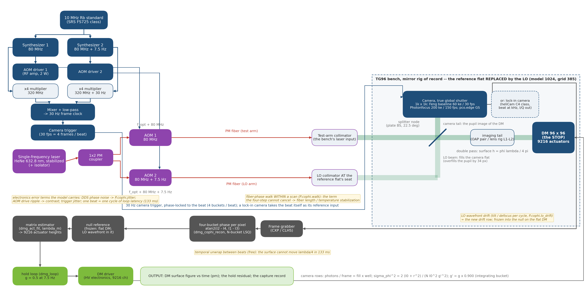
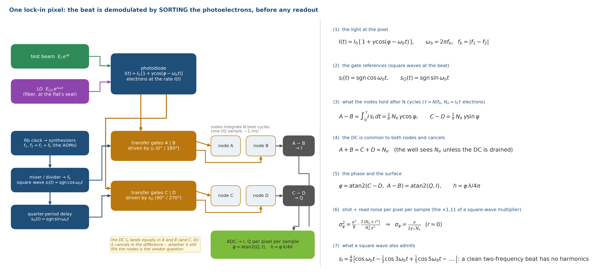
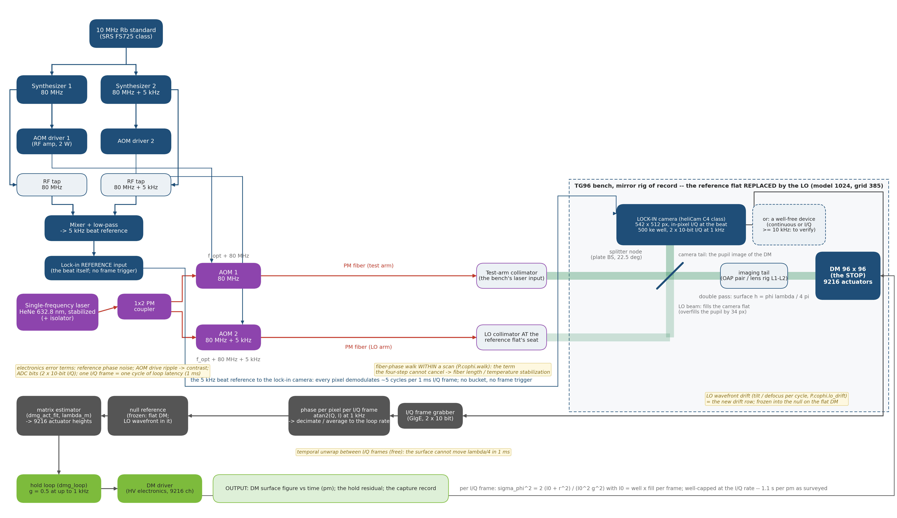
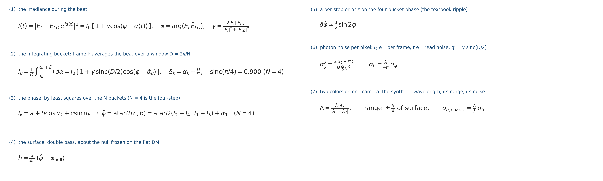
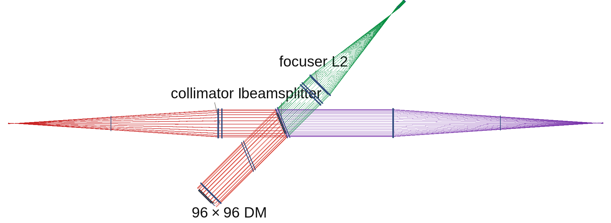
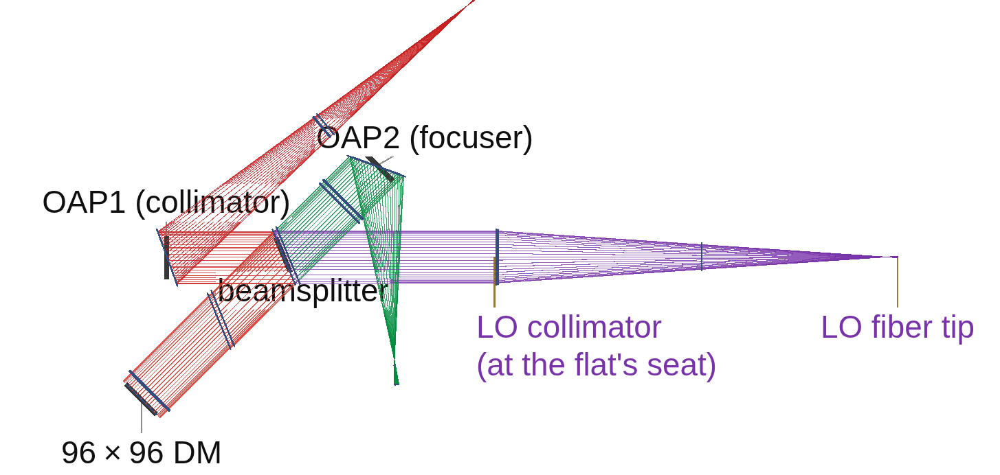
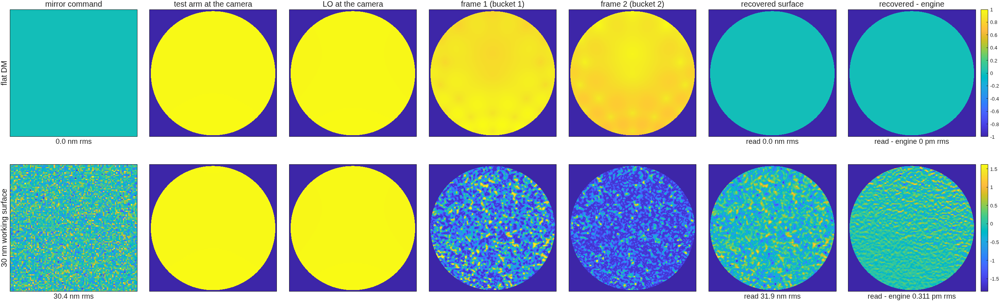
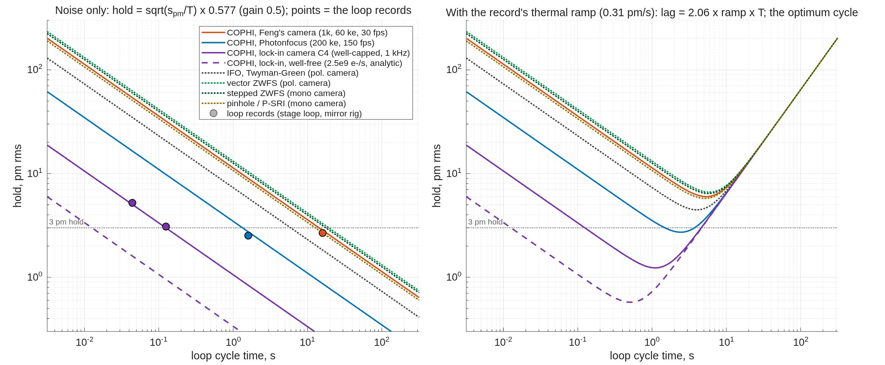
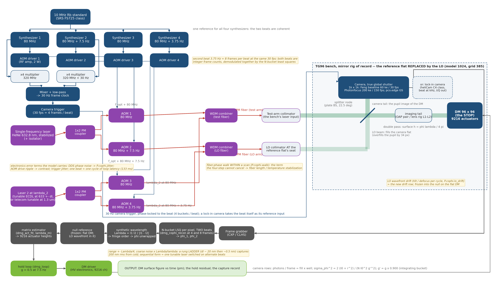

<!--
deck_cophi.md -- COPHI (Feng Zhao's heterodyne camera interferometer) as the fifth DM gauge,
scored on the same bench as the four others.  DRAFT -- pending Dave's sign-off.
Build: python3 make_brief_slides.py deck_cophi.md
Sources: macos/BRIEF_cophi_campaign.md (plan, rulings, sec. 8 stage records); the template
MACOS_resources/mmacos/templates/40_benches/cophi_dm96/ (cophi_params, README, runs/<tag>/);
dm_gauge_lib/dmg_cophi_*.m + dmg_converge.m; gates tCophi 8/8, tCophiBench 9/9, tConvergedEst 4/4;
surveys macos/NOTE_detectors_survey.md, NOTE_lockin_arrays_survey.md (web, unverified).
Every number is a record's (run tags in the footnotes).  Figures are the tools' own PNGs
(figs/cophi_stations_oap.png = runs/figs_oap_plain/figs_oap_plain_stations.png; the block
diagrams from make_cophi_block_fig.py).  American English.  Structure = the gauge deck's
(reads / frames / reconstruction / gets right / gets wrong / scored) so it drops into the
composite deck unchanged.
-->

# COPHI as the Fifth DM Gauge Bench Sensor
Feng Zhao's heterodyne camera interferometer, scored on the same bench, the same 30 nm surface and the same rows as the interferometer, the Zernike sensors and the pinhole — and a faster alternative using lock-in detectors
D. C. Redding, with Claude Code (TO: the bench stages).
October 2026.  Working record.
DRAFT — pending review.
~ Feng's proposal (COPHI_for_DM_gauge.pptx, 2026-05-19): a single-frequency laser split to two AOMs at 80 MHz and 80 MHz + 7.5 Hz on a Rb standard, a fiber LO combined before a 30 fps camera imaging the DM, four frames per beat, the four-frame phase.  Purpose: to hold each DM in a local loop against drift, to << 10 pm.  What does that read on our bench, and what does it cost?

## Feng's proposal, in one slide | A heterodyne interferometer whose phase steps are set by frequency, not by a piezo, with a fiber-fed local oscillator at the camera, and an array detector providing many parallel channels to resolve 96 × 96 actuators
::: left
- **Layout:** laser → 1×2 coupler → AOM-1 (80 MHz) and AOM-2 (80 MHz + 7.5 Hz), both synthesizers on a 10 MHz Rb standard; the measurement beam to the DM, the LO fiber to a splitter before the camera; the ×4 multipliers mixed to a 30 Hz camera trigger: four frames per 7.5 Hz fringe cycle – see next slide.
- **Algorithm:** I = I₀ (1 + γ cos(φ + 2π f t)); frames at α = 0, π/2, π, 3π/2; φ = atan2(I₄ − I₂, I₁ − I₃); surface = ½ (φ/2π) λ (double pass).  Backup: the N-frame least-squares solution (Zygo's four-step is N = 4).
- **Main purpose: stabilize the DM!**  Run each DM in a local loop to hold it — our job 3.  For us to figure out: the camera, the photon budget, the error terms, estimated performance.
::: right
- **Built on our DM Gauge bench:** the bench with mirror and lens layouts, the 96 × 96 DM, swappable sensors: the core Twyman-Green interferometer (IFO), scalar and vector Zernike wavefront sensors (ZWFS), point-diffraction interferometers.
- **The same scoring:** on a 30 nm working surface, the response matrix measured through the reading, the hold loop, the capture ladder, the photon rows.
- **What is new:** the Local Oscillator (LO) arm (a fiber tip and collimator where the reference flat sat); frequency-set steps; each frame integrating a quarter of the beat; the LO's wavefront drift; the differential fiber phase within a scan; trigger jitter; a camera chosen for the job.
- **What is absent:** the polarizing train — no analyzer, no quarter-wave plates, the same polarization in both arms — so the polarization gain the IFO carries (0.983–1.004) does not exist here.
~ Feng's slide 8 is the implementation example this deck's block diagrams follow; TOM3 (SPIE 6268) is the photodiode heritage.

## COPHI on the DM Gauge bench: the four-step run continuously | The record interferometer's piezo four-step with the steps set by a Rb-clocked beat, a quarter-cycle integrating bucket per frame, and a fiber LO; the reconstruction is the same
::: full
{h=5.05}
::: left
- **Feng's four-frame method, one-color version, for the hold job.**  Every box is a component of the TG96 DM Gauge bench.
::: right
- Blue = RF / timing · Red = PM fiber · Green = free-space beam · Gray = data
~ `make_cophi_block_fig.py`; the camera rows name the surveyed parts; the lock-in alternative has its own diagram (slide 7).

## Our implementation of Feng's approach: the choices, in one table | Feng's layout kept where he specified it, each unspecified part fixed by a bench number; the lock-in camera (next slide) changes the camera, the beat and the trigger chain only
| part | Feng's proposal | our implementation (what the model runs) | why |
|---|---|---|---|
| laser | single-frequency, λ unstated | 632.8 nm, the record bench's; a 1.3 µm row for InGaAs | the other four gauges' surface, matrix and photon rows |
| RF and timing | AOMs 80 MHz / 80 MHz + 7.5 Hz, 10 MHz Rb | as proposed; camera trigger on the same reference, 30 fps = 4 × 7.5 Hz; jitter a knob, nominal 0 | frequency-set steps on one clock |
| buckets | four frames per beat | each frame integrates a quarter cycle: contrast × 0.900; N > 4 = the least-squares backup | the four-step, with the bucket priced |
| local oscillator | a fiber LO before the camera | PM fiber tip + collimator at the reference flat's seat (slide 9); LO/test ~1, contrast 0.98 | the seat registers on both rigs |
| beam train | one polarization, plain splitter | the plain splitter scored; the polarizing train priced beside it (same pm, ×1.5 laser) | no analyzer: no polarization gain |
| camera | a 30 fps array, part unstated | four surveyed rows, read noise in each: baseline 1k² 60 ke⁻ 30 fps; Photonfocus 200 ke⁻ 150 fps (the "Feng's camera" row); pco.edge GS; C-RED 2 | well × frame rate decides (slide 13) |
| exposure, resolution | 96 × 96 resolved | frame mean at half the well; model 3.3 px per actuator, real cameras 5–21 | oversampling costs no photons (slide 11) |
| reconstruction | atan2 four-step; surface = φλ/4π | the same about the bucket centers; LO-only annulus median-filled; unknowns = control set | the record's estimator |
| errors, hold, capture | "stabilize the DM" | fiber walk, jitter, LO drift, shot + read noise, the record's drifts (slide 14); the record's loop at the camera's cadence; two colors from cold (slides 16–17) | the other gauges' loop and ladder |
~ Sheet `cophi_params.m` (every row is a field there); records in the footnotes of the slides cited; detector rows from NOTE_detectors_survey.md (web, unverified).

## The lock-in camera: COPHI's algorithm built into the sensor | Feng's camera takes four frames per beat and the computer demodulates; a lock-in camera demodulates in every pixel at a kHz beat and reads the whole lattice in a second — same optics, same RF chain; its rows run through every table that follows
::: left
- **Ruling:** every mode we care about (EFC probes included) runs at full actuator resolution — so the second implementation is a per-pixel demodulating reading at ≥ 1 element per actuator, assumed to exist.
- **Lock-in** = synchronous detection inside each pixel:
-- the photocurrent is multiplied by the beat reference and by its 90°-shifted copy, and integrated
-- the stores are I = I₀γ cos φ (in-phase) and Q = I₀γ sin φ (quadrature) — not intensities; φ = atan2(Q, I)
-- the DC term never reaches the well; I and Q leave at the frame rate
- **Surveyed (unverified):** Heliotis heliCam C4 / C4M — 542 × 512 (1024 × 1102), lock-in 1–250 kHz, 500 ke⁻ well, 2 × 10-bit I/Q, external reference; one vendor, four generations.
-- also ranked: 128² CMOS at 20–40 kfps, time-of-flight demodulators, digital-pixel ROICs, coherent photonic arrays; not fit: SPAD / Geiger arrays (count-rate ceilings)
::: right
| the two implementations, same optics and RF | Feng's camera (Photonfocus row) | lock-in camera (heliCam C4, as surveyed) |
|---|---|---|
| beat | 7.5 Hz | 5 kHz (1–250 kHz) |
| what leaves the sensor | 4 frames per beat | I/Q (in-phase / quadrature) per pixel at 1 kHz |
| pixels per actuator | 9.4 | 5.3 (C4M 10.6) |
| per-reading noise | 39.5 pm | 57.9 / 61.1 pm per 1 ms sample, mirror / lens (63 / 66 at 100 e⁻ read) |
| **seconds per pm** | **42** | **3.35 / 3.73** (mirror / lens; 4.0 / 4.4 at 100 e⁻ read); ×1.23 in time for the two-tap square wave; well-capped at the I/Q rate |
| if well-free: 10⁹ / 10¹⁰ e⁻/s per element | — | 0.84 / 0.084 s (0.34 at 2.5 × 10⁹); analytic |
| loop latency | one beat, 133 ms | one I/Q sample, 1 ms (one 0.125 s cycle as the loop's upper bound) |
- **The lock-in is ~12× the Photonfocus and ~110× Feng's baseline.**
-- a well-free device (continuous, or I/Q ≥ 10 kHz) at 2.5 × 10⁹ e⁻/s per element: ~18 pm per sample, ~0.34 s per pm — 10× better again; that is what the vendor question decides
- **The vendor question:** phase noise per pixel vs flux at t_c = 100 ms, and whether the full well bounds each internal 1 MSa/s sample or the 5.6 kSa/s output — for Heliotis, through Dave.
~ Stage format (`runs/format_lens_plain`); NOTE_lockin_arrays_survey.md (web survey, every number sourced, none verified by us).

## How the lock-in detector works | One pixel sorts its photoelectrons into two storage nodes by a square-wave reference at the beat frequency; the node difference IS the lock-in product, formed before any readout — Feng's four-step inside the pixel, integrated over thousands of cycles
::: full
{h=5.0}
::: left
- **The reference:** a square wave at the beat f_b = |f₁ − f₂| (5 kHz), locked to the AOMs through the Rb clock, fed to the camera's reference input — one clock; software does only atan2(Q, I).
::: right
- **Against a frame camera:** N cycles per sample, not a quarter cycle; the DC cancels in the difference (does it fill the nodes? vendor question 2); the square wave costs ×1.11 in σ (eq. 6).
~ `make_cophi_lid_fig.py`; the pixel is CSEM's demodulation pixel (Lange & Seitz 2001), the heliCam's "dual-phase lock-in".

## COPHI with a lock-in camera: the block diagram | Same laser, fibers, LO and bench; the beat moves to 5 kHz and goes to the camera's reference input; no frame trigger, no bucket; I/Q frames at 1 kHz go straight to the phase
::: full
{h=5.0}
::: left
- **What changes from slide 3:** synthesizer 2 at 80 MHz + 5 kHz; the ×4 / 30 Hz trigger chain becomes the 5 kHz reference, fed to the pixels' transfer gates; the camera is drawn as the chain inside one pixel (slide 6: photodiode → gates → nodes → A − B, C − D) in series with the frame grabber; the processing is atan2(Q, I) per sample, decimated to the loop rate.  Fiber, LO and hold loop are unchanged.
::: right
- Blue = RF / timing · Red = PM fiber · Green = free-space beam · Gray = data
~ `make_cophi_block_fig.py` (lock-in variant); the pixel chain's inputs and outputs are slide 6's.

## The reading's algebra, pinned before the bench | What the camera records, how the phase and the surface come out, and what the gate measured: the quarter-cycle integration costs 10 % of contrast, a step error is not cured by more frames, read noise is in the photon law
::: full
{h=3.5}
::: left
- **Integrating bucket (1)–(2):** a frame cannot sample the beat at an instant; it integrates while the LO phase advances a quarter cycle.
-- the phase is kept (referred to the bucket center ᾱ_k); the amplitude shrinks by sinc(π/4) = **0.900**; nothing else changes
- **Phase (3):** a least-squares fit of the N frames to a + b cos ᾱ_k + c sin ᾱ_k.
-- for N = 4 it is Feng's atan2 exactly (his sign is for cos(φ + 2πft))
::: right
- **Step error (5):** steps of D(1 + ε) instead of D give a phase error (ε/2) sin 2φ — a ripple at twice the fringe frequency (Schwider 1983, Creath 1988).
-- more buckets do not cure it: an 8-bucket fit with the same step error is 1.43× worse
-- knowing the steps does: the fit at the true ᾱ_k is exact, and a Rb-clocked scan knows them
- **Photons (6):** shot noise ∝ 1/√I₀ (measured slope −0.500 ± 0.02 over two decades); read noise adds in quadrature.
-- a fiber walk or trigger jitter within a scan passes through at 0.13 of its size, with 4 or 8 buckets alike — no algorithmic cure
~ Gate `tCophi` (8 tests) pins each line; `dm_gauge_lib/dmg_cophi_*`; TeX source `deck_cophi_equations.tex`.

## The LO on the DM Gauge bench replaces the IFO's reference flat | A fiber tip and collimator, its powered face at the reference flat's seat, on both rigs; it registers to a pixel and the flat-DM null is sub-nanometer
::: left
{h=3.0}
- **Registration:** chief ray 0.000 px on both rigs; the LO overfills the test pupil by 34 px (radius ratio 1.215).
- **Null on the flat DM:** lens rig 0.000 nm; mirror rig 0.746 nm rms, mostly tilt.
-- the LO collimator's own wavefront, frozen into the null as the IFO freezes its reference; its motion is the LO-drift row (slide 14)
- **Contrast:** 0.982 at LO/test power 1.47, as 2√r/(1 + r) says.
::: right
{h=3.0}
- **Two findings for any traced LO:**
-- the tail places the detector field by ray index, not camera position (null 681 nm by index, 0.45 nm by position) — the LO is placed by position
-- the plain mirror train had kept a source trim solved with the polarizer plate: OAP1 fed off focus (84 nm defocus) — now trimmed to zero
- **Two trains priced:** the polarizing train and Feng's plain splitter read the same picometers (the camera is well-bound); the polarizing train costs light only (throughput 0.271 vs 0.408, ×1.5 laser).  The plain splitter is scored.
~ Stage bench (`runs/bench_{lens,oap}`; the layouts = `bench_{lens,oap}_vlayout.png`, the engine's own renders), gate `tCophiBench` 9/9 (registration, poke 1.001 converged, LO tilt, no-fringe refused by name, dark camera refused).

## Reading the 30 nm working surface, station by station | The same mirror command through the heterodyne train on the mirror rig, plain splitter; the last column is the raw map against the engine's own field
::: full
{h=3.6}
- **Resolution shown:** camera grid 1024 × 1024, pupil 315 px across — **3.3 pixels per actuator across, ~11 per actuator in area** (6948 lit actuators on ~77,900 pupil pixels).
-- every real camera on the table samples finer (5–21 px per actuator, slide 11); what resolution buys and costs is slide 19
~ Stage figs (`runs/figs_oap_plain`), noise-free; the deck's station-figure format (row 1 flat DM, row 2 the working surface).

## Resolution and timing, camera by camera | The model samples the pupil at 3.3 pixels per actuator; every camera on the table oversamples the 96 × 96 lattice, so resolution costs no photons — the time to a picometer is well depth × frame rate, not pixel count
::: full
| sensor / camera | pixels across the pupil | pixels per actuator (96 across) | pm per reading | seconds per pm (SNR 1 at 1 pm) |
|---|---|---|---|---|
| the model's grid (both rigs, 1024 grid; the station figure) | 315 | 3.3 | — | — |
| **COPHI, Feng's camera, 1k², 60 ke, 30 fps** | ~900 | 9.4 | 57.7 / 53.7 | **443 / 385 (≈ 7 min)** |
| **COPHI, Photonfocus 1024², 200 ke, 150 fps** | ~900 | 9.4 | 39.5 / 36.5 | **42 / 36** |
| COPHI, pco.edge 5.5 in GS mode, 2560 × 2160, 30 ke, 50 fps | ~2000 | 21 | 40.2 / 38.3 | 129 / 117 |
| COPHI at 1.3 µm, C-RED 2, 640 × 512 (placeholder at 632.8 nm) | ~480 | 5.0 | 19.6 / 18.7 | — (the 1.3 µm stage) |
| **COPHI, lock-in camera, heliCam C4, 542 × 512** | 512 | 5.3 | 61.1 / 57.9 per 1 ms I/Q sample | **3.73 / 3.35** (well-capped at 1 kHz; ×1.11 square-wave) |
| COPHI, lock-in camera, heliCam C4M, 1024 × 1102 | ~1000 | 10.6 | (C4 pixel assumed) | same (well × rate per element) |
- **Resolution is free down to ~1.5 pixels per actuator:** a camera's photons per second are pixels × well × rate over the pupil; binning finer pixels onto the lattice changes only the read noise per sample.
-- measured (slide 19): 1 px per actuator fails the single-actuator row, 1.5–2 px holds at 1.6–2× the time, 3.3 and 4 are the same — 5 px per actuator is the floor on this table
-- nothing coarser is modeled (ruling: every mode of interest is commanded at full actuator resolution)
- **Cameras were put on the model grid by binning** (well × k², read × k): the pm-per-reading rows are the full camera's photons at the model's sampling.
~ Stage noise and format; the pupil in pixels is the camera's short side filled by the pupil image (the tail's magnification is set for it); the model's 315 px = 157.45 px radius (stage bench).

## Performance side by side: HET against the IFO on the same surface | HET = the heterodyne (COPHI) reading; IFO = the record's Twyman-Green polarization interferometer.  Same seed, surface and matrix: HET matches the IFO's floor, halves its mirror-rig random-surface error, and is exact where the IFO is not
::: full
| reading, rig (estimator) | 10 nm on one actuator: gain / floor | 1 nm on the grid: gain / floor | dense random 10 nm: gain / error |
|---|---|---|---|
| **HET (COPHI), lens (one-step)** | 0.9947 / 2 pm | 0.9964 / 2 pm | 0.9967 / 180 pm |
| IFO (Twyman-Green), lens (one-step) | 1.0001 / 1 pm | 1.0046 / 2 pm | 1.0053 / 179 pm |
| **HET, mirror (one-step)** | 0.9941 / 1 pm | 0.9949 / 1 pm | 0.9950 / 118 pm |
| IFO, mirror (one-step) | 0.9832 / 2 pm | 0.9838 / 2 pm | 0.9844 / 223 pm |
| **HET, lens (converged)** | 1.0008 | 1.0022 | 1.0024 |
| **HET, mirror (converged)** | **1.0000** | 1.0005 | 1.0005 |
| IFO, lens (converged) | 1.0064 | 1.0106 | 1.0112 |
| IFO, mirror (converged) | 0.9887 | 0.9892 | 0.9896 |
| **HET, lock-in camera** (record, noise-free) | converged 1.0000 | 1.0006 | 1.0005 — the same reading, the same algebra |
- **The one-step rows sit 0.5 % low for HET on both rigs — the estimator, not the reading:** the reading is exact (a 1.000 nm poke reads at slope 1.000000); the 0.5 % is the one-step Tikhonov shrinkage at the record's λ_m = 10⁻³ (1.0007 at 10⁻⁵) — the "matrix bias" every gauge carries, now a number.
- **Driven to convergence (the servo use), HET reads exactly on the mirror rig, and the IFO shows its polarization gain in the open:** IFO/HET = 1.006–1.009 (lens rig), 0.989 (mirror rig); the IFO's lens-rig "1.000" was polarization gain cancelling the shrinkage.
~ Stage battery (`runs/battery_{lens,oap}`, the IFO column = `redo96_<optics>ph`: tail md5, lit 6948, seed 7, the 64-state matrix on the surface); the gain probe (`runs/gainprobe_lens`); the converged estimator (`dm_gauge_lib/dmg_converge`, gate `tConvergedEst` 4/4; `runs/conv_H_*`, `tg_psi_dm96_oap/runs/conv_I_*`; H and I are the reading-class letters in the records); the one-step rows reproduce the record to the digit.

## Photons for 1 pm, camera by camera | A heterodyne read is photon-limited at full well: pixels × well × frame rate decides; Feng's baseline camera is seven minutes per picometer, the deepest-well 1k global-shutter part is 40 seconds, the lock-in 3.4 s
::: left
| camera (survey, to verify) | read noise r, e⁻ (σ penalty √((I₀ + r²)/I₀) at half well) | pm per reading, lens / mirror | SNR at 1 pm per reading | seconds to SNR 1 at 1 pm, lens / mirror | to SNR 10 |
|---|---|---|---|---|---|
| **as proposed: 1k², 60 ke, 30 fps** | 5 assumed (1.000) | 57.7 / 53.7 | 0.017 | **443 / 385 (≈ 7 min)** | 12 / 11 h |
| **Photonfocus MV1-D1024E, 200 ke, 150 fps** | 220 (1.22) | 39.5 / 36.5 | 0.025 | **42 / 36** | 70 / 60 min |
| pco.edge 5.5, true global-shutter mode, 30 ke, 50 fps | 2.2 (1.000) | 40.2 / 38.3 | 0.025 | 129 / 117 | 3.6 / 3.3 h |
| C-RED 2 (InGaAs), at 632.8 nm as a placeholder | 30 assumed (1.001) | 19.6 / 18.7 | 0.051 | — (the 1.3 µm stage) | — |
| **lock-in camera, heliCam C4, 500 ke, I/Q at 1 kHz** (the lock-in reading; well-capped) | n/s: run at 0 and at 100 assumed (1.09) | 61.1 / 57.9 per 1 ms sample (66 / 63 at read 100) | 0.017 per sample | **3.73 / 3.35** (4.4 / 4.0 at read 100; ×1.23 in time for two-tap demodulation) | 6.2 / 5.6 min |
- **The metric:** the piston-free robust floor over the unpoked actuators (1.48 MAD, median of 12 draws).
-- the raw single-actuator noise is mostly a common piston (165 vs 76 pm) — unobservable and inert on a DM; the composite deck puts every gauge on this metric
::: right
- **Read noise is in every row** (σ_φ² ∝ I₀ + r²): the Photonfocus's 220 e⁻ costs 22 % in σ at half well and it still wins on well × rate.
-- the baseline's and the C-RED's read noise are assumed (not in Feng's deck; the survey's value unconfirmed)
- **SNR at the 1 pm target:** one reading gives SNR 0.02–0.05; SNR 1 takes (pm per reading)² readings — the seconds-per-pm column; SNR 10 takes 100× that.
-- a hold loop never needs SNR 10 in one measurement: it integrates readings (next slide)
- **Model and bench agree:** the per-pixel noise on the bench equals the `tCophi` formula to 1.000 ± 0.002 on every camera, rig and train.
- **Rolling-shutter cameras are out:** rows exposed in sequence see different beat phases — a phase ramp across the image.  Needed: true global shutter, hardware trigger from the Rb clock, full-frame streaming.
- **Why the camera, not the pixel count:** a 1k camera oversamples the lattice ten to one; well depth × frame rate is the budget.
~ Stage noise (`runs/noise_{lens,oap}[_plain]`), 12 draws, cameras binned onto the model grid (well × k², read × k, frame mean at half well).  Mask convention from the lock-in runs on: the LO-only annulus (no test light) is filled with the fringe pixels' median, not zero — a zero there made any common phase a pupil-edge step the edge actuators fit; the bucket camera's electronics rows move ≤ 9 % under it.

## Holding 3 pm: the servo at the camera's cadence | COPHI holds 3 pm against the record's drifts: Feng's baseline camera needs a 16 s cycle, the Photonfocus 1.6 s, the lock-in camera 0.125 s (3.09 pm, fiber term inert); the LO's pointing is the term the loop cannot see past
::: left
| drift (gain 0.5, 60 cycles, seed 77) | hold, pm rms, lens / mirror |
|---|---|
| noise only, baseline camera (120 readings per cycle, 16 s) | 2.75 / 2.67 |
| **noise only, Photonfocus (60 readings, 1.6 s)** | **2.60 / 2.52** |
| **noise only, lock-in camera** (125 I/Q samples per cycle, a cycle every 0.125 s) | **3.09 (converged 3.14)**; at 44 samples (44 ms cycles) 5.22 |
| random walk 2 pm per cycle | 3.60 / 3.53 |
| thermal ramp 5 pm per cycle | 10.3 / 10.3 (the lag rate/gG — every gauge) |
| camera offset walk | 2.85 / 2.77 (immune: zero-sum frames) |
| one cycle of sensor latency (one beat; for the lock-in one whole 0.125 s cycle as the upper bound) | 3.65 / 3.54 (+0.9 pm); lock-in 4.12 |
| differential fiber walk at the budget / at 3× (baseline camera) | 3.95 / 9.2 (mirror); Photonfocus 4.8 / 12.7; **lock-in 5.22 / 5.22 = its noise-only hold to the digit: a per-sample piston, inert** |
| **LO drift, 0.1 nrad tilt + 1 pm defocus per cycle** | **29.6 / 29.4** (lock-in 29.4: the LO is the same term in every form) |
::: right
- **LO drift is not separable from DM drift:** the matrix takes an LO tilt as a DM tilt one-for-one (1 nrad reads as a surface tilt of 1.008 × θ/2), and the loop drives the DM to follow it.
-- **the LO pointing must hold ~10 prad per cycle (~10 pm of fiber-tip motion at the collimator's focal length), or be referenced** — the requirement the plain-splitter layout adds, beside the fiber's
- **Fiber phase errors are not observable:** the four-step cannot cancel a differential fiber-phase walk within its own four frames.
-- budget at the photon floor (mirror rig): **3.9 × 10⁻³ rad per frame = 0.39 nm of differential OPD per 33 ms, ~12 nm/s, ~1.2 mK/s per meter of uncommon fiber** — co-routed, thermally tied, or servoed
-- with the lock-in camera the walk is a per-sample piston: inert (record)
- **How the loop reaches 3 pm from 55 pm readings — two integrators:**
-- the estimator's regularization (λ_m) is a spatial low-pass over the matrix's small-singular-value directions, where photon and read noise live; it trades a 0.5 % gain for a lower floor (the converged estimator removes the bias but admits ×2.1 the white noise)
-- the loop averages across cycles at gain g (steady state σ_n √(g/(2 − g)), plus M readings per cycle); in the loop the one-step and converged estimators agree to 0.1 pm on every row
- **Electronics, the rest:** trigger jitter < 2.8 × 10⁻³ rad, AOM drive ripple < 1.8 × 10⁻³ — both easy with a Rb-locked DDS; latency one beat (133 ms at 7.5 Hz).
~ Stage loop (`runs/loop_{lens,oap}_plain`, `runs/loopfib_*`), plain splitter, `dmg_loop` with the delay row; the mirror rig on the fixed feed (SRC_TRIM 0; every row within 0.02 pm of the mis-fed run, kept in `runs/oap_plain_misfed`); the fiber rows at the corrected budget (3.5 × 10⁻³ rad/frame as run; 3.9 × 10⁻³ under the median-fill convention); the noise stage's first fiber number was 2.3× low (a 12-draw Monte Carlo of three random numbers) and is replaced by the exact expectation.

## Hold vs cycle time: what the fast cycle buys | At a fixed cycle time a sensor averages (cycle time ÷ seconds per pm) readings, so the hold floor is √(s_pm / T) × 0.577: the lock-in's 3.4 s per pm is 115× fewer than Feng's camera — 10.7× less noise at any cycle time; the loop records sit on the budget curves
::: full
{h=4.3}
::: left
- **At 1.6 s cycles:** Feng's camera 9.0 pm, Photonfocus 2.7, lock-in 0.84 (well-free 0.27); IFO 5.8, vector ZWFS 10.4 (on their polarization cameras).  Records match the law to 8 %.
::: right
- **Against a drift rate the cycle has an optimum** (right): Feng's camera 6.0 pm at 5.5 s, Photonfocus 2.7 at 2.5 s, lock-in 1.2 at 1.1 s, well-free 0.57 at 0.5 s — the fast reading holds a drift at the picometer where the slow cameras cannot.
~ `cophi_hold_vs_cycle` (`runs/figs_hold_vs_cycle/`); seconds per pm from the records (stages noise / format / lockin; `camI_oap`, `camS_oap`); the lag from stage loop's thermal row.  A budget, no new runs.

## Capture from a cold start: two colors frequency-multiplexed on one camera | A second laser at λ₂, its own AOM pair at a second beat, WDM combiners into the same two fibers; all four synthesizers on one reference; the processing adds the synthetic-wavelength block
::: full
{h=5.0}
::: left
- **Two colors, one camera, one 8-frame set:** beats of 7.5 Hz and 3.75 Hz are 4 and 8 frames at the same 30 fps, so each color is demodulated at its own bucket centers from the same frames; the colors do not interfere (THz apart).
::: right
- Blue = RF / timing · Red = PM fiber · Green = free-space beam · Gray = data
~ `make_cophi_block_fig.py`; the sequential form — one tunable laser switched on alternate beats — uses the one-color hardware and half the cadence.

## Capture from a cold start: the numbers, and the parts it adds | Zero wrong fringe orders on the whole capture ladder to 480 nm rms; a single color wraps from 40 nm; temporal unwrapping holds a running loop, not a cold start
::: left
- **Two colors, one reading:** 632.8 + 652.8 nm (synthetic Λ = 20.65 µm, range ±5.2 µm), each color read by its own buckets (crosstalk 4 × 10⁻¹⁶ rad).
-- **zero wrong orders to 480 nm rms, both cameras** (0.15 / 0.10 nm per pixel); one color is 74 % wrong at 480
-- **a 200 nm rms figure is captured from cold in one 0.27 s reading**
-- any Δλ from 1 to ~100 nm works (the fine requirement at Δλ = 20 nm is 1.7 nm against ~0.1 nm per pixel): one rung of the synthetic-wavelength ladder is enough here
- **Temporal unwrapping:** holds at 0.9 × λ/4 per reading, fails at 1.1 ×: 1.19 µm/s at the peak pixel (baseline camera), 5.9 µm/s (Photonfocus) — ~0.24 / 1.2 µm/s rms for a 30 nm-class shape.
- **With the lock-in camera (record):** one reference at a time, so the two colors alternate on I/Q samples (2 ms per pair) — zero wrong orders to 480 nm rms, 0.12 nm per pixel; temporal unwrapping at 1 kHz tolerates 158 µm/s.
::: right
| part added for the second color | count | note |
|---|---|---|
| laser 2 at λ₂ (tunable ECDL at 633 ± Δλ, or a telecom tunable at 1.3 µm) | 1 | the only costly part at 633; cheap at 1.3 µm |
| 1×2 PM coupler | 1 | |
| AOMs 3 and 4 + drivers | 2 + 2 | the second beat 3.75 Hz |
| synthesizers 3 and 4 on the same Rb reference | 2 | the beats coherent |
| WDM combiners (test fiber, LO fiber) | 2 | both colors in the same two fibers |
| processing: the second demodulation + the synthetic-wavelength unwrap | software | `dmg_cophi_recon` twice |
~ Stage capture (`runs/capture_{lens,oap}_plain`); truth = the engine's per-pixel OPD unwrapped; λ₂ is a re-trace of both decks.  Caveat: the model's lenses are dispersion-free, so the tail's chromatic refocus (~0.5 mm of focuser travel for silica at Δλ = 20 nm, to verify) is not shown; its static part freezes into each color's null.  At 1.3 µm the base range doubles and telecom tunables are cheap (ruling 2).

## Electronics: what each gauge needs behind the optics | The IFO and the vector Zernike sensor read with a polarization camera in one frame; COPHI adds an RF chain, a fiber LO and three control loops of its own; the lock-in camera moves the demodulation on-chip
::: full
| | TG96 IFO (polarization camera, one frame) | stepped / vector Zernike (vector: polarization camera, one frame) | pinhole / P-SRI | **COPHI, Feng's camera** | **COPHI, lock-in camera** |
|---|---|---|---|---|---|
| source | HeNe, isolator | dedicated laser | laser | single-frequency laser, 1×2 coupler, PM fibers | same |
| modulation | none for the snapshot (piezo + HV driver for the four-step calibration only) | none (vector); mask stepper (stepped) | pinhole stepper / shutter; phase shifter (P-SRI) | **2 AOMs, 2 synthesizers, Rb standard, ×4 + mixer → trigger** | same, beat at kHz |
| detector | polarization sCMOS (micro-polarizer array 0/45/90/135) | camera / polarization sCMOS | camera | 1k² global-shutter camera, grabber | lock-in camera, I/Q out |
| latency per reading | 1 frame | 1 frame (vector) / 4 (stepped) | 1–5 frames | 4 frames = one beat (133 ms) | one I/Q frame (ms) |
| sensor's own loops | — | — | — | laser frequency; two RF chains; **fiber phase; LO pointing (10 prad)** | same |
| error terms carried | polarization gain (0.98–1.01, calibrated by the four-step) | — | stepper repeatability | DDS phase noise → jitter; drive ripple → contrast; **fiber walk**; **LO drift** | reference phase noise; ADC bits |
| photons per measurement for 1 pm (gauge deck, 30 nm surface) | 7 × 10¹⁴ (mirror) – 1 × 10¹⁵ (lens) | 1.2 × 10¹⁴ stepped / 4.6 × 10¹³ vector | 1.5 × 10¹⁴ | (this deck: 57.7 pm per reading at 1.9 × 10¹² ph/s) | (34 pm per 1 ms frame) |
| **seconds to SNR 1 at 1 pm** (SNR 10 = 100×) | **189 / 160 s** (lens / mirror; IMX250MZR-class polarization camera, record `camI_*`) | **475 s stepped (mono camera, 4 frames) / 519 s vector** (polarization camera, mirror rig, `camS_oap`) | **342 s** (mono, K frames) | **443 (Feng's camera) / 42 (Photonfocus)** | **3.35 / 3.73** (mirror / lens) |
~ Camera timings on an IMX250MZR-class polarization camera (2448 × 2048, 75 fps; well ~10 ke⁻, read 2.4 e⁻, unconfirmed).  The sensors run 10–40× slower than photons ÷ sensor rate would say: the ZWFS core sets the exposure, the frame mean sits at half well, two orientations go unused.  Parts counts and TRL to follow (campaign brief sec. 9.1).

## How much resolution? IFO, vector ZWFS, HET — the sweep's records | Camera pixels per actuator swept at 1 / 1.5 / 2 / 3.3 / 4 for all six readings, the matrix measured through the resampled reading: 1 px fails the single-actuator row, 1.5–2 px cost 1.6–2× the time, above 3.3 nothing changes
::: full
{h=3.6}
::: left
- **1 px per actuator fails every reading the same way:** single-actuator floor 13–32 pm (from 1.2–2.6), converged gain off 0.4–0.5 %; the "wrong actuator" never happens — the fit degrades, it does not swap.
- **1.5–2 px holds but pays in time:** HET 69–74 s per pm against 36 at 3.3 (Photonfocus); IFO 266–302 against 161; vector ZWFS 1040–1150 against 639 — 1.6–2×, because a coarser pixel INTEGRATES the fringe (the point-sampled ZWFS at 1.65, hollow, costs nothing).
::: right
- **Above 3.3 px nothing changes** (4 = 3.3 to the digit); the records at 3.3 stand.
-- registration: a ±0.1-pitch shift after calibration costs gain 0.95 and a 16–18 pm floor at EVERY sampling ≥ 1.5 — the camera must stay registered to ~0.03 pitch, whatever the pixel count
- **The lock-in's advantage survives the sweep:** 3.4 / 5.4 / 6.3 s per pm at 3.3 / 2 / 1.5 px, holding 3.1 / 4.0 / 4.3 pm at 0.125 s cycles — 10× the Photonfocus at every sampling.
~ `ressweep_run` / `ressweep_zrun` / `ressweep_figs` (`cophi_dm96/runs/ressweep_*`, TO 2026-10-13); mechanism `dmg_camres` (frames box-integrated onto camera pixels, the matrix measured through them); gate `tResolutionSweep` 7/7.

## COPHI against the Zernike sensor with a dedicated laser, for the hold job | Feng's deck poses this comparison; on our bench the answer is photons and time: the vector Zernike holds 3 pm from 2 × 10¹² photons per cycle, COPHI with Feng's camera from ~1 × 10¹⁴ — and COPHI with a lock-in camera reaches a picometer faster than any of them, captures from cold, and reads absolutely
::: full
| | vector Zernike (dedicated laser, pol. camera) | COPHI, Feng's camera | COPHI, Photonfocus | **COPHI, lock-in camera (C4, as surveyed)** |
|---|---|---|---|---|
| photons per 3 pm hold cycle | 2.2 × 10¹² (gauge deck) | ~1 × 10¹⁴ (120 readings) | ~1 × 10¹⁴ (60 readings) | ~9 × 10¹² (125 samples, capped well) |
| time per 3 pm hold cycle | **~60 s on the assumed pol. camera** (519 s/pm ÷ 9: its 10 ke⁻ well, the core's dynamic range, two unused orientations — the camera is the ZWFS's own question) | 16 s | 1.6 s | **0.125 s** (record: 3.09 pm) |
| seconds to SNR 1 at 1 pm | 519 (pol. camera, record) | 443 / 385 | 42 / 36 | **3.35 / 3.73** (×1.23 in time for two-tap demodulation) |
| capture from cold | no: the reference ages past 36–70 nm | two colors, one 0.27 s reading | same | two colors on alternate samples; zero wrong orders to 480 nm |
| absolute read | reference iterated or matrix re-measured | exact (slope 1.000000) against the LO | exact | exact |
| its own stabilities | none beyond the bench | fiber 0.39 nm per frame; LO 10 prad per cycle | same | LO the same (29.4 pm); **fiber a per-sample piston, inert (record)** |
- **For hold alone, the vector Zernike is cheapest in photons** (~50×) and needs no stabilities of its own — but on the assumed polarization camera it is the slowest (~60 s per cycle).  Feng's camera makes COPHI slow (16 s), the Photonfocus fast (1.6 s), **the lock-in the fastest on the table (0.125 s)** if its well is as surveyed.
- **For capture and the absolute figure:** COPHI in either form.
- **For a flight DM:** hold only and photons scarce → the Zernike sensor with a camera chosen for it; hold + capture + absolute, or speed → COPHI (the lock-in fastest by 20–500×).  **The hybrid** — Zernike for the hold, COPHI's two-color read for capture and commissioning — stays the conservative answer until the lock-in's vendor numbers are in.
~ The Zernike rows are the gauge deck's (redo96_*sens, zloop) with the polarization-camera timing from `camS_oap`; the COPHI rows this deck's; the lock-in rows are records (`runs/lockin_*`, resources 2a07af9).

## Recommendations | COPHI is a credible fifth gauge: it matches the IFO's floor, reads exactly, and captures from cold in one reading; its cost is the fiber and the LO, its speed is set by the camera's frame rate, with the lock-in detector the clear winner
::: left
- **Add COPHI to the DM Gauge plan** as the fifth column, with the converged estimator and the piston-free photon metric for every gauge (both found here, both apply to the record).
- **Consider a swappable splitter** (Feng's layout); the current polarizing train costs ×1.5 of laser and nothing else.
- **Camera:** the Photonfocus-class 1k global-shutter part (42 s per pm, 3 pm held in 1.6 s cycles) over Feng's baseline (7 min, 16 s); the lock-in camera faster yet.
-- verify the survey against the vendor sheets before a part is named
- **The lock-in camera is the fast form:** 3.4 s per pm as surveyed, 0.125 s cycles.
-- verify all performance specs with the vendor
- **Implement two colors from the start:** capture from cold in one reading; at 1.3 µm, telecom tunables and twice the base range — the InGaAs stage.
::: right
- **Open in the record:** the lens rig's +0.1–0.2 % converged gain (a matrix-model term); the polarization-camera timings through the noise hook (slide 18); the lock-in's demodulation form from the vendor (two-tap square-wave assumed).
- **Model next:** the tail's chromatic refocus at Δλ = 20 nm (dispersive glass in the model); the LO referenced against the test arm's own flat; parts counts and TRL for all five gauges; Kent's ZWFS reconstruction.
~ Everything reproduces from `templates/40_benches/cophi_dm96/` (`cophi_run`, the stage tags in each footnote); gates `tCophi`, `tCophiBench`, `tConvergedEst`, `tDmgLoop`.

## What to develop: what, why, how, how long | Five items, each a requirement this deck put a number on; durations are estimates for a bench team with the parts in hand
::: full
| item | what | why (the number) | how | how long |
|---|---|---|---|---|
| **1 Fiber phase** | the two PM fibers' differential OPD held to 0.39 nm per 33 ms frame (~12 nm/s; ~1.2 mK/s per m of uncommon fiber) | the one term the four-step cannot cancel: 66 pm per 0.01 rad/frame; 3× the budget doubles the hold floor | passive first: one coupler, co-routed in one jacket, < 1 m uncommon, one thermal mount; then a pickoff between the fiber ends and a stretcher servo (SIM-MET style); **with a lock-in camera the term is a per-sample piston, inert (record)** — the requirement belongs to the four-frame camera form | passive: weeks; servo: 2–4 months |
| **2 LO pointing** | the LO collimator's tilt held to ~10 prad per cycle (~10 pm of fiber-tip motion), or measured and removed | the loop reads LO drift as DM drift one-for-one: 0.1 nrad per cycle = 29 pm of hold | a monolithic collimator mount on the splitter block, thermally tied; or a referenced LO: a quad cell on an LO pickoff, or a flat on the DM mount read by the same frames (the next model stage) | mount: weeks; referenced LO: 1–2 months |
| **3 Lock-in camera** | a heliCam C4 at a 5 kHz beat on the record bench; per-pixel phase noise vs flux measured | ~12× the Photonfocus's speed as surveyed (3.4 s per pm); the well-free question is the next factor | the vendor question (phase noise vs flux at t_c 100 ms; what the well bounds); a loaner on the bench, reading class H unchanged; `format` re-run on measured numbers | question: days; bench: 1–3 months |
| **4 Two-color source** | laser 2 (ECDL at 633 ± 20 nm, or a 1.3 µm telecom tunable), 2 AOMs + drivers, 2 synthesizers, 2 WDM combiners | capture from cold in one 0.27 s reading, zero wrong orders to 480 nm rms; temporal unwrapping cannot start cold | 633: an ECDL (costly, a few nm); 1.3 µm: cheap PM-native tunables but an InGaAs camera and a refocused tail — model the 1.3 µm stage first, then choose the band | model: 2–3 weeks; hardware: 3–6 months |
| **5 Chromatic refocus** | dispersive glass in the model (today n = 1.5 fixed); the ~0.5 mm focuser travel at Δλ = 20 nm traced; its effect on the pupil image and the null | the one caveat on the capture result | the glass catalog is in the engine (`GlassElt=`): re-emit the lens rig with real glass, re-trace at λ₂, re-run `capture` | 1–2 weeks (model) |
~ Numbers from stages noise and loop (1–2), format and the survey (3), capture (4–5).  "How long" is an engineering estimate, not a record.

## Backup

## Feng's N-frame algebra, and ours | The same least squares; the sign convention differs by the direction of the beat
::: left
- Feng: I = I₀(1 + γ cos(φ + 2πf_h t)), α_k = 0, π/2, π, 3π/2; φ = atan2(I₄ − I₂, I₁ − I₃).  N frames: the linear least squares for (I₀, I₀γ cos φ, I₀γ sin φ).
- Ours (the record's sign): I_k = I₀[1 + γ sinc(π/N) cos(φ − α_k)], α_k the bucket *centers*; φ = atan2(I₂ − I₄, I₁ − I₃) + α₁ for N = 4; the N-bucket least squares `dmg_cophi_recon` is the same solve.  Surface h = φ λ/4π about a frozen null.
::: right
- Two colors on one camera: the beats 7.5 and 3.75 Hz are both integer frame counts at 30 fps (4 and 8), so one 8-frame set serves both colors; each color's frames are demodulated at its own bucket centers; the colors do not interfere (THz apart).
- Synthetic wavelength Λ = λ₁λ₂/|λ₁ − λ₂|; range ±Λ/4 of surface; the coarse phase's noise is amplified Λ/λ and must resolve the fine fringe — one rung suffices here (Λ = 20.65 µm); a ladder is needed only for ranges beyond ±5 µm.

## The detector survey, and its caveats | Web surveys, every number sourced, none verified by us; the rows the deck uses and the question each needs answered
::: full
| part | the number the deck uses | to verify |
|---|---|---|
| Feng's baseline camera | 1k², 60 ke⁻, 30 fps, read noise assumed 5 e⁻ | the part itself (not named in the deck) |
| Photonfocus MV1-D1024E-160 | 1024², 200 ke⁻, 150 fps, 220 e⁻ read, 10.6 µm | datasheet; ROI frame rates |
| pco.edge 5.5 GS mode | 2560 × 2160, 30 ke⁻, 50 fps GS, 2.2 e⁻ | the GS-mode well and rate |
| First Light C-RED 2 | 640 × 512 InGaAs, 1.4 Me⁻, 600 fps | read noise at low gain; the 1.3 µm stage |
| Heliotis heliCam C4 / C4M | 542 × 512 / 1024 × 1102, 1–250 kHz, 500 ke⁻, 2 × 10-bit I/Q, external reference | read noise; whether the well bounds the internal sample or the output; price |
~ NOTE_detectors_survey.md (2026-10-09), NOTE_lockin_arrays_survey.md (2026-10-11); the 1 pm yardstick: 2 × 10⁻⁵ rad of phase at 633 nm double pass → ~2.5 × 10⁹ e⁻/s per element shot-limited.

## Run tags and records | Every number in this deck, where it came from
::: full
| stage | record | headline |
|---|---|---|
| bench | `runs/bench_{lens,oap}` | registration PASS, null 0.000 / 0.746 nm, contrast 0.982 |
| battery | `runs/battery_{lens,oap}`, I = `redo96_<optics>ph` | H vs I same surface; the 0.5 % one-step shrinkage |
| gain probe | `runs/gainprobe_lens` | reading exact (slope 1.000000); λ_m names the 0.5 % |
| converged estimator | `runs/conv_H_*`, `tg_psi_dm96_oap/runs/conv_I_*ph` | H 1.0000 mirror; I/H 1.006–1.009 / 0.989 |
| noise | `runs/noise_{lens,oap}[_plain]` | pm per reading per camera; both trains; electronics terms |
| loop | `runs/loop_{lens,oap}_plain`, `runs/loopfib_*` | 3 pm held; LO 29.6 pm; fiber 4.2 / 9.9 |
| capture | `runs/capture_{lens,oap}_plain` | two colors: zero wrong orders to 480 nm |
| format / lock-in | `runs/format_lens_plain`; the lock-in as a READING: `runs/lockin_*` (noise both rigs, capture, battery, loop) | 3.35 / 3.73 s per pm well-capped (the format stage's 1.1 counted four wells per sample); 3 pm held at 0.125 s cycles; fiber inert |
| figs | `runs/figs_oap_plain` | the station figure |
| the other gauges on a polarization camera | `tg_psi_dm96_oap/runs/camI_{lens,oap}`, `zwfs_dm96/runs/camS_oap` | IFO 189 / 160 s per pm; stepped 475, vector 519, pinhole 342 |
~ `MACOS_resources/mmacos/templates/40_benches/cophi_dm96/`, README per stage; gates `tCophi` 8, `tCophiBench` 9, `tConvergedEst` 4, `tDmgLoop` 17.
