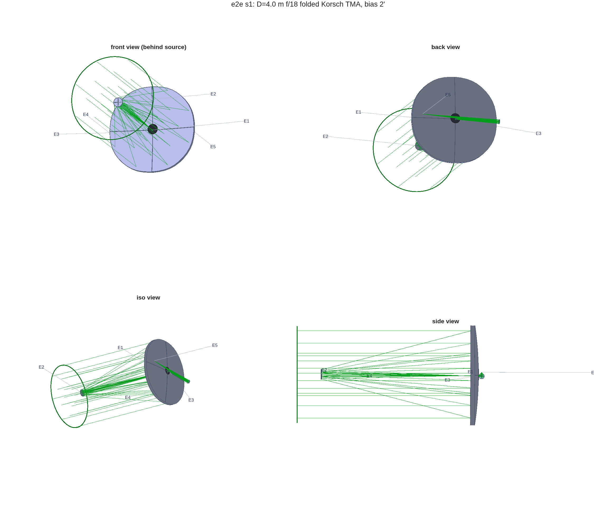
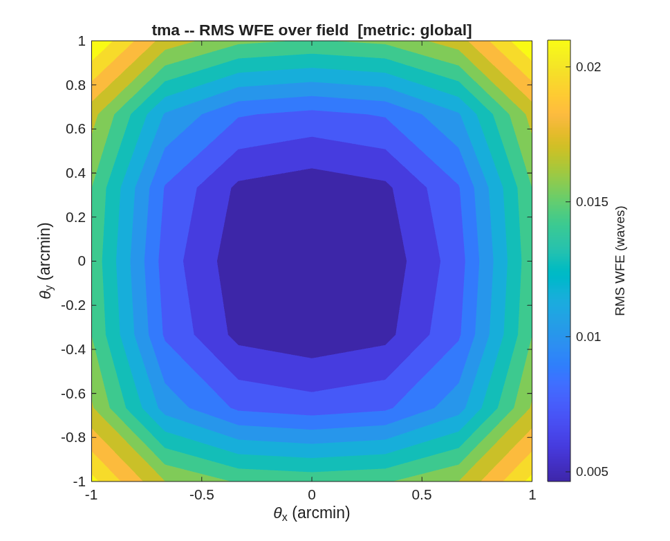

## SECTION 1: A Telescope

Part I follows one telescope from a sketch to an error budget: the e2e flow of the template library
(`MACOS_resources/mmacos/templates/80_end_to_end/e2e`), a 4 m, f/18 folded Korsch three-mirror
anastigmat (TMA) at 500 nm, built in seven stages that each consume the one before. This section is
the first stage, the telescope. Section 2 adds its instruments, Section 3 segments its primary,
Section 4 harvests its sensitivities, Section 5 adds laser metrology, Section 6 closes the loop, and
Section 7 hands the error budget to systems engineering.

Each section speaks in three voices. *You ask* is the request, as a user would type it to the
assistant. *The assistant reads* lists the files the assistant reads before it acts; they are paths
in the two repositories, so you can hand the same list to any assistant. *It runs* is what the
assistant runs, with what it printed and drew. Every listing, figure and number below was produced
by that run (the front matter, *How this manual is made*).

### You ask

> Design a 4 m visible telescope for me: a three-mirror anastigmat, f/1.75 primary, f/18 overall,
> with the back end folded behind the primary so the instruments sit on a bench. It should be
> diffraction-limited over a ±1′ field at 500 nm. Give me the MACOS prescription, its first-order
> properties and the exit pupil, and show me the layout.

### The assistant reads

- `MACOS_resources/mmacos/CLAUDE.md` -- the *mmacos* layers, the design layer
  (`+macos/+design/`, the `Telescope` builder) and the gotchas that bite in MATLAB.
- `MACOS_resources/optical_design/OPTICAL_DESIGN_AGENT_GUIDE.md` -- how to use the design
  reference and its fixtures; the sign and parameterization conventions are fixed, not guessed.
- `MACOS_resources/optical_design/TELESCOPE_DESIGN_REFERENCE.md` -- the closed-form first-order
  layout and the third-order conditions of the Korsch TMA.
- `MACOS_resources/mmacos/templates/00_INDEX.md` and
  `MACOS_resources/mmacos/templates/80_end_to_end/e2e/README.md` -- which template answers the
  request, and the stage contract (one parameter file; each stage writes its `.in`, `.mat`,
  figures and report beside itself).
- `macos/macos_f90/notes/pupil_fex_stop.md` -- how the engine finds the exit pupil (FEX) and the
  stop, so the pupil the report names is the one the engine uses.

The request is the e2e flow's first stage almost word for word, so the assistant does not write a
new design script; it runs the template's, with the request's numbers in its parameter file. The
improved design flow `templates/80_end_to_end/e2e2` (a 3 m, f/20 TMA, with stated references and a
pupil gate per stage) supersedes this stage as a design example; e2e is the thread here because it
carries all seven stages.

### It runs

The knobs are one file, `e2e_params.m`. Its telescope block, as the run read it:

<!-- transcript: ch01_params -->

Then the stage script, unchanged:

```matlab
run('<path-to>/mmacos/templates/80_end_to_end/e2e/s1_telescope.m')
```

`s1_telescope.m` works in eight steps, each printed as it runs: (1) the first-order Korsch layout
in closed form from the f-numbers and the feed magnification (`macos.design.tma_layout`); (2) the
90° fold after the secondary, and a sweep of the off-axis field bias for the least bias at which the
folded design clears its own beams -- here %pin:ch01_bias_arcmin%; (3) a CALIB solve of the three
conics at that bias; (4) a freeform refinement, Zernike departures on the three powered mirrors
under the sphere-plus-Zernike solve rules; (5) the primary's central hole sized from the measured
beam (%pin:ch01_hole_r_m% in radius, the secondary's shadow as its floor) and the focal plane
fitted to a grid of field foci; (6) the standard views and field maps; (7) the prescription saved
and reloaded alone as a check; (8) the design report:

<!-- transcript: ch01_report -->

The report reads top to bottom as the request does: the elements and their conics; the first-order
properties; the wavefront error over the field, in waves at 500 nm, with tilt removed and as a
Strehl ratio, ring by ring; the focal plane; the exit pupil; the packaging. The ±1′ ring is the
request's field, and it is diffraction-limited (the bar is 0.071 waves, Maréchal). The 2′ ring is
there because Section 2 widens the field.

The layout, from `macos.view_std`:



**FIGURE 1** The e2e telescope, front, back, isometric and side views (`macos.view_std`; the
elements are labeled by number, E1 the primary with its central hole).

and the wavefront error over the field, the request's ±1′:



**FIGURE 2** RMS wavefront error over the ±1′ field (waves at 500 nm).

### Checking the assistant's work

The deliverable is the prescription `s1_telescope.in`; everything else in the run is evidence for
it. Its source block and first element, as emitted by the design layer:

<!-- transcript: ch01_rx_head -->

A reader checks it the way the stage does: a fresh engine session, the file alone, a trace, and
the engine's own first-order analysis (`macos.first_order_properties`, the SYSPROP command of the
MACOS Manual):

<!-- transcript: ch01_reload -->

The engine reads an effective focal length of %pin:ch01_efl_m% (%pin:ch01_fno%) from the emitted
file. The request asked for f/18, and the closed-form layout of step (1) gave exactly that before
the conics and the freeform departures were solved. The design report's own "EFL" line is a
different measurement and reads a little longer: it is the chief ray's image displacement per unit
field angle over ±0.1′ about the 2′ field bias (`design_report.m`), the local plate scale at the
field point, which carries the off-axis design's distortion; SYSPROP is the engine's chief- and
marginal-ray analysis. Quote the one that answers the question: SYSPROP for the f-number, the
report's for the plate scale on the detector. λ/D is %pin:ch01_lamD_mas%. Of the
%pin:ch01_rays% rays, %pin:ch01_rays_pass% reach the focal plane; the rest fall through the
primary's central hole, which the prescription declares on the primary itself (`nObs= 1`,
`ObsType= Circle` in the listing above) rather than as a source obscuration (`Obscratn= 0`), so
the first-order obscuration ratio reads zero.

### What to ask next

- *"Widen the field to ±2′ and put an imager behind it."* -- Section 2.
- *"Change the primary to f/1.5 and rerun."* -- one line of `e2e_params.m`; the radii re-derive.
- *"Use the e2e2 flow instead."* -- `templates/80_end_to_end/e2e2`, its own parameter file.
