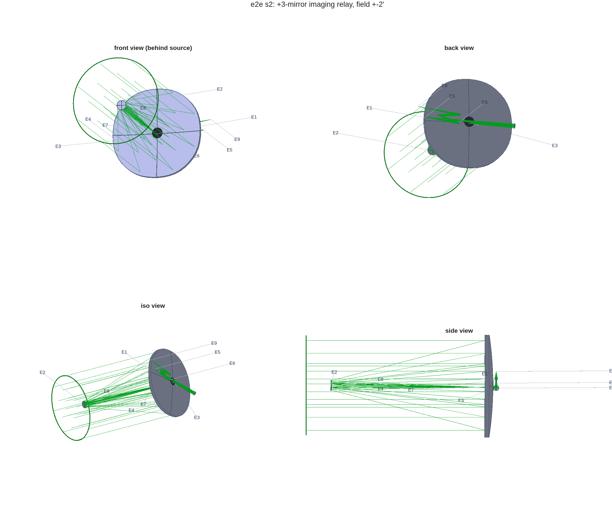
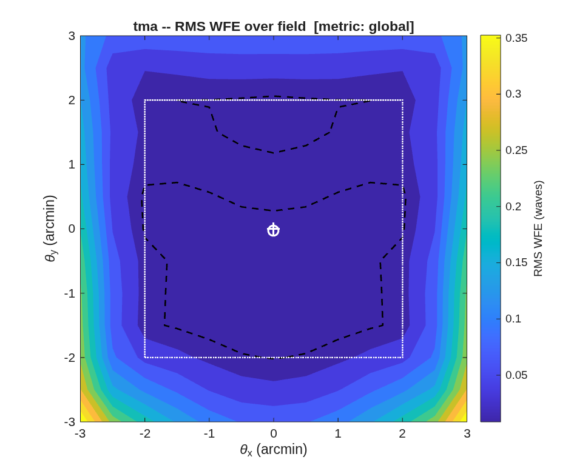
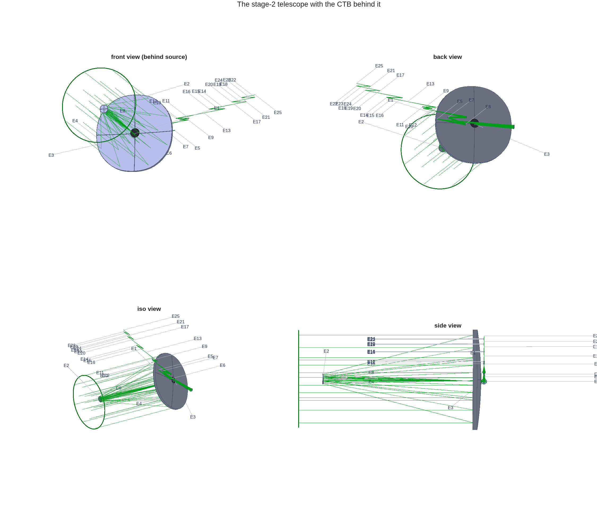
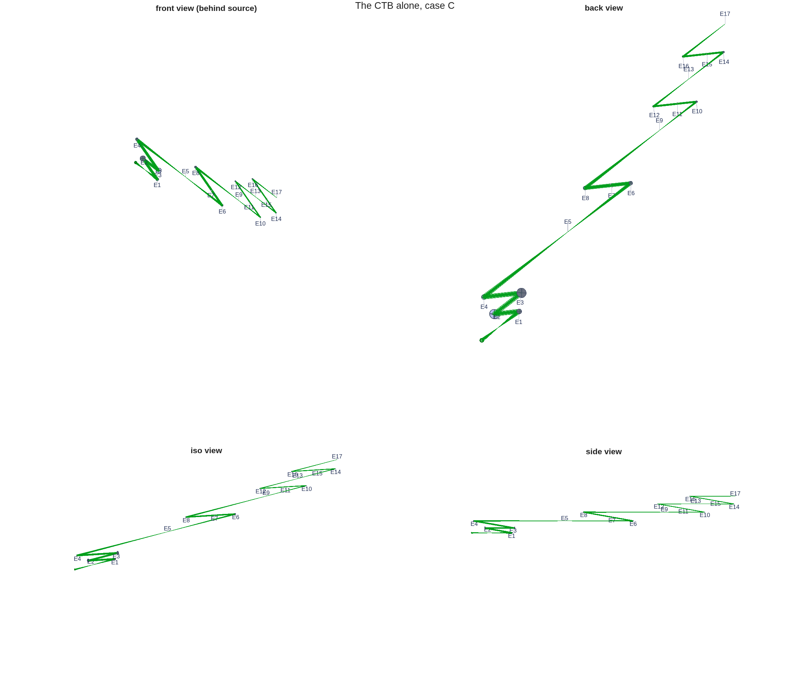
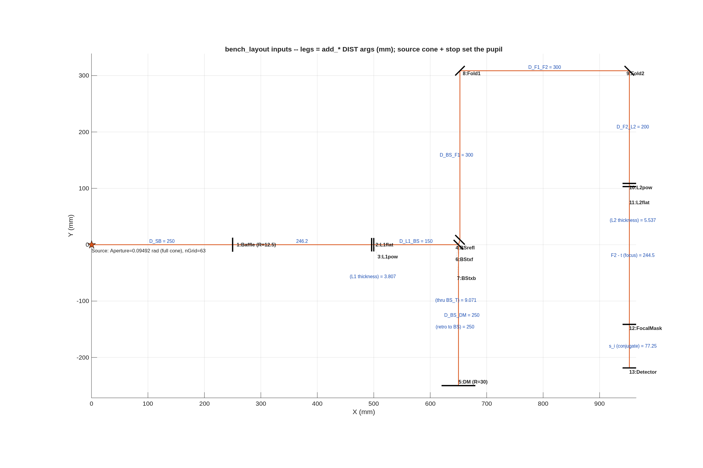
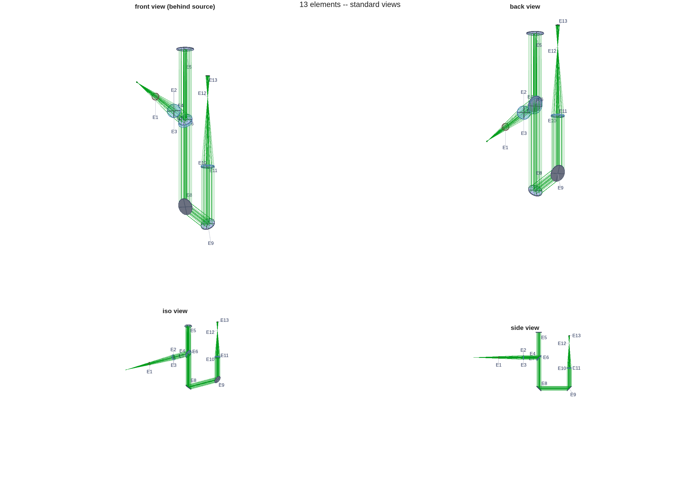

## SECTION 2: Instruments

A telescope delivers a focus; an instrument decides what is done with the light there. This section
puts the thread's imager behind the Section 1 telescope (the e2e flow's second stage), then puts the
library's coronagraph testbed behind the same telescope, and steps off the thread once for a bench
built optic by optic. The imager and the bench are templates run unchanged; the coronagraph is a
template with one focal length and one spacing changed, both measured here. A last paragraph says
when *not* to split a design into a telescope and an instrument.

### You ask

> Widen the field to ±2′ and put an imaging relay behind the telescope, re-imaging its focus onto a
> detector. Keep it diffraction-limited over the whole ±2′ at 500 nm, and tell me where the science
> field should be centered.

### The assistant reads

- `MACOS_resources/mmacos/templates/80_end_to_end/e2e/README.md`, the `s2_instrument.m` row -- the
  stage's inputs (the stage-1 `.mat`), the relay types it offers, and the dead ends already walked
  (kept in `s2_instrument.m` so nobody re-walks them).
- `MACOS_resources/mmacos/templates/00_INDEX.md`, tier T3 -- the imager rung *is* this stage until a
  standalone template is extracted.
- `MACOS_resources/optical_design/OPTICAL_DESIGN_AGENT_GUIDE.md` -- the sphere-plus-Zernike solve
  rules again, now for a joint telescope-and-relay solve.

### It runs

The instrument's knobs are the `P.inst` block of the same `e2e_params.m`:

<!-- transcript: ch02_inst_params -->

The default relay is an Offner: two passes off one concave sphere (R = 2 m) about a convex sphere of
half its radius at the stop, all concentric. There are no tilted powered surfaces, so the
astigmatism a tilted-sphere relay pays grows from nothing, and coma and distortion cancel by
symmetry; the usable field is a ring, and the biased science field is an arc of it. The other choice,
`"zigzag"`, is the tilted-sphere bench relay. Then the stage script, unchanged, in the directory where
Section 1 left its products:

```matlab
run('<path-to>/mmacos/templates/80_end_to_end/e2e/s2_instrument.m')
```

The stage reloads the stage-1 design, appends the relay, and solves the telescope and the relay
together (the conics of M2 and M3 keep refining as the field widens). It then fits the best detector
plane through a grid of measured field foci and finds the science-field center itself: one solve at
a starting guess, a ±3′ map of the wavefront error, the chief ray moved to the centroid of the region
under 0.02 waves, and one solve again there. Its report is the Section 1 report with an addendum:

<!-- transcript: ch02_report -->

The ladder is in waves at 500 nm, with tilt removed, about the adopted field center (`bias` at the
top of the field table). Every ring through 2′ is under the Maréchal bar of 0.071 waves, with room to
spare: compare the 2′ row, and its Strehl ratio, with the Section 1 report's, where the telescope
alone was just inside the bar. The last line of the addendum is what the relay does not fix:
the distortion at the detector, which the M4 field-corrector solve leaves where it found it.



**FIGURE 3** The telescope with its Offner relay (`macos.view_std`): front, back, isometric and side
views, the elements labeled by number.



**FIGURE 4** RMS wavefront error over ±3′ of field about the adopted center (waves at 500 nm); the
white box is the ±2′ science field.

### A coronagraph behind the telescope

Back to the telescope, for a second instrument: a coronagraph does not image the star; it removes it.
The library's best coronagraph is the CTB, `templates/30_instruments/bench_ctb`: eight off-axis
parabolas (OAPs) and two deformable mirrors, laid out with the design layer's `macos.design.Bench`.
The question is whether it takes the telescope's beam as it stands.

> Put the CTB behind the stage-2 telescope. Does it take the telescope's beam as built? If not,
> change as little as you can, and tell me how far off axis it can look before the beam walks on the
> deformable mirrors.

- `templates/30_instruments/bench_ctb/example_ctb.m` -- its parameter block and its build: OAP1
  collimates onto DM1, DM2 follows 500 mm on, then the focal-plane mask, the Lyot stop and the
  detector, every OAP at 5° incidence.
- `templates/30_instruments/bench_ctb/README.md` and `deck_ctb.md` -- the beam on the DMs (21.38 mm
  across) and the dark zone's inner edge, 8 λ/D.
- `macos.design.append_rx`, its help text -- splicing a bench onto a telescope's prescription at its
  focus.
- `MACOS_resources/optical_design/CORONAGRAPH_DESIGN_RULES.md` -- the coronagraph rules for
  prescriptions.

It runs on the thread's stage-2 prescription, with the CTB's knobs read from the template, which is
left unchanged:

<!-- transcript: ch02_ctb_params -->

It builds that chain behind the telescope's focus three times: as built, with OAP1 matched to the
telescope, and with DM1 moved as well. Each one is spliced onto the stage-2 prescription with
`append_rx` and traced:

<!-- transcript: ch02_ctb_run -->

As built, the CTB does not take the beam: its OAP1 is a 2.5 m collimator for the much slower beam
of its own source, so the telescope's beam leaves OAP1 several times wider than DM1, and only
%pin:ch02_ctb_asbuilt% rays reach it. The fix is the textbook match, a collimator focal length equal
to the f-number times the beam diameter on the DMs: %pin:ch02_ctb_foap1% at the marginal ray's
%pin:ch02_ctb_fno%. The CTB's legs were laid for its own source, though, and with that OAP1 the
telescope's stop is imaged %pin:ch02_ctb_simg% after OAP1, not at DM1's 600 mm. A DM away from the
stop's image sees the beam walk across it as the field moves, so DM1 moves there. That is one focal
length and one spacing changed, and the system the rest of this section measures.

DM2 keeps its 500 mm past DM1, out of the pupil, by design. Light that crosses the gap between the
two mirrors spreads out by diffraction, which lets the pair correct amplitude as well as phase and
dig a dark zone on both sides of the star. A DM2 at a second image of the pupil would reduce the
pair to one phase corrector.

On axis, %pin:ch02_ctb_pass% of %pin:ch02_ctb_rays% rays reach the detector, the same rays the
telescope passes on its own, and the wavefront there is %pin:ch02_ctb_wfe% rms. The beam on DM1 is
an ellipse, %pin:ch02_ctb_ell_a% × %pin:ch02_ctb_ell_b% mm, not a circle: the telescope's beam is
slightly anamorphic, %pin:ch02_ctb_fno_u% and %pin:ch02_ctb_fno_v% along the two axes of its pupil,
because the science field sits off the telescope's axis.

The walk table answers the last question. The telescope's aperture is %pin:ch02_ctb_mag% times the beam on
the DMs, so a field angle on the sky is that many times larger at the DMs. At the CTB's dark-zone
edge, 8 λ/D or %pin:ch02_ctb_edge% on this telescope, the beam moves %pin:ch02_ctb_w1_edge% on DM1,
which sits at the stop's image, and %pin:ch02_ctb_w2_edge% of an actuator spacing on DM2. At 10″ it
has moved %pin:ch02_ctb_w2_10% of the pupil's radius on DM2; by 30″ DM2 clips the beam, and by 60″
few rays pass. So the coronagraph is an instrument with a field of arcseconds. The imager's ±2′
cannot pass through it, and no realignment would change that: a beam 21 mm across cannot carry
that field (the Lagrange invariant). The telescope keeps its arcminute field for its other
instruments, each with a slightly offset field of view. The coronagraph takes an arcsecond sub-field
about the field center that stage 2 adopted, %pin:ch02_ctb_bias% off axis.



**FIGURE 5** The stage-2 telescope with the CTB behind it (`macos.view_std`). At this scale the CTB
is the small zigzag behind the primary.



**FIGURE 6** The CTB on its own, with OAP1 matched and DM1 at the stop's image, fed at the
telescope's focus (`macos.view_std`): E1 OAP1, E2 DM1, E3 DM2, E9 the focal-plane mask, E11 the Lyot
stop, E17 the detector.

The layout is drawn unfolded, in the CTB's own zigzag. The realized instrument folds into the
telescope's shroud. That is a design step of its own, after this manual, under the design drivers:
every fold at under 15° incidence, a numeric clearance from the shroud, and a small relay. The
dark-zone and walk numbers are measured again after the fold.

### A bench on its own

Off the thread again: an optical bench built from nothing, optic by optic, with the design
layer's `macos.design.Bench` builder. The library's worked example is the classic test-arm bench of a
surface gauge: a point source, a baffle as the stop, a collimating singlet, a beam splitter to a
deformable mirror and back through the plate, two folds, an imaging singlet, an internal focus at a
mask, and a detector at the image of the DM pupil.

> Lay out a folded test-arm bench in the X-Y plane with real angles of incidence: collimate onto the
> DM, focus at a field mask, and put the detector at the DM's pupil image. Then optimize it.

- `MACOS_resources/mmacos/CLAUDE.md`, the `Bench` entries -- among them, ask `Bench.station` where
  an element sits on the bench; an off-axis section's vertex is its parent's.
- `templates/40_benches/bench_layout/example_bench_layout.m` -- its header: why the solve is
  staged, one conjugate condition per plane, so that a single wavefront solve at the detector
  cannot mis-collimate at the DM and hide it at the focus.

It runs the example unchanged:

<!-- transcript: ch02_bench_run -->

The builder tracks the chief ray in closed form (mirror turns, refraction through the tilted plate),
so every element is emitted on the beam; the first check in the run is that the engine's chief ray
agrees with the builder's. Then three solves, each a geometric cost on its own plane: L1 for
collimation at the DM (the ray-direction spread), L2 for the focus at the mask (the spot), and the
detector's position for the pupil image (the beam shift a field tilt causes). Numbers that solve to
zero print as a bound (`<`): their last digits differ between machines.



**FIGURE 7** The bench's inputs (`bench_layout_params.png`): the legs, in millimetres, are the
`add_*` distance arguments; the source cone and the stop set the pupil.



**FIGURE 8** The optimized bench, %pin:ch02_bench_nelt% elements (`macos.view_std`).

### When not to split: a small dedicated imager

The thread splits its design into a telescope and an instrument because the telescope feeds several
instruments over a wide field, and each instrument takes an arc of it. A small camera that is its
own telescope does not split. `ImageDemo.in`, the MACOS Manual's Appendix A example (after the Mars
Observer Camera), is %pin:ch02_imagedemo_nelt% elements traced as one design, telescope and camera
together; loaded and asked the same question as the stages above:

<!-- transcript: ch02_imagedemo -->

It reads %pin:ch02_imagedemo_fno%, with an obscuration of %pin:ch02_imagedemo_obsc%. Two cautions
for an assistant reading it. The deck declares no `BaseUnits`, so the engine's metre conversion
factor is 1 and `dpup_m` prints the deck's own millimetres (380); quote it as 380 mm, or add
`BaseUnits= mm` to the deck. And the primary's obscuration is declared on the elements, not on the
source, so the first-order obscuration ratio reads zero for the same reason as in Section 1.

### Checking the assistant's work

The stage-2 prescription reloaded alone in a fresh session:

<!-- transcript: ch02_reload -->

%pin:ch02_nelt% elements, and %pin:ch02_rays_pass% of %pin:ch02_rays% rays pass, the same rays as the
Section 1 telescope: the relay clips nothing the primary's hole does not. SYSPROP reads
%pin:ch02_efl_m% (%pin:ch02_fno%); the report's "EFL" is again the local plate scale at the field
point and reads longer. The report's clearance line flags bodies in the beam at M2, which is the
secondary's own shadow on the incoming beam, as in Section 1, and now at FM, the fold flat; that the
trace passes the same rays says the fold blocks no traced ray, but the report does not say how close
the body comes, so ask (below). Read the dead-ends paragraph of the e2e README before asking for a
wider or flatter field: a per-field corrector at a focus and a fourth weak mirror near the relayed
pupil were both tried and both rejected.

### What to ask next

- *"Why does the clearance check flag the fold flat, and by how much?"* --
  `t.check_clipping` on the stage-2 design, the call the report makes.
- *"Center the science field lower, inside the ring."* -- `P.inst.field_dy_arcmin` with
  `field_center = "manual"`; the variants kept in `s2_variants/` are the two already solved.
- *"Segment the primary."* -- Section 3.
- *"A spectrograph instead of an imager."* -- not on the thread. `templates/10_telescopes/tma_longslit`
  is the slit-fed spectrometer's front end (telecentric, long working distance), and
  `challenges/dyson5` is the VSWIR Dyson imaging spectrometer built behind it.
