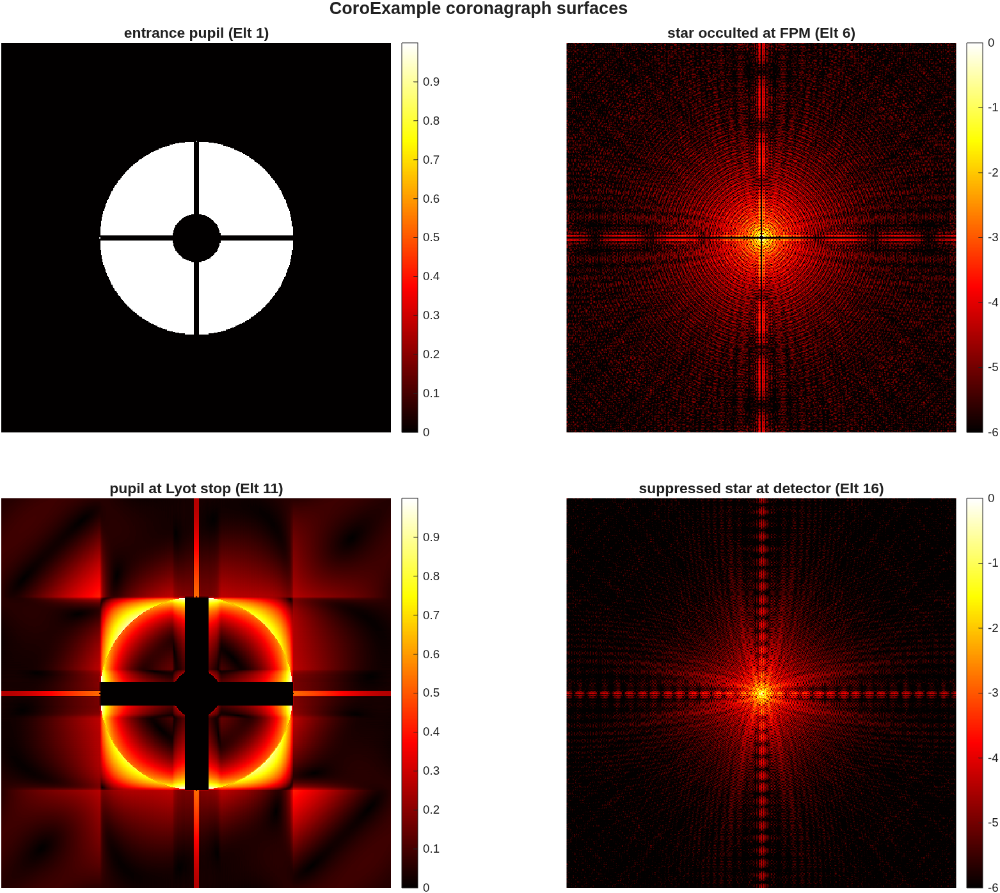

## SECTION 2: Instruments

A telescope delivers a focus; an instrument decides what is done with the light there. This section
puts the thread's imager behind the Section 1 telescope (the e2e flow's second stage), then steps off
the thread twice: once for a coronagraph, and once for a bench built optic by optic. Each one is a
template in the library, run unchanged. A last paragraph says when *not* to split a design into a
telescope and an instrument.

### You ask

> Widen the field to ±2′ and put an imaging relay behind the telescope, re-imaging its focus onto a
> detector. Keep it diffraction-limited over the whole ±2′ at 500 nm, and tell me where the science
> field should be centered.

### The assistant reads

- `MACOS_resources/mmacos/templates/80_end_to_end/e2e/README.md`, the `s2_instrument.m` row -- the
  stage's inputs (the stage-1 `.mat`), the relay types it offers, and the dead ends already walked
  (kept in `s2_instrument.m` so nobody re-walks them).
- `MACOS_resources/mmacos/templates/00_INDEX.md`, tier T3 -- the imager rung *is* this stage until a
  standalone template is extracted.
- `MACOS_resources/optical_design/OPTICAL_DESIGN_AGENT_GUIDE.md` -- the sphere-plus-Zernike solve
  rules again, now for a joint telescope-and-relay solve.

### It runs

The instrument's knobs are the `P.inst` block of the same `e2e_params.m`:

<!-- transcript: ch02_inst_params -->

The default relay is an Offner: two passes off one concave sphere (R = 2 m) about a convex sphere of
half its radius at the stop, all concentric. There are no tilted powered surfaces, so the
astigmatism a tilted-sphere relay pays grows from nothing, and coma and distortion cancel by
symmetry; the usable field is a ring, and the biased science field is an arc of it. The other choice,
`"zigzag"`, is the tilted-sphere bench relay. Then the stage script, unchanged, in the directory where
Section 1 left its products:

```matlab
run('<path-to>/mmacos/templates/80_end_to_end/e2e/s2_instrument.m')
```

The stage reloads the stage-1 design, appends the relay, and solves the telescope and the relay
together (the conics of M2 and M3 keep refining as the field widens). It then fits the best detector
plane through a grid of measured field foci and finds the science-field center itself: one solve at
a starting guess, a ±3′ map of the wavefront error, the chief ray moved to the centroid of the region
under 0.02 waves, and one solve again there. Its report is the Section 1 report with an addendum:

<!-- transcript: ch02_report -->

The ladder is in waves at 500 nm, with tilt removed, about the adopted field center (`bias` at the
top of the field table). Every ring through 2′ is under the Maréchal bar of 0.071 waves, with room to
spare: compare the 2′ row, and its Strehl ratio, with the Section 1 report's, where the telescope
alone was just inside the bar. The last line of the addendum is what the relay does not fix:
the distortion at the detector, which the M4 field-corrector solve leaves where it found it.


**FIGURE 3** The telescope with its Offner relay (`macos.view_std`): front, back, isometric and side
views, the elements labeled by number.


**FIGURE 4** RMS wavefront error over ±3′ of field about the adopted center (waves at 500 nm); the
white box is the ±2′ science field.

### A coronagraph

Off the thread: a coronagraph does not image the star; it removes it. The request, and what
the assistant reads, are short, because the library carries the recipe:

> Show me a Lyot coronagraph working: the pupil, the star at the focal-plane mask, the Lyot stop,
> and what is left of the star at the detector.

- `MACOS_resources/optical_design/CORONAGRAPH_DESIGN_RULES.md` -- the coronagraph rules for
  prescriptions, among them the `Element= Obscuring` mask rule.
- `macos-manual/examples/CoroExample.in` and `CoroExample.jou` -- the MACOS Manual's coronagraph
  example and the CLI journal whose `pgp 4` plot pages the template reproduces.
- `templates/30_instruments/coro_planet_demo/coro_planet_demo.m` -- its help text: the defaults
  (model size 512, the mask at element 6, the Lyot stop at 11, the detector at 16).

It runs the template with its defaults, in a MATLAB of its own (the model size differs from the
thread's):

<!-- transcript: ch02_coro_run -->



**FIGURE 5** The CoroExample coronagraph, surface by surface (`coro_planet_demo`, its surfaces page):
the entrance pupil with the secondary's obscuration and the spiders; the star at the focal-plane mask
(log intensity); the pupil at the Lyot stop, where the light the mask diffracted sits on the edges of
the pupil and the spiders and the stop blocks it; and what is left of the star at the detector (log
intensity).

The picture to check is the third panel. A working focal-plane mask throws the star's light to the
edges of the re-imaged pupil, the bright rim here, and the Lyot stop, which passes only the
pupil's interior, removes it. A filled, even pupil at the Lyot plane means the mask is not doing its job, whatever the
detector panel shows. The template also composes an off-axis planet onto the detector; that page is
not printed here (the open questions list says why).

### A bench on its own

Off the thread again: an optical bench built from nothing, optic by optic, with the design
layer's `macos.design.Bench` builder. The library's worked example is the classic test-arm bench of a
surface gauge: a point source, a baffle as the stop, a collimating singlet, a beam splitter to a
deformable mirror and back through the plate, two folds, an imaging singlet, an internal focus at a
mask, and a detector at the image of the DM pupil.

> Lay out a folded test-arm bench in the X-Y plane with real angles of incidence: collimate onto the
> DM, focus at a field mask, and put the detector at the DM's pupil image. Then optimize it.

- `MACOS_resources/mmacos/CLAUDE.md`, the `Bench` entries -- among them, ask `Bench.station` where
  an element sits on the bench; an off-axis section's vertex is its parent's.
- `templates/40_benches/bench_layout/example_bench_layout.m` -- its header: why the solve is
  staged, one conjugate condition per plane, so that a single wavefront solve at the detector
  cannot mis-collimate at the DM and hide it at the focus.

It runs the example unchanged:

<!-- transcript: ch02_bench_run -->

The builder tracks the chief ray in closed form (mirror turns, refraction through the tilted plate),
so every element is emitted on the beam; the first check in the run is that the engine's chief ray
agrees with the builder's. Then three solves, each a geometric cost on its own plane: L1 for
collimation at the DM (the ray-direction spread), L2 for the focus at the mask (the spot), and the
detector's position for the pupil image (the beam shift a field tilt causes). Numbers that solve to
zero print as a bound (`<`): their last digits differ between machines.


**FIGURE 6** The bench's inputs (`bench_layout_params.png`): the legs, in millimetres, are the
`add_*` distance arguments; the source cone and the stop set the pupil.


**FIGURE 7** The optimized bench, %pin:ch02_bench_nelt% elements (`macos.view_std`).

### When not to split: a small dedicated imager

The thread splits its design into a telescope and an instrument because the telescope feeds several
instruments over a wide field, and each instrument takes an arc of it. A small camera that is its
own telescope does not split. `ImageDemo.in`, the MACOS Manual's Appendix A example (after the Mars
Observer Camera), is %pin:ch02_imagedemo_nelt% elements traced as one design, telescope and camera
together; loaded and asked the same question as the stages above:

<!-- transcript: ch02_imagedemo -->

It reads %pin:ch02_imagedemo_fno%, with an obscuration of %pin:ch02_imagedemo_obsc%. Two cautions
for an assistant reading it. The deck declares no `BaseUnits`, so the engine's metre conversion
factor is 1 and `dpup_m` prints the deck's own millimetres (380); quote it as 380 mm, or add
`BaseUnits= mm` to the deck. And the primary's obscuration is declared on the elements, not on the
source, so the first-order obscuration ratio reads zero for the same reason as in Section 1.

### Checking the assistant's work

The stage-2 prescription reloaded alone in a fresh session:

<!-- transcript: ch02_reload -->

%pin:ch02_nelt% elements, and %pin:ch02_rays_pass% of %pin:ch02_rays% rays pass, the same rays as the
Section 1 telescope: the relay clips nothing the primary's hole does not. SYSPROP reads
%pin:ch02_efl_m% (%pin:ch02_fno%); the report's "EFL" is again the local plate scale at the field
point and reads longer. The report's clearance line flags bodies in the beam at M2, which is the
secondary's own shadow on the incoming beam, as in Section 1, and now at FM, the fold flat; that the
trace passes the same rays says the fold blocks no traced ray, but the report does not say how close
the body comes, so ask (below). Read the dead-ends paragraph of the e2e README before asking for a
wider or flatter field: a per-field corrector at a focus and a fourth weak mirror near the relayed
pupil were both tried and both rejected.

### What to ask next

- *"Why does the clearance check flag the fold flat, and by how much?"* --
  `t.check_clipping` on the stage-2 design, the call the report makes.
- *"Center the science field lower, inside the ring."* -- `P.inst.field_dy_arcmin` with
  `field_center = "manual"`; the variants kept in `s2_variants/` are the two already solved.
- *"Segment the primary."* -- Section 3.
- *"A spectrograph instead of an imager."* -- not on the thread. `templates/10_telescopes/tma_longslit`
  is the slit-fed spectrometer's front end (telecentric, long working distance), and
  `challenges/dyson5` is the VSWIR Dyson imaging spectrometer built behind it.
