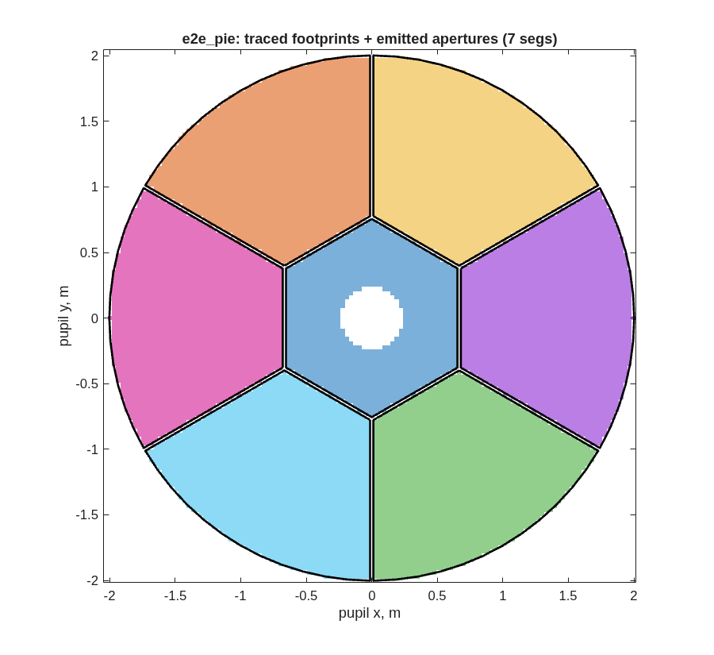
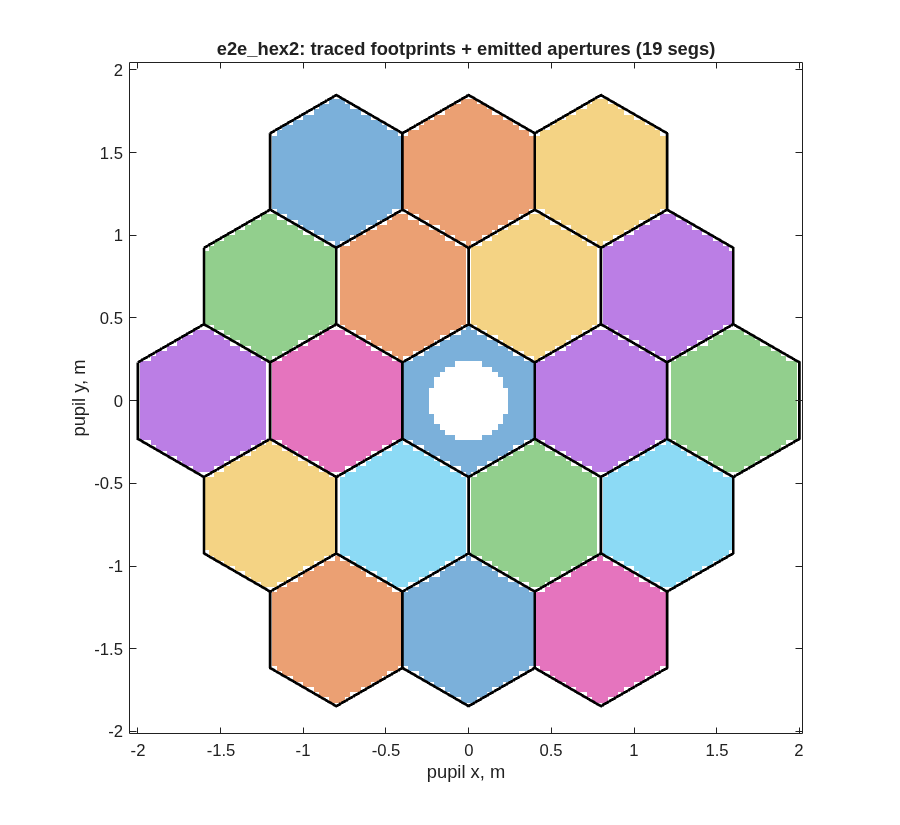
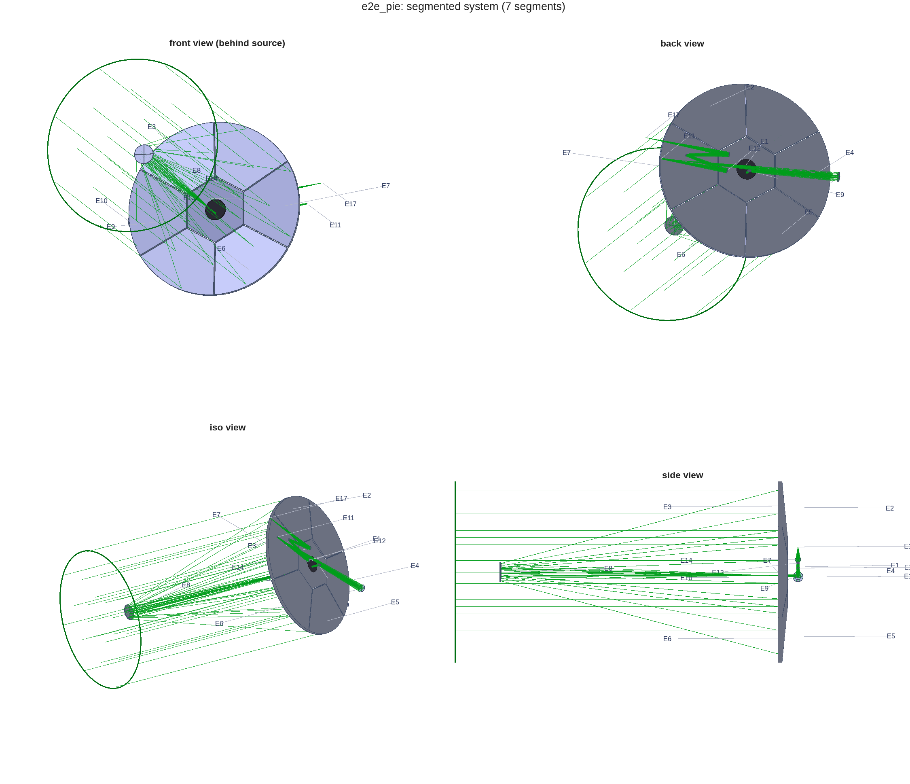

## SECTION 3: Segmentation

A 4 m primary is one piece of glass in Sections 1 and 2. This section cuts it into segments, two
ways, and keeps both: a 1-ring pie (%pin:ch03_pie_nseg% segments, a center hexagon and six chorded
wedges) and a 2-ring hex (%pin:ch03_hex2_nseg% hexagons). The pie is the one Sections 4 to 7 carry
forward. Segmentation changes no optics. It adds the bodies whose motions the later sections sense
and control: every segment becomes an element with its own frame and its own six degrees of freedom.

### You ask

> Segment the primary of the stage-2 design two ways, a pie of seven and a hex of nineteen, with
> 25 mm gaps and real segment edges, so that light falling in a gap is lost. Keep the primary's
> figure on every segment, check each segmented deck against the monolithic one, and tell me which
> one the rest of the flow should use.

### The assistant reads

- `MACOS_resources/mmacos/templates/80_end_to_end/e2e/README.md`, the `s3_segmentation.m` row --
  the two variants, the knob that picks the one stages 4 to 6 consume, and the gotchas this stage
  flushed out (a Zernike parent's figure that SegMirMaker would drop; the heritage `xGrid` frame the
  tiling contract needs).
- `MACOS_resources/mmacos/design/runners/run_segmentation.m`, its help text -- the general stage
  runner the e2e stage is a thin driver over, its artefacts, and its verification ladder: a parent
  baseline, a bare segmentation trace, engine-truth footprints, the trace with physical apertures,
  and a standalone reload of the emitted deck.
- `MACOS_resources/mmacos/templates/20_segmentation/` (`e5_pie`, `e5_seg`) -- the segmentation
  templates of the library, at twice this aperture.

### It runs

The knobs are the `P.seg` block of `e2e_params.m`. Segment size is not among them: SegMirMaker
sizes a segment as the aperture over (2 × rings + 1), so the tiling scales with the aperture.

<!-- transcript: ch03_seg_params -->

Then the stage script, unchanged, in the directory Sections 1 and 2 left their products in:

```matlab
run('<path-to>/mmacos/templates/80_end_to_end/e2e/s3_segmentation.m')
```

Each variant goes through `run_segmentation` once. The stage report:

<!-- transcript: ch03_report -->

and the runner's own report for the pie, the verification ladder step by step:

<!-- transcript: ch03_pie_report -->

Segment widths are flat to flat: %pin:ch03_pie_width% for the pie, %pin:ch03_hex2_width% for the
hex. The primary's central hole rides on the pie's center segment (step [1], one obscuration carried
over). The rmsWFE change against the parent is a sampling effect, not an optical one, as the report
says: the segmented deck's source grid samples the pupil differently from the parent's circular
grid.



**FIGURE 9** The pie: each segment's traced footprint (`macos.design.seg_footprints`, found by poking
each segment and differencing the trace) and the aperture polygons emitted into the deck (black).



**FIGURE 10** The hex, the same way.



**FIGURE 11** The segmented system, `e2e_pie.in` (`macos.view_std`).

### Checking the assistant's work

The deliverable is `e2e_pie.in`. Reloaded alone in a fresh session, at the model size the
segmented stages need:

<!-- transcript: ch03_reload -->

%pin:ch03_reload_nelt% elements, %pin:ch03_reload_pass% of %pin:ch03_pie_src% rays passing: the counts
the runner verified in session (step [5]). Check two things more in the runner's report.

First, where the lost rays are lost. The census of step [3] names element 1, the center segment,
which carries the primary's hole; the bare segmented trace and the trace with apertures pass the same
rays (%pin:ch03_pie_clip% clipped). In this run, then, no traced ray falls in a gap. The footprint
figure agrees: the gaps are empty and every footprint fills its polygon. A gap that clipped nothing
because the apertures were missing would look different: footprints spilling over the black lines.

Second, that the segments sit where the parent's surface is. The frames table of step [1] puts each
wedge's center a few centimetres behind the center segment's: that is the parent's sag at the
wedge's radius, not an error, since every segment carries the parent's figure.

### What to ask next

- *"Use the hex for the rest of the flow."* -- `P.seg.variant = "hex2"`; both decks always exist.
- *"Narrow the gaps to 10 mm."* -- `P.seg.gap_mm`; rerun from this stage.
- *"How sensitive is the image to each segment's motion?"* -- Section 4.
