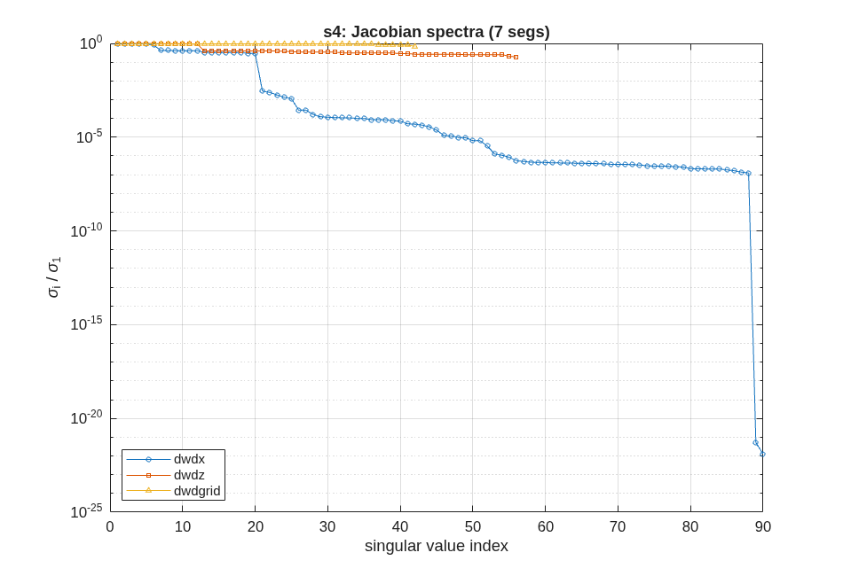
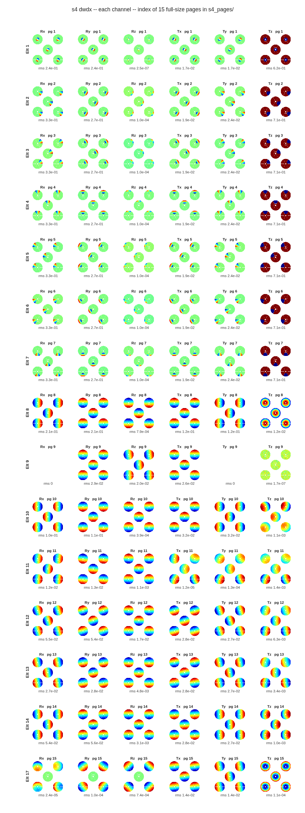

## SECTION 4: Sensitivities

Sections 5 to 7 sense the segmented telescope, estimate its state and control it, and none of them
traces a ray to do so. They work on a linear model of the telescope, harvested once in this section:
how the wavefront over the science field moves for a unit motion of every body, a unit of every
figure mode of every segment, and a unit of every grid influence function. Each channel is a matrix
in one stacked form, `w = J·x + w0`: a column per degree of freedom, a row per ray per field point.

### You ask

> Harvest the linear model of the segmented telescope over the ±2′ science field: rigid-body
> sensitivities for every optic, segment figure in low-order Zernike modes, and per-segment grid
> influence functions. Tell me how well conditioned each one is.

### The assistant reads

- `MACOS_resources/mmacos/templates/80_end_to_end/e2e/README.md`, the `s4_jacobians.m` row -- the
  three channels, the field set (the center and the four corners of the ±2′ field), and why the
  figure channel uses each segment's own Zernike basis rather than the parent's.
- `MACOS_resources/mmacos/design/runners/run_sensitivities.m` -- the runner over the production
  `macos.dw_d*_multi` supervisors, the grid augmentation (`macos.design.grid_augment_rx`), and the
  report it writes.
- `MACOS_resources/mmacos/tests/tDwDx.m`, the comments on its pins -- the noise floor of a
  finite-difference sensitivity (about 1e-6 absolute, up to 3e-5 on columns that are nearly zero),
  which decides which numbers below are signals and which are bounds.

### It runs

The stage script, unchanged, in the thread directory:

```matlab
run('<path-to>/mmacos/templates/80_end_to_end/e2e/s4_jacobians.m')
```

It takes `e2e_pie.in` from Section 3 and writes `s4_jacobians.mat` (the three matrices, for the
later stages), a fingerprint of them (`s4_jacobians.fp.json`, committed where the matrices are too
large to be), one page of maps per element, and the report. As this manual prints it, numbers set by
the noise floor are shown as the bound they are known to sit under or over (`<`, `>`):

<!-- transcript: ch04_report -->

Each channel has %pin:ch04_rows% rows: the rays that pass, at five field points. The rigid-body
channel `dwdx` has %pin:ch04_dwdx_cols% columns, six for each of the fifteen bodies that move (the
seven segments, then the optics behind them). The figure channel `dwdz` has %pin:ch04_dwdz_cols%,
Zernike modes 4 to 11 on each segment, and the grid channel `dwdgrid` has
%pin:ch04_dwdgrid_cols%, six influence functions on each segment.



**FIGURE 11** The singular-value spectra of the three channels, each normalized to its largest.

The spectrum says what the conditioning table says, and more. `dwdz` and `dwdgrid` are flat: full
rank (%pin:ch04_dwdz_rank% and %pin:ch04_dwdgrid_rank%), condition numbers %pin:ch04_dwdz_cond% and
%pin:ch04_dwdgrid_cond%. Every mode is seen, and seen about equally. `dwdx` is not. About twenty
modes are strong, the segments' pistons and tilts; a cliff of more than two decades follows, then a
long tail at the floor, then two columns that are exactly zero. The channel pages show which:

{height=8in}

**FIGURE 12** The rigid-body channel, one row per element and one column per degree of freedom (the
index page of `s4_pages/`; each tile is the center-field wavefront change, with its rms).

The two exact zeros are the fold flat's (element 9) in-plane motions, Rx and Ty, which move a flat
mirror within its own plane. The segments' clocking, Rz, is near the floor too: rotating a segment
about its own axis on a nearly flat parent moves almost nothing, the center segment least of all.

### Checking the assistant's work

Two checks, both on numbers in the report.

The first is units. The column norms are in the deck's native units per unit motion, metres of
wavefront per radian or per metre (BaseUnits are metres here). A segment's piston, Tz, reads about
0.7, and that can be checked by hand: a mirror moved along its normal changes the reflected path by
twice the motion, on about a seventh of the rays; with the mean removed (the report's analyses
remove each field's piston, its `piston:` line says so, Section 6 says why), the rms is
2·√(1/7 · 6/7) ≈ 0.70. (The center segment reads less: the primary's hole takes some of its rays.)
A units slip would show as a factor of a thousand.

The second is what the floor means. A finite-difference sensitivity cannot resolve a column smaller
than its own noise, and that noise differs between machines in the last digits. A condition number
divided by a singular value at the floor is not a property of the telescope, which is why this
manual prints the `dwdx` condition numbers as bounds, and why the segment-only figure in the report
is no better: segment clocking is in it. For estimation and control the later stages do not invert
`dwdx` raw; Section 6 regularizes it with a prior, and the README says what happens when it is not
(the pose estimate diverges).

### What to ask next

- *"Leave out the degrees of freedom the telescope cannot see."* -- the clocking and the fold's
  in-plane motions; `run_sensitivities` takes the element and DOF lists (`'elts'`, `'dofs'`).
- *"Show me one segment's maps at full size."* -- `s4_pages/`, indexed by `s4_pages_index.txt`.
- *"Add laser metrology."* -- Section 5.
