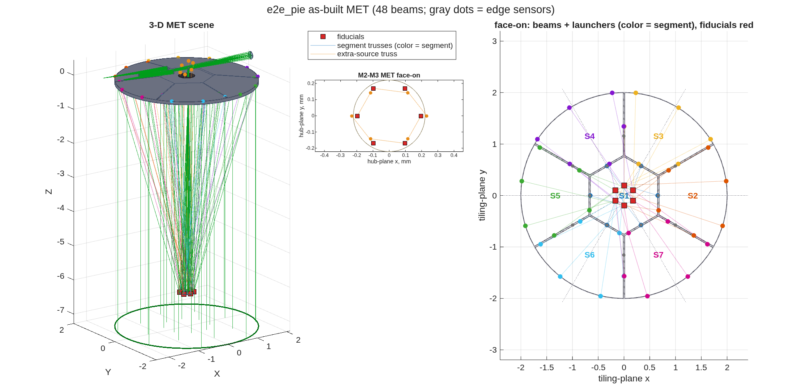
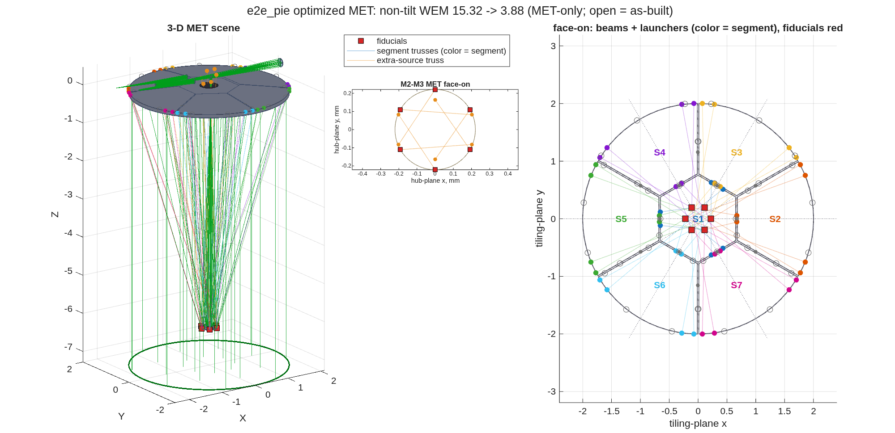

## SECTION 5: Laser Metrology

A segmented telescope drifts: each segment, the secondary and the fold move a little, all the time,
by much less than the wavefront can afford to lose between corrections. This section adds the
sensors that watch those motions: capacitive edge sensors across every gap, and a laser truss (MET),
beams from launchers on the back of each segment to fiducials on the secondary's rim, with an aft
ring on the fold watching the secondary through the primary's hole. Then it asks how well the
sensors see the motions that matter to the wavefront, and moves the launchers to see them better.

### You ask

> Add laser metrology to the segmented telescope: six launchers on each segment, six fiducials on
> the secondary's rim, and an aft ring on the bench-side fold watching the secondary through the
> hole. Use the edge sensors from the segmentation. Score how much of the drift wavefront each
> sensor set leaves after control, then optimize the launcher layout on the metrology alone.

### The assistant reads

- `MACOS_resources/mmacos/templates/80_end_to_end/e2e/README.md`, the `s5_met.m` row -- the truss,
  the edge-sensor model (two locations per shared edge, three axes each: piston, gap, shear), why
  the headline metrics are dimensionless, and the 50 mm separation rule a layout must keep.
- `MACOS_resources/mmacos/templates/80_end_to_end/e2e/s5_met.m`, its header -- the geometry note:
  the aft ring sits on the fold, at the secondary's radius, because a ring at M3 would have no line
  of sight through the hole.
- `MACOS_resources/mmacos/design/runners/run_met.m` -- the stage runner: the as-built truss, the
  `dldx` engine check, the scoring, the shape-class layout optimizer, the Monte-Carlo acceptance.

### It runs

The knobs are the `P.met` block of `e2e_params.m`:

<!-- transcript: ch05_met_params -->

Then the stage script, with one change. Its last block copies the optimized layout into the
library's shared preset folder (`design/runners/presets/`), where future builds of the same tiling
start from it. That block writes a record other work depends on, so the manual runs a copy of the
script with that block, and only that block, removed. The presets were checked by checksum before
and after the run: this manual's run does not touch them.

```matlab
run('<path-to>/mmacos/templates/80_end_to_end/e2e/s5_met.m')   % less its preset promotion
```

The report (numbers that are numerical zeros are printed as their bounds):

<!-- transcript: ch05_report -->

Read it in order. Step [1] builds the as-built truss, %pin:ch05_beams% beams, and checks that it
changes no traced ray, and that the aft beams clear the hole, by %pin:ch05_hole_margin% m at the
closest. Step [2] is the gate on the measurement model: the derivative of every beam length with
respect to every body motion (`dldx`), by finite differences in the engine and in closed form,
agree to the noise of the difference. The edge-sensor matrix (`dedx`) has %pin:ch05_edge_rows% rows
for the %pin:ch05_dofs% sensed degrees of freedom (seven segments, the secondary and the fold, six
each).

Step [3] scores the sensors. "Fraction of prior" is the wavefront drift left after control, as a
fraction of the drift with no sensing at all. The WEM is the same wavefront per unit of gauge noise,
a number free of any assumed noise level, which is why it heads the comparison: the drift the truss
tracks is the slow drift between wavefront corrections, far below a nanometre. The tilt columns read
zero by construction, since the sensitivities of Section 4 were taken with the focal plane tracking
the image.

Step [4] is the layout search: one launcher pattern per segment shape class, the center hexagon and
the six congruent wedges, on the metrology-only, non-tilt merit (the truss has to stand without the
edge sensors). Step [4b] compares the as-built truss, the optimized one, and a hand-placed layout of
launcher pairs at each class's corners. The optimizer takes the metrology-only WEM from
%pin:ch05_asbuilt_met% to %pin:ch05_optimized_met%, and with the edge sensors from
%pin:ch05_asbuilt_emet% to %pin:ch05_optimized_emet%.



**FIGURE 13** The as-built truss (`e2e_pie_met_layout.png`): the 3-D scene, the fiducials on the
secondary's rim (the inset's axes are labeled mm; the deck's units are metres), and the face-on view
of the beams and launchers, colored by segment, with the edge sensors as gray dots.



**FIGURE 14** The optimized truss, the same views (open circles: the as-built launchers).

### Checking the assistant's work

Two things to check, both in the report.

The search's answer has to be a layout the hardware can build. The corner-pairs row of [4b] is close
to the optimizer's score, but its last column is the closest separation of two launchers, 15 mm, and
the rule is 50 mm. The optimizer searches only layouts that keep the rule (`min_sep`; if none did,
it would keep the as-built truss and say so). A score next to a layout that cannot be
built is not a result.

The statistics have to agree. Step [5] draws %pin:ch05_mc_draws% drifts from the prior, each with a noisy
reading of the edge sensors and the optimized truss, corrects each by its estimate, and measures the
wavefront left: %pin:ch05_mc_nm% nm rms, against the
analytic %pin:ch05_mc_analytic_nm% nm. The draws are seeded, so this run repeats.

The library's committed record of this stage was not produced by its committed script: its report
says the layout was held from a saved preset, and the script as committed searches afresh. The
search lands on a different pattern for the center hexagon than the preset holds, and the committed
optimized WEM reads lower than this run's (the open questions list has both). This manual prints
the search the script runs.

### What to ask next

- *"Hold the layout from the preset and just score it."* -- `run_met(..., 'opt_preset', <file>)`.
- *"Optimize with the edge sensors in the merit."* -- `'optimize_with_edge', true`.
- *"Does the linear model match the engine?"* -- Section 6.
