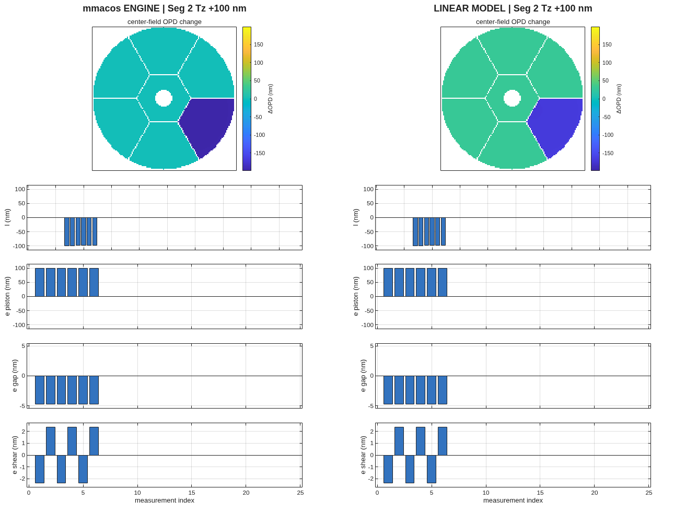
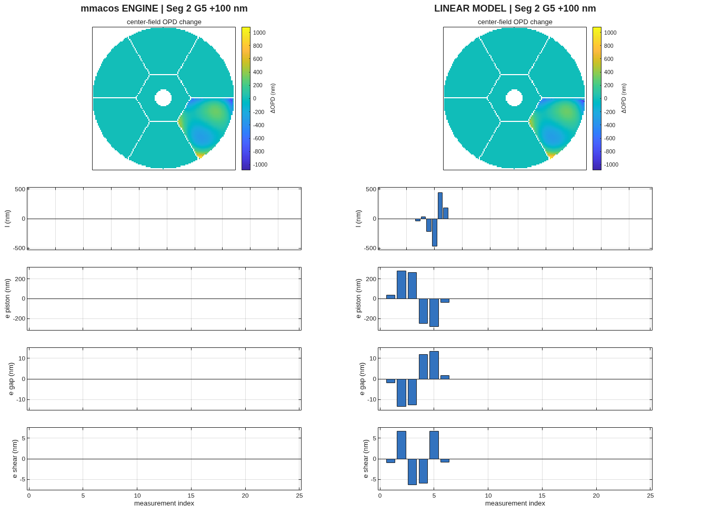
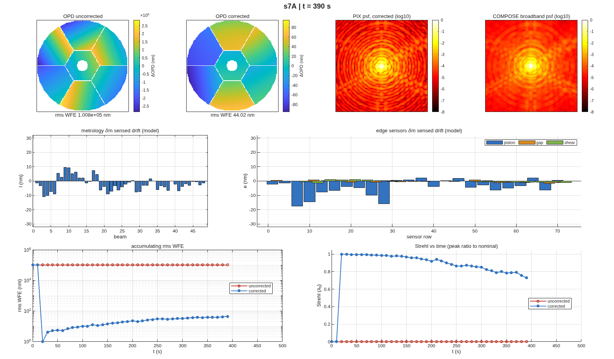
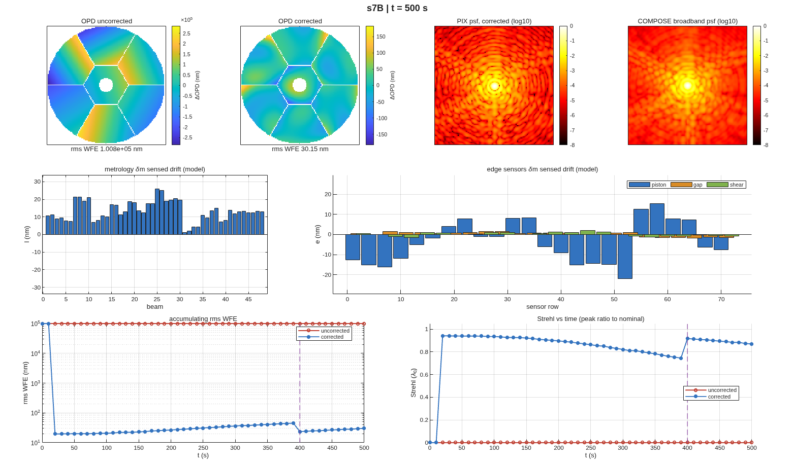

## SECTION 6: Closing the Loop

Sections 4 and 5 built a linear model of the telescope and its sensors. This section asks two
questions of it. Is the linear model the engine? Poke every degree of freedom in the engine, and
compare the response with the model's prediction. And does the loop built on it hold the wavefront?
Play a disturbance history through the engine, with wavefront control and the metrology loop
running, and watch the wavefront for 500 seconds.

### You ask

> Check the linear model against the engine, degree of freedom by degree of freedom, for the
> wavefront, the metrology and the edge sensors. Then simulate 500 s of drift with image-based
> wavefront control, the metrology loop holding pose, and a maintenance recontrol at 400 s: once
> with a metrology bias the loop cannot see, once with a figure drift it cannot sense.

### The assistant reads

- `MACOS_resources/mmacos/templates/80_end_to_end/e2e/README.md`, the `s6_compare.m` and
  `s7_simulate.m` rows -- what each pokes or plays, the two scenarios, and the two-pass rule: the
  engine runs the uncorrected and the corrected histories as two passes, because plus and minus the
  control do not commute through the engine's incremental perturbation path.
- `MACOS_resources/mmacos/design/runners/run_compare.m` and `run_simulator.m` -- the runners: the
  engine truth for each measurement, the estimator (a weighted least-squares pose estimate with a
  prior) and the controller.
- `MACOS_resources/mmacos/src/+macos/opd_ref.m`, its help text -- the OPD map's reference, the
  chief ray (the default since 2026-10-10) or the aperture mean. It decides what Section 6's first
  check measures (below).

### It runs: the linear model against the engine

The stage-6 script, unchanged, in the thread directory:

```matlab
run('<path-to>/mmacos/templates/80_end_to_end/e2e/s6_compare.m')
```

It pokes each of the %pin:ch06_x_pokes% rigid-body degrees of freedom by 100 nrad or 100 nm, each of
the 56 figure modes and each of the %pin:ch06_g_pokes% grid influence functions by 100 nm, and for
every poke draws the engine's response beside the model's: the center-field wavefront change, the
metrology beam lengths, and the edge sensors' piston, gap and shear. The report's header and its
summary (the per-poke table is in `s6_report.txt`):

<!-- transcript: ch06_compare -->



**FIGURE 15** One rigid-body poke, segment 2 piston +100 nm: the engine (left) and the linear model
(right). The segment's change is the same; the rest of the pupil differs by a constant.



**FIGURE 16** One grid poke, segment 2 influence function 5: the wavefront agrees in shape; the
engine's measurement bars read zero, because the engine holds the metrology and sensor points rigid
for figure states (the report says so), while the model shows what the figure-sensing model
predicts.

### Checking the assistant's work

The measurements agree to the noise of the comparison: the metrology beams to %pin:ch06_x_l% and the
edge sensors to %pin:ch06_x_e%, relative. The wavefront does not: the worst rigid-body poke reads
%pin:ch06_x_w%, the worst figure mode %pin:ch06_z_w%, relative, where the library's committed run of
this stage read a few parts in a thousand. The worst pokes are the center segment's, and Figure 15
shows the shape of the miss: a constant across the pupil.

The cause is the OPD reference, not the model. Since 2026-10-10 the engine references the OPD map
to the chief ray by default, and loading a prescription restores that default. The Section 4
harvest was taken with the map referenced to the aperture mean. This stage's engine side takes the
default. So a poke that moves the chief ray's own path, as the center segment's piston does, shifts
the engine's whole map by a constant that the linear column, mean-referenced, does not have.
Measured directly on this deck, one poke, segment 1 piston +100 nm, under each reference:

<!-- transcript: ch06_opdref -->

The engine under the chief-ray reference gives %pin:ch06_ref_chief_rms% nm rms, %pin:ch06_ref_chief_mean%
nm of it a constant; under the mean reference %pin:ch06_ref_mean_rms% nm; the linear column
%pin:ch06_ref_linear_rms% nm. About its mean, the engine's change is the model's in both. (The
`macos.modify()` after the perturb matters: without it the next trace reuses the cached geometry and
the change reads zero.) Which reference the harvest should use is an open question for the library (the
open questions list), and this manual prints the comparison as it runs. The lesson stands either
way: an engine-against-model check is only as good as the conventions both sides share.

The grid channel's miss, %pin:ch06_g_w%, has a second cause the report names in its note: the
engine's grid-surface response is not proportional across sub-micrometre amplitudes on a
metre-based prescription, an open engine question.

### It runs: the loop

The stage-7 script, unchanged. Its random draws are seeded (`rng(7)` in `s7_simulate.m`), so a
rerun from this page gives these numbers:

```matlab
run('<path-to>/mmacos/templates/80_end_to_end/e2e/s7_simulate.m')
```

Both scenarios start from the as-deployed telescope, about 100 µm of wavefront error, mostly
segment piston and tilt; image-based wavefront control comes on at 20 s, the metrology loop holds
pose from then on, and a wavefront-maintenance recontrol runs at 400 s. Scenario A, the metrology
bias: the metrology's zero point drifts, so the loop faithfully holds a biased reading while the
true pose walks away, unseen.

<!-- transcript: ch06_simA -->



**FIGURE 17** Scenario A at 390 s, just before the recontrol: the uncorrected and corrected
wavefronts, the corrected point-spread functions (monochromatic and broadband), the sensed drift of
the metrology and the edge sensors, and the history of the wavefront error and the Strehl ratio.

The corrected wavefront drifts to %pin:ch06_a_corr_390% nm by 390 s; the recontrol at 400 s takes
it to %pin:ch06_a_corr_400% nm, and it re-accumulates to %pin:ch06_a_corr_500% nm by 500 s.
Scenario B, a figure drift: each segment's focus and astigmatism trend, the low-order modes that
drift thermally, while the truss reads only rigid pose.

<!-- transcript: ch06_simB -->



**FIGURE 18** Scenario B at 500 s, the same panels; the dashed line marks the recontrol.

The figure accumulates unseen to %pin:ch06_b_corr_390% nm; the recontrol, with a tight ridge that
engages the segments' lateral motions (a decentered segment on a curved parent changes its own
best-fit radius), removes the focus and part of the astigmatism, to %pin:ch06_b_corr_400% nm. What
is left, the higher orders and the static grid figure, no rigid-body control removes; it reads
%pin:ch06_b_corr_500% nm at 500 s. (The broadband Strehl ratio can read slightly above 1: it is a
peak ratio against a nominal image, not the exact aperture form.)

### What to ask next

- *"Rerun the comparison with both sides on the same reference."* -- the reference is a session
  setting (`macos.opd_ref`); which one the harvest uses is the open question above.
- *"Give the loop the figure states."* -- the README's next step: a steady-state Kalman form with
  the figure-sensing matrices of Section 6 in the estimator.
- *"What does all this cost in the error budget?"* -- Section 7.
