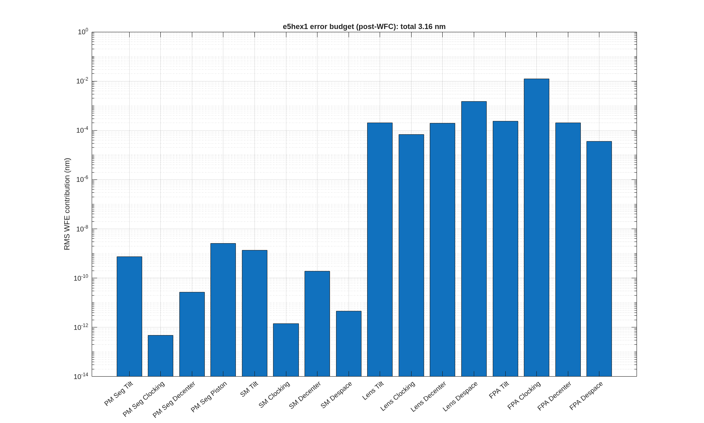

## SECTION 7: An Error Budget

The last product of the design is not an optic; it is a table that systems engineering can carry:
every error source, its allowed size, how much wavefront it costs, and the total against the
requirement. With linear sensitivities in hand, that table is a covariance calculation (Redding
2014, *Optical error budgeting using linearized ray-trace models*). A properly formed RSS budget is
a covariance analysis, and a Monte-Carlo of the same model gives the same answer.

This section steps off the thread. The e2e flow has no budget stage, and a budget for it needs its
group table, one allowed sigma per error line, which is a design decision rather than a computation
(the open questions list asks for it). The library's worked budget is on `e5hex1.in`, a public
seven-segment hex telescope, the same class as the thread's pie, budgeted after wavefront control
with the seven segments and the secondary as the actuators.

### You ask

> Build the error budget for the seven-segment telescope after wavefront control: alignment errors
> on every optic, the segments and the secondary controlled, 3 nm of sensing noise, 1 nm of
> actuator noise. Give me the covariance total, a Monte-Carlo check, and a workbook the systems
> engineer can edit.

### The assistant reads

- `MACOS_resources/mmacos/templates/50_sensitivities/e5hex1_budget/README.md` -- the method, the
  group table as the interface, the WFC stage (which rows a controller removes, and the two kinds of
  rows it adds: sensing error and actuator noise), and the live-formula workbook.
- `MACOS_resources/mmacos/design/runners/run_budget.m`, its help text -- the stage runner: the
  options for the controlled budget and for the metrology stage, the artefacts.
- `budget_spec_e5hex1.m` -- the group table itself, printed below.

### It runs

The budget's inputs are one file, the group table, with the controller's noise inputs at its end:

<!-- transcript: ch07_spec -->

Every row names elements, a degree-of-freedom type, a distribution and its size. The `Control`
column tags the rows the controller acts on. The actuator noise for a rotation is stated as 1 nm of
motion at the optic's edge, converted to an angle by its radius in the file.

The template's runner, unchanged, harvests the rigid-body sensitivities (`macos.dw_dx_multi`, five
field points, model size 128) and calls `run_budget`. It writes its products beside itself, among
them the committed workbook, so the manual runs a copy of the template's folder: the library's
files were checked by checksum before and after and are untouched.

```matlab
run('<path-to>/mmacos/templates/50_sensitivities/e5hex1_budget/run_budget_e5hex1.m')
```

The report:

<!-- transcript: ch07_report -->

The controlled rows (the segments and the secondary) are gone after control; what is left of them is
a projection residual at the floor of the arithmetic, printed as a bound. The lens and the detector
are not controlled, and their alignment errors pass through, small here because their sensitivities
are small. The total, %pin:ch07_post% nm against %pin:ch07_pre% nm before control, is the cost of
control itself: the actuator rows (segment piston %pin:ch07_pm_seg_piston_actuator% nm, segment tilt
%pin:ch07_pm_seg_tilt_actuator% nm, secondary tilt %pin:ch07_sm_tilt_actuator% nm) and the sensing
error (%pin:ch07_wfs_sensing_error% nm, the part of 3 nm of white noise the controller can see).



**FIGURE 19** The per-group chart the runner draws (`e5hex1_budget.png`). It shows the alignment
groups only: the actuator and sensing rows, which make up the 3.16 nm in its title, are not in it,
and the controlled groups' bars are the projection residuals, numerical zeros (the report prints
them as `< 1e-06`).

The budget a systems engineer uses is the workbook the runner writes beside the report,
`e5hex1_wfe_budget.xlsx`, in the form of the HabEx budget: white cells are inputs (the sigmas),
gray cells formulas, so a changed sigma re-rolls the payload total without MATLAB. Its README
records that LibreOffice's recalculated total matches the MATLAB total to 5.6e-16.

### Checking the assistant's work

The check is built in: the Monte-Carlo line. %pin:ch07_mc_draws% draws of every error source, each
put through the same controller with sensing and actuator noise drawn in the loop, give
%pin:ch07_mc% nm against the covariance's %pin:ch07_post% nm. They are the same model computed two
ways; an assistant that changed the controller in one and not the other would see them part.

A second check is the units of the rotation rows: the actuator sigma for segment tilt is
1 nm / 1510.73 mm = 0.662 nrad, and the file shows the arithmetic. A budget whose rotation inputs
had been typed in degrees, or per millimetre, would be off by orders of magnitude, and the table
would say so line by line.

### What to ask next

- *"Budget the thread's telescope."* -- `run_budget` takes any sensitivities artefact: the
  `s4_sens.mat` of Section 4 and a group table for e2e (`macos.budget.suggest_groups` proposes a
  skeleton, with placeholder sigmas to replace).
- *"Add the metrology stage."* -- `run_budget(..., 'met', ...)` with the drift table and the
  metrology Jacobian of Section 5 (`macos.budget.project_met`) fills the workbook's drift columns.
- *"Change a sigma."* -- in the workbook, no MATLAB.
