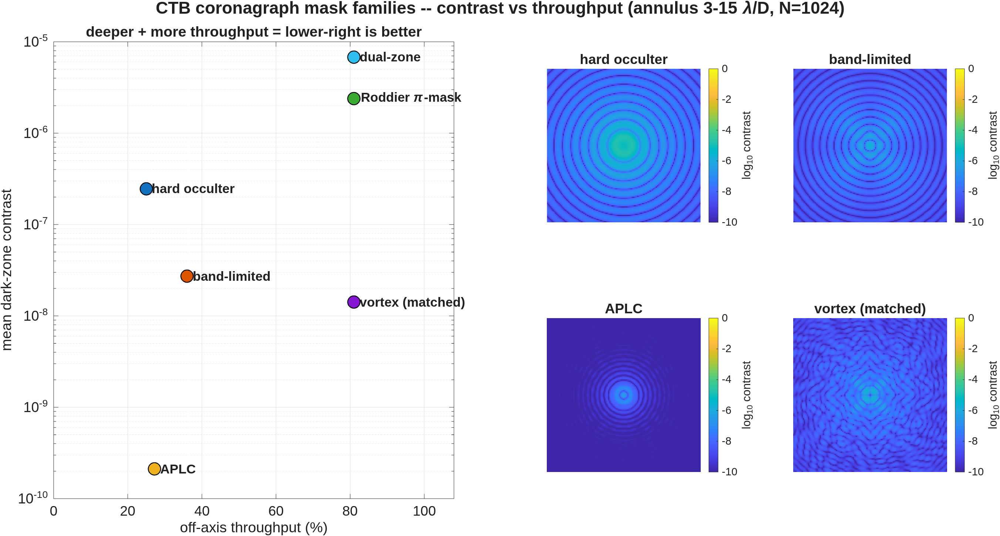
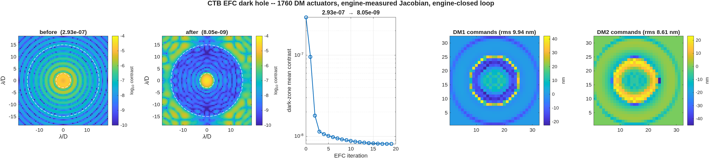
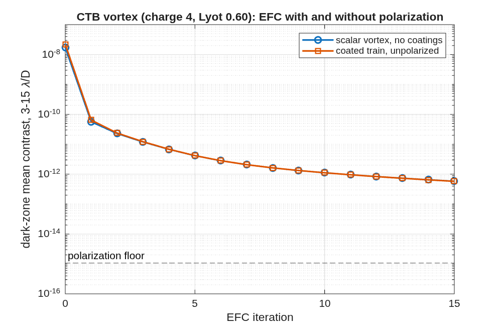

## SECTION 8: Coronagraph Analyses on the CTB

Section 2 put the coronagraph testbed, the CTB, behind the thread's telescope and checked that the
beam gets through it. This section asks what the coronagraph does with the light: how dark a
focal-plane mask makes the region around the star on its own, how much darker the two deformable
mirrors make it under control, and what the mirrors' coatings cost through polarization. Each
answer is a template in `templates/30_instruments/bench_ctb`, run unchanged on a scratch copy.

These analyses run on the CTB's own diffraction model: the bench fed by its own point source, from
the committed decks `ctb_dcr.in` and `ctb_dm.in` (the reference spheres as committed). The library
has no diffraction model of the telescope and the CTB together yet; the open questions list says so.

### You ask

> On the CTB, show me how dark each coronagraph mask gets on its own, then dig a dark hole with the
> two deformable mirrors, and tell me what the mirror coatings' polarization costs.

### The assistant reads

- `templates/30_instruments/bench_ctb/README.md`, the "Diffraction layer" and "DM layer" parts --
  how the field is carried from the source to the detector, why masks are applied in MATLAB and not
  declared in the deck, and the one trap in the control loop (below).
- `ctb_mask_compare.m`, its help text -- the six mask families, scored on the same deck, grid,
  dark zone and normalization.
- `ctb_dm_jacobian.m` and `ctb_efc.m`, their help texts -- the sensitivity matrix measured through
  the engine, and the control loop that uses it.
- `ctb_efc_physics.m`, its help text -- how the coatings' polarization enters as pupil screens.
- `MACOS_resources/optical_design/CORONAGRAPH_DESIGN_RULES.md` -- the coronagraph rules.

### The dark zone before control

A coronagraph is scored by its contrast: the light left in a region near the star, the dark zone,
as a fraction of the star's peak without the coronagraph. Here the dark zone is the ring from 3 to
15 λ/D around the star. `ctb_mask_compare` puts six published focal-plane masks on the same bench
and scores them the same way:

<!-- transcript: ch08_masks_run -->

**FIGURE 21** The six mask families on the CTB (`ctb_mask_compare`): dark-zone contrast against
off-axis throughput, lower right is better, and the detector image for four of them (log contrast).

Two numbers describe each mask, and they trade against each other. The contrast is how dark the
ring is; the throughput is how much of a planet's light gets through the masks. The simple
opaque spot, the hard occulter, reaches %pin:ch08_dz_hard% at %pin:ch08_th_hard% throughput. The
apodized pupil Lyot coronagraph (APLC) is the darkest, %pin:ch08_dz_aplc%, at
%pin:ch08_th_aplc%. The charge-6 vortex keeps %pin:ch08_th_vortex% of the planet at
%pin:ch08_dz_vortex%. The two phase masks, the Roddier π-mask and the dual-zone mask, pass as much
light as the vortex but leave the ring two decades or more brighter. The throughput column is a first-order
proxy (the area of the Lyot stop, times the apodizer's fill), good for ranking and not for a
photometric budget.

### Closing the loop

No mask on a real bench reaches its design contrast: the optics' errors scatter starlight into the
ring. The two deformable mirrors (DMs) correct that, by electric-field conjugation (EFC). Each
actuator of each DM is poked once through the full chain, masks and all, and the change in the
complex field on the dark-zone pixels is recorded. That sensitivity matrix, the Jacobian, then
gives the DM commands that cancel the field. The run uses the hard occulter, and measures the
Jacobian first (the copy carries none: the 37 MB file is not committed):

<!-- transcript: ch08_efc_run -->

**FIGURE 22** The EFC dark hole (`ctb_efc`): the detector before and after, log contrast with the
dark zone's edges dashed; the contrast at each iteration; and the commands on the two DMs.

%pin:ch08_efc_nact% actuators on the two DMs dig the ring from %pin:ch08_efc_before% to
%pin:ch08_efc_after%, %pin:ch08_efc_gain% times darker, in %pin:ch08_efc_iter% iterations. The
loop stops itself when no regularization makes the measured contrast better. The strokes it
needs are small: %pin:ch08_efc_s1% rms on DM1 and %pin:ch08_efc_s2% on DM2. The commands in the
figure concentrate in a ring: with a Lyot stop at half the pupil, a ripple across the full beam lands
in the dark zone at half its spatial frequency, so the 32-actuator mirrors control cleanly only
to about 8 λ/D.

The condition number in the first line, about 1e15, says that some combinations of actuators move
nothing in the dark zone. The regularization, line-searched at every iteration, keeps the solve
away from them. The loop reads the complex field straight from the engine: it assumes perfect
sensing (below).

### What polarization costs

Every reflection off a coated mirror treats the two polarizations slightly differently. The CTB's
ten reflectors are protected aluminium, and `ctb_efc_physics` computes their combined effect at
the exit pupil (`macos.jones_pupil`) and applies it as four pupil screens, one per component of the
Jones matrix, for unpolarized light. One DM setting serves all four components, so what it
cannot cancel is the spread between them. The run is the vortex chain (charge 4, Lyot stop at 0.60
of the pupil), twice: without the coatings, and with them:

<!-- transcript: ch08_pol_run -->

**FIGURE 23** EFC on the CTB vortex with and without the coatings' polarization (this chapter's
driver plots the two runs); the dashed line is the polarization floor.

The coatings make the starting point worse, %pin:ch08_pol_before% against %pin:ch08_vx_before%
without them: they add a small, smooth aberration that is nearly the same for both polarizations, and
the DMs remove it like any other. After the loop's 15 iterations the two runs reach the same
depth, %pin:ch08_pol_after%, with the coatings or without them, and neither
has stopped improving. What the DMs cannot reach is the polarization floor, %pin:ch08_pol_floor%,
about five hundred times below the depth reached here. On this bench polarization does not limit
the contrast. The CTB folds gently, every mirror at 5° incidence, and its coatings change little
between the polarizations. The floor would rise with steeper folds, which is one reason the fold
that puts the CTB in the telescope's shroud (Section 2) must keep every incidence angle under 15°.

### Sensing

The control loop above reads the complex field directly from the model. A real bench sees only
intensity, and estimates the field by applying small probe commands to a DM and differencing the
images (pairwise probing). That estimator is not in the library today; adding it is a question for
Dave, not something this chapter can run.

What the library does have is the other kind of sensing: measuring the DM's own surface. The gauge
benches of Section 9 do that, each a template run unchanged there, most of them on a 96 × 96
actuator DM: a polarization phase-shifting Twyman-Green (`tg_psi_dm96`, and `tg_psi_dm` at bench
scale), a Zernike wavefront sensor (`zwfs_dm96`), point-diffraction gauges (`pdi_dm96`) and a
heterodyne camera interferometer (`cophi_dm96`).

### Checking the assistant's work

The hard occulter appears twice in this section, scored at two grid sizes: %pin:ch08_dz_hard% on
the comparison's 1024 grid and %pin:ch08_efc_before% at the start of the loop on 512. They are the
same mask on the same optics (`ctb_dcr.in`, and `ctb_dm.in` with its DMs flat), sampled
differently. A loop that started far from the static number would mean the Jacobian was measured
on a different chain. The physics and study drivers (`ctb_efc_physics`, `ctb_study`) refuse a
cached Jacobian whose stored chain configuration differs from the one requested (`ctb_jac_check`);
`ctb_efc` reads its cache by file name without that check, so after changing a mask, delete the
cache or pass the new Jacobian.

The control trap the README records is the one to know about: DM commands are real numbers, and a
complex least-squares solve returns complex commands, which pass MATLAB's type check while the
interface silently drops their imaginary part. The loop then crawls. `ctb_efc` solves the real
and imaginary parts as one stacked real system, and `ctb_dm.apply` refuses complex commands.

### What to ask next

- *"Re-measure the Jacobian at the dug state and continue."* -- `ctb_efc('a0', ...)`, the
  relinearization; the README gives its depth.
- *"Repeat the loop over a 10 % band."* -- `ctb_efc_physics('band', true)`.
- *"Run the whole study for another vortex charge or Lyot stop."* -- `ctb_study('charge', 6,
  'r_lyot_frac', 0.70)`, the 25-step study from one configuration.
- *"Do this on the telescope with the CTB behind it."* -- not yet: the coupled system needs a
  diffraction model (Dave's call).
