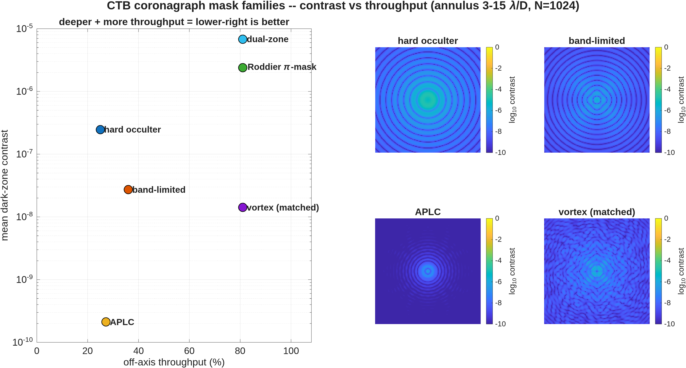
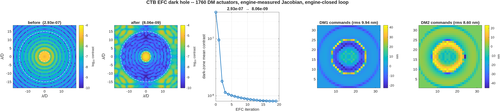
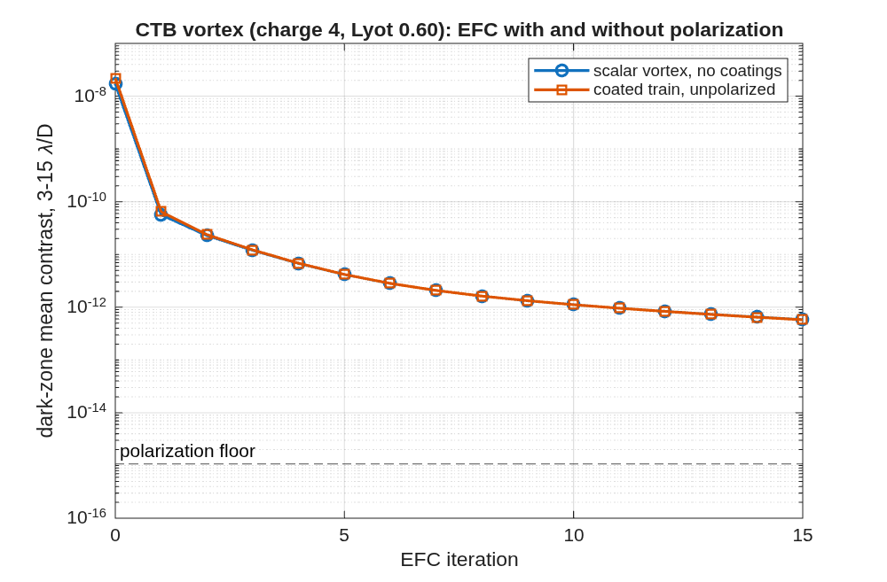
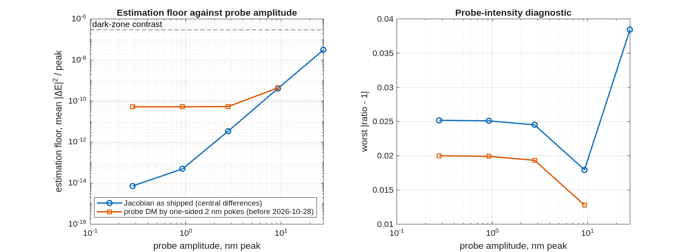
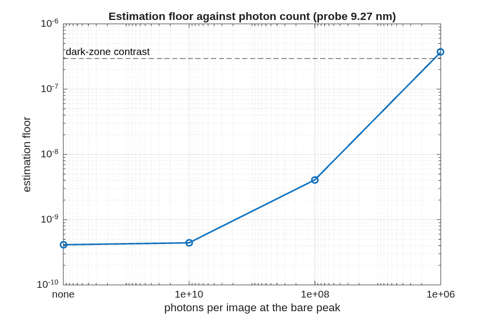
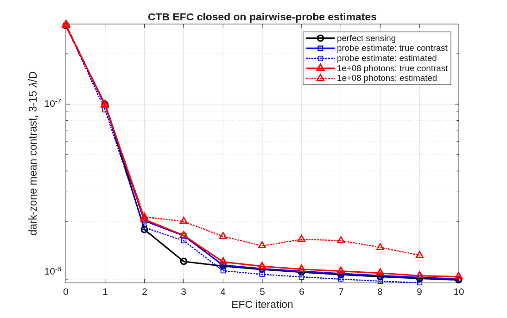
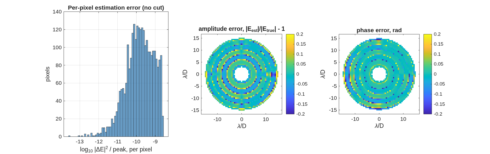
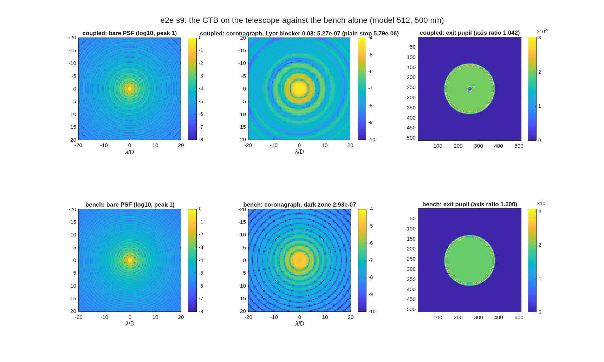
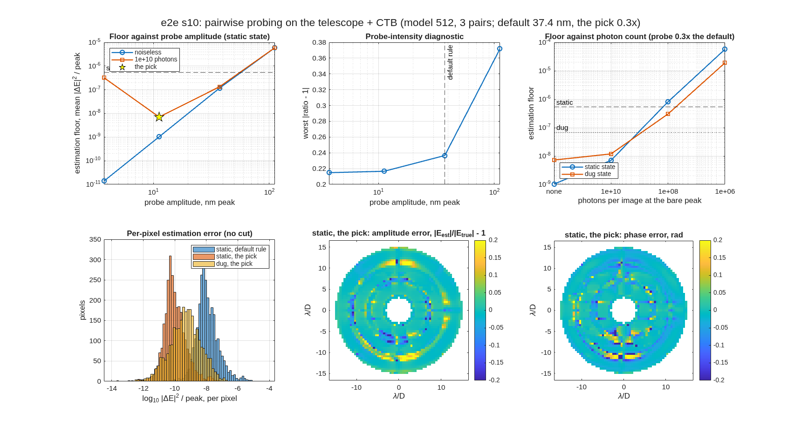
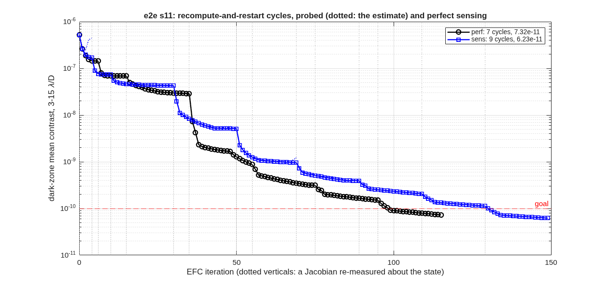

## SECTION 8: Coronagraph Analyses on the CTB

Section 2 put the coronagraph testbed, the CTB, behind the thread's telescope and checked that the
beam gets through it. This section asks what the coronagraph does with the light: how dark a
focal-plane mask makes the region around the star on its own, how much darker the two deformable
mirrors make it under control, what the mirrors' coatings cost through polarization, and how well
the field can be sensed from images alone, as a lab must. Each
answer is a template in `templates/30_instruments/bench_ctb`, run unchanged on a scratch copy.

These analyses run first on the CTB's own diffraction model: the bench fed by its own point source,
from the committed decks `ctb_dcr.in` and `ctb_dm.in` (the reference spheres as committed). The last
part of the section runs the same chain, control matrix and loop on the thread's telescope with the
CTB folded behind it, the thread's stages 9 to 11.

### You ask

> On the CTB, show me how dark each coronagraph mask gets on its own, then dig a dark hole with the
> two deformable mirrors, and tell me what the mirror coatings' polarization costs. Then close the
> loop on fields estimated from probe images instead of the model's. Then put the CTB behind the
> thread's telescope and do it all again there, down to 10⁻⁸.

### The assistant reads

- `templates/30_instruments/bench_ctb/README.md`, the "Diffraction layer" and "DM layer" parts --
  how the field is carried from the source to the detector, why masks are applied in MATLAB and not
  declared in the deck, and the one trap in the control loop (below).
- `ctb_mask_compare.m`, its help text -- the six mask families, scored on the same deck, grid,
  dark zone and normalization.
- `ctb_dm_jacobian.m` and `ctb_efc.m`, their help texts -- the sensitivity matrix measured through
  the engine, and the control loop that uses it.
- `ctb_efc_physics.m`, its help text -- how the coatings' polarization enters as pupil screens.
- `ctb_probe_estimate.m`, its help text -- the pairwise-probe estimator, and `ctb_efc`'s
  `'sensing'` option that closes the loop on it.
- `MACOS_resources/optical_design/CORONAGRAPH_DESIGN_RULES.md` -- the coronagraph rules.
- `templates/80_end_to_end/e2e/README.md`, the rows for stages 9 to 11 -- the coupled model, probing
  on it, and the recompute-and-restart cycles.

### The dark zone before control

A coronagraph is scored by its contrast: the light left in a region near the star, the dark zone,
as a fraction of the star's peak without the coronagraph. Here the dark zone is the ring from 3 to
15 λ/D around the star. `ctb_mask_compare` puts six published focal-plane masks on the same bench
and scores them the same way:

<!-- transcript: ch08_masks_run -->

**FIGURE 21** The six mask families on the CTB (`ctb_mask_compare`): dark-zone contrast against
off-axis throughput, lower right is better, and the detector image for four of them (log contrast).

Two numbers describe each mask, and they trade against each other. The contrast is how dark the
ring is; the throughput is how much of a planet's light gets through the masks. The simple
opaque spot, the hard occulter, reaches %pin:ch08_dz_hard% at %pin:ch08_th_hard% throughput. The
apodized pupil Lyot coronagraph (APLC) is the darkest, %pin:ch08_dz_aplc%, at
%pin:ch08_th_aplc%. The charge-6 vortex keeps %pin:ch08_th_vortex% of the planet at
%pin:ch08_dz_vortex%. The two phase masks, the Roddier π-mask and the dual-zone mask, pass as much
light as the vortex but leave the ring two decades or more brighter. The throughput column is a first-order
proxy (the area of the Lyot stop, times the apodizer's fill), good for ranking and not for a
photometric budget.

### Closing the loop

No mask on a real bench reaches its design contrast: the optics' errors scatter starlight into the
ring. The two deformable mirrors (DMs) correct that, by electric-field conjugation (EFC). Each
actuator of each DM is poked up and down through the full chain, masks and all, and the change in
the complex field on the dark-zone pixels is recorded (a central difference: half the difference
over the poke). That sensitivity matrix, the Jacobian, then
gives the DM commands that cancel the field. The run uses the hard occulter, and measures the
Jacobian first (the copy carries none: the 37 MB file is not committed):

<!-- transcript: ch08_efc_run -->

**FIGURE 22** The EFC dark hole (`ctb_efc`): the detector before and after, log contrast with the
dark zone's edges dashed; the contrast at each iteration; and the commands on the two DMs.

%pin:ch08_efc_nact% actuators on the two DMs dig the ring from %pin:ch08_efc_before% to
%pin:ch08_efc_after%, %pin:ch08_efc_gain% times darker, in %pin:ch08_efc_iter% iterations. The
loop stops itself when no regularization makes the measured contrast better. The strokes it
needs are small: %pin:ch08_efc_s1% rms on DM1 and %pin:ch08_efc_s2% on DM2. The commands in the
figure concentrate in a ring: with a Lyot stop at half the pupil, a ripple across the full beam lands
in the dark zone at half its spatial frequency, so the 32-actuator mirrors control cleanly only
to about 8 λ/D.

The condition number in the first line, about 1e15, says that some combinations of actuators move
nothing in the dark zone. The regularization, line-searched at every iteration, keeps the solve
away from them. The loop reads the complex field straight from the engine: it assumes perfect
sensing (below).

### What polarization costs

Every reflection off a coated mirror treats the two polarizations slightly differently. The CTB's
ten reflectors are protected aluminium, and `ctb_efc_physics` computes their combined effect at
the exit pupil (`macos.jones_pupil`) and applies it as four pupil screens, one per component of the
Jones matrix, for unpolarized light. One DM setting serves all four components, so what it
cannot cancel is the spread between them. The run is the vortex chain (charge 4, Lyot stop at 0.60
of the pupil), twice: without the coatings, and with them:

<!-- transcript: ch08_pol_run -->

**FIGURE 23** EFC on the CTB vortex with and without the coatings' polarization (this chapter's
driver plots the two runs); the dashed line is the polarization floor.

The coatings make the starting point worse, %pin:ch08_pol_before% against %pin:ch08_vx_before%
without them: they add a small, smooth aberration that is nearly the same for both polarizations, and
the DMs remove it like any other. After the loop's 15 iterations the two runs reach the same
depth, %pin:ch08_pol_after%, with the coatings or without them, and neither
has stopped improving. What the DMs cannot reach is the polarization floor, %pin:ch08_pol_floor%,
about five hundred times below the depth reached here. On this bench polarization does not limit
the contrast. The CTB folds gently, every mirror at 5° incidence, and its coatings change little
between the polarizations. The floor would rise with steeper folds, which is one reason the fold
that puts the CTB in the telescope's shroud (Section 2) must keep every incidence angle under 15°.

### Sensing

The control loop above reads the complex field directly from the model. A real bench sees only
intensity. It estimates the field by pairwise probing (Give'on, Kern and Shaklan, 2011): it puts a
small known pattern on a DM, takes the image with the pattern added and with it subtracted, and
does this for three patterns. Each difference of a pair is linear in the unknown field, with the
Jacobian's prediction of the probe's own field as the coefficient, so three pairs give every
dark-zone pixel three equations for two unknowns, the field's real and imaginary parts.
`ctb_probe_estimate` does this through the full masked chain and reads the engine's true field only
to score the estimate. `ctb_efc('sensing', ...)` closes the loop on the estimate; its default stays
perfect sensing. The run measures the Jacobian, estimates the field at the flat DMs, sweeps the
probe amplitude and the photon count, repeats the sweep with the probe DM's columns built the
pre-2026-10-28 way (one-sided pokes) for comparison, and then runs ten EFC iterations three ways:

<!-- transcript: ch08_probe_run -->

At the default amplitude, %pin:ch08_probe_nm% peak, the probes are as bright as the speckle. The
estimate is off by %pin:ch08_probe_floor% of the peak, %pin:ch08_probe_rel% of the field, against a
dark zone of %pin:ch08_efc_before%.

**FIGURE 24** Estimation floor and the probe-intensity diagnostic against probe amplitude
(this chapter's driver plots the sweep), with the Jacobian as shipped (central differences) and
with the probe DM's columns from one-sided pokes.

Figure 24 has the main lesson. Large probes fail as the DM's response stops being linear: at three
times the default the error is a third of the field. Small probes reach %pin:ch08_probe_lin_rel%
with the Jacobian as `ctb_dm_jacobian` measures it, central differences at 2 nm. That residual is
the Jacobian's own. One-sided pokes, the method before 2026-10-28, differ from the derivative by up
to %pin:ch08_probe_bias%, and the small-probe error then levels off at %pin:ch08_probe_os_rel%: the
Jacobian's bias, not the probes, sets it. The default amplitude sits at the knee, where the
probe's second-order response is about a tenth of its linear one.

The diagnostic ratio, the probes' measured intensity over the Jacobian's prediction, stays within
%pin:ch08_probe_ratio% of 1 at the default and swings off it only for the largest probe. It does
not reveal the one-sided Jacobian's bias, and with the central-difference Jacobian it reads about
1.02 at every small amplitude. The probe's second-order field adds to the image in proportion to the
probe intensity itself, so the ratio has a floor of its own. Treat a ratio within a few percent of
1 as a sign of no gross mismatch, not as a measure of the estimate's error.

**FIGURE 25** Estimation floor against photons per image at the bare peak, default probes.

Photon noise matters below about 1e10 photons per image at the bare peak. At 1e8 the floor is
%pin:ch08_probe_ph8%; at 1e6 it is %pin:ch08_probe_ph6%, larger than the dark zone itself.

**FIGURE 26** EFC closed on probe estimates: the true contrast (solid) and the controller's estimate
(dotted) for noiseless probes and for 1e8 photons, against perfect sensing. The estimate is taken
before each iteration, so the estimated curves end one step before the true ones.

Closed on the noiseless estimate, ten iterations reach %pin:ch08_probe_efcE%, against
%pin:ch08_probe_efcT% with perfect sensing. With 1e8 photons per image they reach
%pin:ch08_probe_efcP%. The line search still scores each step on the measured contrast, so an
estimate that is wrong costs depth, never stability. With noise, the estimated contrast sits above
the true one: the noise adds its own power to the estimate.

**FIGURE 27** The default estimate, pixel by pixel: the error's histogram with no pixel cut, and
the amplitude and phase errors over the dark zone.

The error maps carry the coronagraph's ring structure. The relative errors are largest where the
true field is weakest, between the rings of the occulter's diffraction.

What the library also has is the other kind of sensing: measuring the DM's own surface. The gauge
benches of Section 9 do that, each a template run unchanged there, most of them on a 96 × 96
actuator DM: a polarization phase-shifting Twyman-Green (`tg_psi_dm96`, and `tg_psi_dm` at bench
scale), a Zernike wavefront sensor (`zwfs_dm96`), point-diffraction gauges (`pdi_dm96`) and a
heterodyne camera interferometer (`cophi_dm96`).

### The coronagraph on the telescope

Section 2 folded the CTB behind the thread's telescope. The thread's stages 9 to 11
(`templates/80_end_to_end/e2e`: `s9_diffraction.m`, `s10_sensing.m`, `s11_cycles.m`) put this
section's diffraction model behind it and run the same chain, control matrix and loop there. The
three stages cost about eight hours, most of it six control matrices of 3520 chain runs each, so this
page reads their products instead of running them; the driver says how to refresh it.

<!-- transcript: ch08_tel_run -->

**The coupled model.** The CTB's generator inserts its three mask quartets, the DM leg and the
far-field terminal behind the nine telescope elements of the folded train; the chief ray at every
optic is within 10⁻¹³ mm of the bare train, and the point image lands on the centre pixel. With the
bench's plain Lyot disk the static dark zone is %pin:ch08_tel_static%, twenty times the bench's own
%pin:ch08_tel_bench%. It is not the wavefront: the pupil carries %pin:ch08_tel_wfe% waves rms, and
flattening it with DM1 changes the dark zone by nothing. It is the secondary's shadow,
%pin:ch08_tel_shadow% of the pupil area, whose diffraction the occulter throws into the Lyot plane
around the shadow's image, where a plain disk passes it; the same deck without the obscuration sits
at %pin:ch08_tel_noobs%, below the bench. A central blocker of %pin:ch08_tel_blocker% pupil radii in
the Lyot stop covers the shadow's image: %pin:ch08_tel_lyot% at %pin:ch08_tel_thr% of the stop's
throughput, the best of the scan in the listing (a larger blocker's own edge diffracts). The model's
limit is on record: the telescope's beam is %pin:ch08_tel_anam% anamorphic and the engine carries the
field on the ray lattice with one spacing, so the model's point image is round; scaling the occulter
over that ratio moves the static number between the bracket's ends in the listing.

**FIGURE 28** The telescope (top) against the bench alone (bottom): the bare point image, the
coronagraph image over 3-15 λ/D, and the exit pupil with the secondary's shadow (`s9_diffraction`).

The loop runs as on the bench, given the deck and its station map. The control matrix measured at
the flat mirrors digs %pin:ch08_tel_lyot% to %pin:ch08_tel_efc0% in %pin:ch08_tel_efc0_it%
iterations; measured again about that state, to %pin:ch08_tel_efc1% in %pin:ch08_tel_efc1_it% more:
%pin:ch08_tel_gain9% times, where the bench alone digs %pin:ch08_efc_gain%. What remains is the
shadow's diffraction outside the blocker, an amplitude hole at the pupil's centre that the mirrors
fill only with strokes past their linear range; the step the bench's regularization grid proposes
overshoots on this brighter halo, so the loop takes smaller steps.

**Sensing the field on it.** Stage 10 closes the loop on pairwise-probe estimates, as on the bench
above, and finds three things the bench did not show. The estimator's default amplitude, probe
intensity equal to the speckle level, is a %pin:ch08_tel_def_nm% probe (%pin:ch08_tel_def_rad% of
wavefront phase) on the shadow's halo, and its second-order response leaves the estimate
%pin:ch08_tel_def_rel% off the field; the error falls as the amplitude squared, and 0.3 times the
default (%pin:ch08_tel_pick_nm%; `ctb_probe_estimate`'s `'probe_rel'`) brings it to
%pin:ch08_tel_pick_rel%, the smallest probe tried to %pin:ch08_tel_lin_rel%. The probe-intensity
ratio reads %pin:ch08_tel_ratio% above 1 at every amplitude there: the probe's second-order field
projected on the halo, which the pairwise difference cancels and the sum keeps, so on a bright halo
the ratio flags a gross mismatch and does not meter the control matrix. And the estimate needs a
matrix measured about the current state: at the dug state of the previous paragraph the flat-state
matrix estimates the field %pin:ch08_tel_dug_rel% off, the matrix about its own point
%pin:ch08_tel_ctl_rel%. The loop closed on the estimate with the matrix held fixed stalls after
three iterations at %pin:ch08_tel_sefc0%, against perfect sensing's %pin:ch08_tel_efc0%; re-measured
on the estimate it reaches %pin:ch08_tel_sefc1% against %pin:ch08_tel_efc1%. The line search still
scores the measured contrast, so a wrong estimate costs depth, never stability. With 10¹⁰ photons
per image at the bare peak the pick's error is %pin:ch08_tel_ph10_rel%; with 10⁸ the floor is
%pin:ch08_tel_ph8_floor%, above the dark zone itself.

**FIGURE 29** Pairwise probing on the telescope (`s10_sensing`): the estimation floor against probe
amplitude, noiseless and at 10¹⁰ photons; the probe-intensity diagnostic; the floor against photon
count at the static and dug states; the per-pixel error with no cut; the amplitude and phase error
maps at the pick.

**Recompute-and-restart cycles.** Stage 11 does what a testbed does: measure the control matrix
about the loop's own state, run the loop until it stalls, measure again from where it ended, and
repeat until the dark zone reaches a goal, here %pin:ch08_tel_goal% (`e2e_cycles`, resumable from
a state file; each matrix about %pin:ch08_tel_jac_min% minutes here). With perfect sensing the goal
takes %pin:ch08_tel_perf_nc% cycles and %pin:ch08_tel_perf_it% iterations, ending at
%pin:ch08_tel_perf_end%; the gains are uneven, one cycle alone covering more than a decade (the
transcript below), the last %pin:ch08_tel_perf_last% times. On probe estimates it takes
%pin:ch08_tel_sens_nc% cycles and %pin:ch08_tel_sens_it% iterations, ending at
%pin:ch08_tel_sens_end%: two cycles more than perfect sensing, the stage's allowance. Below 10⁻⁹
every cycle of either chain runs to its twenty-iteration cap gaining about twice, so the last decade
costs cycles, not sensing. Strokes stay under %pin:ch08_tel_stroke% rms on both mirrors.

<!-- transcript: ch08_tel_cycles -->

**FIGURE 30** The cycles (`s11_cycles`): dark-zone contrast against iteration for the probed loop
(squares; dotted, its own estimate) and for perfect sensing (circles); each dotted vertical is a
control matrix re-measured about the state; the goal dashed.

The estimate at each fresh matrix is within %pin:ch08_tel_est_max3% of the field, that at the
first cycle on the matrix measured at the flat mirrors, and under one per cent at every matrix
measured about the loop's own state, %pin:ch08_tel_est_last% at the last from
%pin:ch08_tel_sens_c3% (the transcript's last column): the estimate improves as the field dims,
as the probe's second-order term predicts.

These records are measured with the mirrors' grids interpolated with continuous slope
(`GridSrfOrder= 3` in each mirror's block; the emitter's `'order', 3`, the thread's
`P.grid_order`). The stage's first run, on the engine's bilinear default, reached a 10⁻⁸ goal in five
cycles but its estimate at the fifth matrix was 17% off the field, and the cause was run down to the
engine, not the estimator: the deformable mirrors are grid surfaces, and between its nodes a bilinear
grid has a continuous height but not a continuous slope, so a ray whose footprint on the second
mirror crosses a cell edge under a sub-nanometre change of the first takes the two cells' slope
difference as a kink and steps its path by tens of nanometres. The continuous-slope interpolation
removes it (at that same state the estimate went from 17% to 0.3%), the stage records were
re-measured on it, and the bilinear surface stays the engine's default for every other deck.

### Checking the assistant's work

The hard occulter appears twice in this section, scored at two grid sizes: %pin:ch08_dz_hard% on
the comparison's 1024 grid and %pin:ch08_efc_before% at the start of the loop on 512. They are the
same mask on the same optics (`ctb_dcr.in`, and `ctb_dm.in` with its DMs flat), sampled
differently. A loop that started far from the static number would mean the Jacobian was measured
on a different chain, and the drivers refuse such a cache. `ctb_efc_physics` and `ctb_study`
refuse a cached Jacobian whose stored chain configuration differs from the one requested
(`ctb_jac_check:mismatch`). `ctb_efc` refuses its default cache when it was measured on another
chain (the same error), and any cache that disagrees with the fingerprint truth committed beside
it (`ctb_efc:fingerprint`). A cache from another deck, mask or engine is never used silently;
`ctb_dm_jacobian` will not overwrite a committed truth unless asked to (`ctb_dm_jacobian:fpTruth`).

The control trap the README records is the one to know about: DM commands are real numbers, and a
complex least-squares solve returns complex commands, which pass MATLAB's type check while the
interface silently drops their imaginary part. The loop then crawls. `ctb_efc` solves the real
and imaginary parts as one stacked real system, and `ctb_dm.apply` refuses complex commands.

### What to ask next

- *"Re-measure the Jacobian at the dug state and continue."* -- `ctb_efc('a0', ...)`, the
  relinearization; the README gives its depth.
- *"Repeat the loop over a 10 % band."* -- `ctb_efc_physics('band', true)`.
- *"Run the whole study for another vortex charge or Lyot stop."* -- `ctb_study('charge', 6,
  'r_lyot_frac', 0.70)`, the 25-step study from one configuration.
- *"Close the loop on probe estimates with fewer photons, or with smaller probes."* --
  `ctb_efc('sensing', struct('photons', 1e7, 'probe_nm', 3))`.
- *"Run the cycles on the telescope to a deeper goal, or more of them."* -- `s11_cycles.m` with
  `P.sens.cycles` in `e2e_params.m` (`goal`, `max`, `stop_gain`); a run resumes from its state file.
- *"Probe with five pairs, or a smaller probe."* -- `P.sens.npairs` and `P.sens.amp_rel` in
  `e2e_params.m`; `s10_sensing.m` picks the largest amplitude whose noiseless error is within the
  bound.
