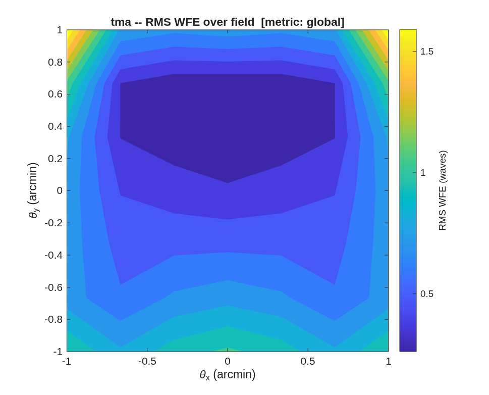

### `freeform_unobscured`: sphere+Zernike unobscured telescope: the visible 3+n front end

The **sphere+Zernike (freeform) strategy** applied to the visible-band
(500 nm) front end for a coronagraph, imager, and spectrometer — the
direction chosen after the conic eccentric-pupil section
(`../tma_unobscured`, kept as the trade study)
proved shroud-expensive and coupling-bound (Dave, 2026-07-06).

Why sphere+Zernike wins here:

- **Geometry and correction decouple.** The 0th-order layout is three
  base SPHERES placed for packaging; the fold TILTS unobscure the beam
  with **M2 staying close to the source→M1 beam** — the tilted-fold
  topology is the shroud-cheap alternative the eccentric section cannot
  reach (its AOI-safe decenter cost 3.6×D of shroud).
- **All correction lives in the Zernike departures** (CALIB OptZern,
  staged center → field). The departures are micron-scale sags that do
  not move the chief ray: once the layout packages, the optimizer
  cannot break the packaging — none of the conic/telecentric coupling
  that bogged the Korsch searches.
- **It holds at 500 nm.** The e5mono-derived geometry corrects from
  ~71,000 waves (all-sphere, uncorrected) to **0.03 waves RMS at the
  field center — diffraction-limited at the visible bar** (35 nm RMS).
  The FIELD is where the visible fight is: a small corrected field is
  fine for the coronagraph; the wide imaging field is what the **+n**
  mirrors are for (the standing rule: a wide field needs a 4th powered
  mirror, not more freeform on three).

**Run it.**

```matlab
cd('<path-to>/mmacos/templates/10_telescopes/freeform_unobscured');
run(fullfile(pwd,'freeform_unobscured.m'));
```

**The knobs** (`freeform_unobscured.m`):

<!-- transcript: p2_freeform_unobscured_knobs -->

**What it prints:**

<!-- transcript: p2_freeform_unobscured_run -->



**FIGURE 21** RMS wavefront error over the ±1' field after the full-field stage (`freeform_unobscured_wfe.png`), waves at 500 nm.

**The number it reproduces.** The center stage takes the all-sphere layout to %pin:p2_freeform_unobscured_s0% waves at the field center; the full-field stage trades that for the field, ending at %pin:p2_freeform_unobscured_s2worst% waves worst and %pin:p2_freeform_unobscured_s2area% area-weighted over ±1': a small corrected field on three mirrors, which is why the README sends a wide field to a fourth powered mirror.

**Adapt it.** *"Using templates/10_telescopes/freeform_unobscured, rerun the staged Zernike correction for a 6 m aperture at 600 nm over a ±0.5' field, and tell me the worst and area-weighted residual after the full-field stage."*

