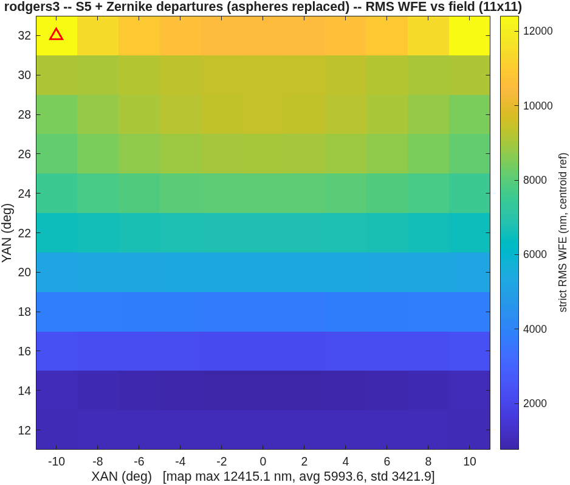

### `offset_imager`: wide-field imager with an offset field

A parameterized, illustrated five-stage design flow for the recurring
problem: a wide field box that must sit **far off the optical axis**
(packaging, stray light, or scan geometry demand it), and what each
class of design freedom buys back.  The flow is the product; the
`challenges/rodgers3` instance (Mike Rodgers' 22°-offset imager ladder)
is the validation.

**Run it.**

```matlab
cd('<path-to>/mmacos/templates/10_telescopes/offset_imager');
OUT = offset_imager();
```

**The knobs** (`offset_imager_params.m`):

<!-- transcript: p2_offset_imager_knobs -->

**What it prints:**

<!-- transcript: p2_offset_imager_run -->



**FIGURE 22** The S5 field map the default run draws (`oi_s5_map.png`): strict rms wavefront error at 11 x 11 points over the 20 x 20 degree box centered 22 degrees off axis, centroid reference; the triangle marks the worst field.

**The number it reproduces.** The on-axis stage reproduces the challenge's record exactly: S1, the coaxial symmetric aspheres, reads %pin:p2_offset_imager_s1max% nm maximum and %pin:p2_offset_imager_s1avg% nm mean over the dense map, as in `challenges/rodgers3/t3/r3t_REPORT.md`. The offset stages do not: run with the template's defaults today, S3 ends at %pin:p2_offset_imager_s3max% nm against the record's 252.0 and S5 at %pin:p2_offset_imager_s5max% nm against 118.2 (and 45.4 nm for the 25-field re-solve). The record was made by `run_t3`, which pins the exit beam (0.1 degree) and runs 30 iterations a stage where the defaults run 12, but the two already part at S2, a focal-plane refit alone, so those differences are not shown to be the cause. Not diagnosed; the open questions list has it, and this page prints the run as it is.

**Adapt it.** *"Using templates/10_telescopes/offset_imager, run the five-stage ladder for a 150 mm F/3.3 imager with a 15 x 15 degree box offset 22.5 degrees, walking the box open with oi_walk if a cold solve stalls, and report each stage's map maximum and clearance."*

