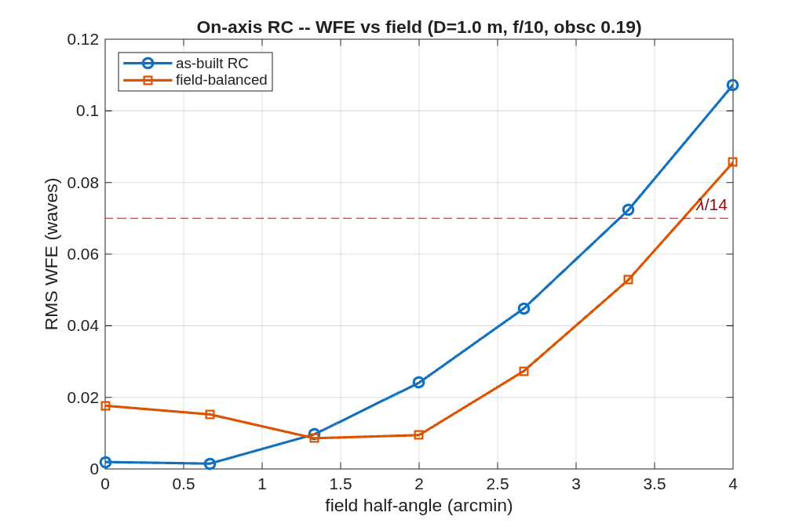

### `rc_onaxis`: Parameterized on-axis Ritchey-Chretien designer

The classical Cassegrain-form RC: a two-mirror APLANAT (zero 3rd-order spherical AND coma by construction), so it is diffraction-limited on-axis. Its field is limited by ASTIGMATISM, which two conics cannot null -- that limit is precisely why wide-field telescopes add a third mirror (a TMA). This driver builds the RC from your aperture + f-numbers, reports its first-order properties (including the central obscuration the secondary casts), shows WFE vs field, then field-balances the conics for a WIDER corrected field and saves that as the deliverable (better-across-the-field usually beats perfect-on-axis for a real instrument). This is the OBSCURED baseline. For the unobscured (coronagraph-feed) version that decenters to an eccentric pupil, see ../rc_unobscured.

**Run it.**

```matlab
cd('<path-to>/mmacos/templates/10_telescopes/rc_onaxis');
run(fullfile(pwd,'rc_onaxis.m'));
```

**The knobs** (`rc_onaxis.m`):

<!-- transcript: p2_rc_onaxis_knobs -->

**What it prints:**

<!-- transcript: p2_rc_onaxis_run -->



**FIGURE 26** RMS wavefront error against field for the as-built aplanat and the field-balanced design (`rc_onaxis_wfe.png`), with the λ/14 line.

**The number it reproduces.** The aplanat is diffraction-limited on axis and out to %pin:p2_rc_onaxis_dl0% arcmin, where the astigmatism two conics cannot null crosses λ/14; balancing the radius and conic over ±4′ trades a little on-axis quality for a field diffraction-limited out to %pin:p2_rc_onaxis_dl1% arcmin. The secondary's central obscuration is %pin:p2_rc_onaxis_obsc% of the aperture.

**Adapt it.** *"Using templates/10_telescopes/rc_onaxis, design a 2 m f/12 Ritchey-Chretien with an f/2.5 primary and 400 mm back focus, and tell me the central obscuration and the diffraction-limited field before and after field balancing."*

