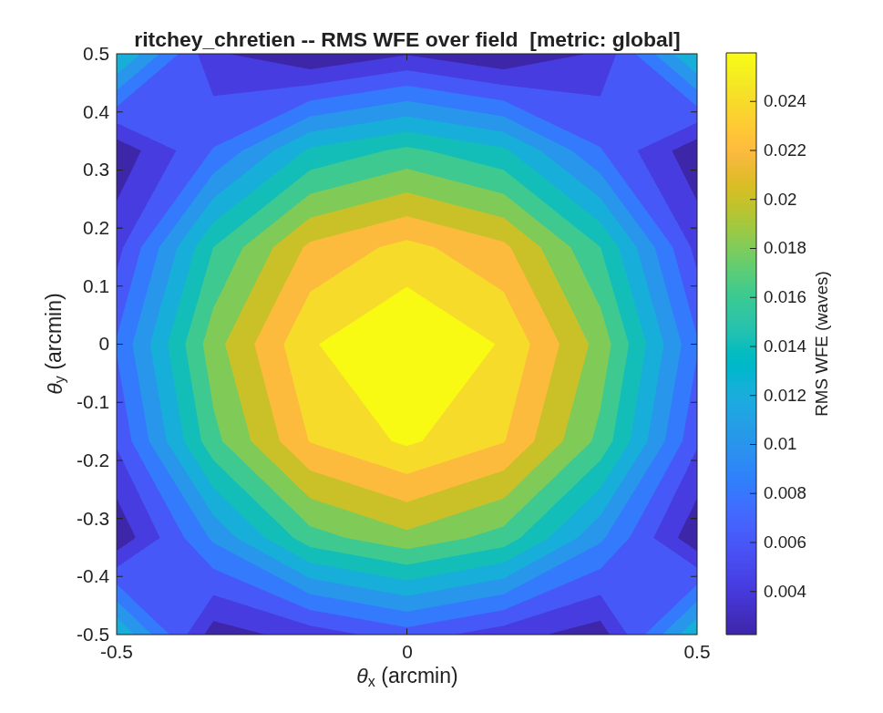

### `rc_unobscured`: Parameterized unobscured off-axis Ritchey-Chretien designer

Pick the four design knobs below; the script builds the on-axis RC parent, takes an UNOBSCURED off-axis section (eccentric pupil), refigures + field-optimizes it to diffraction-limited, verifies it is unobscured, and saves the deliverable (.in + .mat + figures).

**Run it.**

```matlab
cd('<path-to>/mmacos/templates/10_telescopes/rc_unobscured');
run(fullfile(pwd,'rc_unobscured.m'));
```

**The knobs** (`rc_unobscured.m`):

<!-- transcript: p2_rc_unobscured_knobs -->

**What it prints:**

<!-- transcript: p2_rc_unobscured_run -->



**FIGURE 27** RMS wavefront error over the ±0.5′ field of the delivered unobscured section (`rc_unobscured_wfe.png`).

**The number it reproduces.** With an f/1.5 primary at f/20 the eccentric pupil clears the secondary's shadow at a decenter of %pin:p2_rc_unobscured_dec% m, and after the axial refigure and the field optimization the worst field over ±0.5′ is %pin:p2_rc_unobscured_field% waves, diffraction-limited, with all three optics clear.

**Adapt it.** *"Using templates/10_telescopes/rc_unobscured, design an unobscured 1.5 m off-axis RC at f/16 with an f/1.8 primary, and report the decenter it needs and the worst-field wavefront error over ±0.5 arcmin."*

