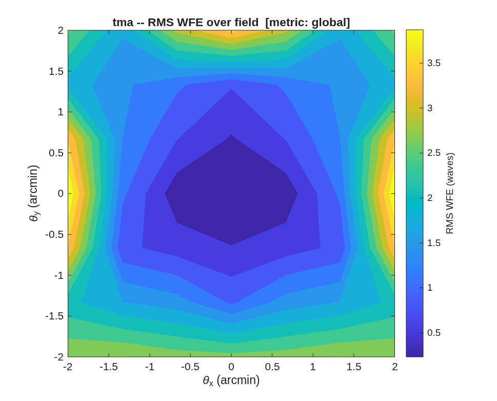

### `sz_tma`: Sphere + Zernike unobscured three-mirror telescope (e5mono-derived)

A wide-field design strategy where GEOMETRY and CORRECTION fully decouple: 0th-order layout = three BASE SPHERES (Kc=0). The sphere radii set first-order power (f/#, EFL); the fold tilts unobscure the beam and keep it compact. No conics -> none of the conic/ telecentric coupling that bogs down a Korsch search. CORRECTION = Zernike departures on each mirror, optimized by MACOS's native multi-field design optimizer (CALIB OptZern). Because the departures are tiny sag perturbations they don't move the chief-ray geometry, so once the layout meets packaging the optimizer cannot break it.

*This template has no README; the text above is generated from its entry script's header (`docs/mmacos-manual/part2/sz_tma.md`, `tools/gen_readme_part2.py`).*

**Run it.**

```matlab
cd('<path-to>/mmacos/templates/10_telescopes/sz_tma');
run(fullfile(pwd,'sz_tma.m'));
```

**The knobs** (`sz_tma.m`):

<!-- transcript: p2_sz_tma_knobs -->

**What it prints:**

<!-- transcript: p2_sz_tma_run -->



**FIGURE 24** RMS wavefront error over the ±2′ field after the full-field stage (`sz_tma_wfe.png`).

**The number it reproduces.** The Zernike departures take the all-sphere layout to %pin:p2_sz_tma_s0% waves at the field center, diffraction-limited, but over the full ±2′ field the worst point is %pin:p2_sz_tma_s2% waves and the area-weighted mean %pin:p2_sz_tma_s2a%: on this 8 m layout the 15 modes per mirror do not hold the field.

**Adapt it.** *"Using templates/10_telescopes/sz_tma, rerun the sphere-plus-Zernike design over a ±1 arcmin field with 21 Zernike modes per mirror, and tell me whether the full-field stage reaches the diffraction limit."*

