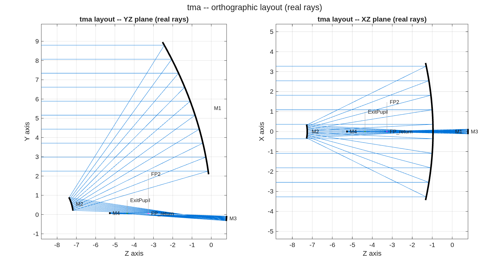

### `tma_3plus1`: 3+1 coronagraph front end -- unobscured conic TMA + M4 pupil relay

Three conic mirrors (j18mono-geometry Korsch, 6.6 m f/20, unobscured eccentric-pupil section) form the SCIENCE FOCUS -- the shared focal plane where instrument pickoffs live (the 3-mirror holds a 5'-diameter circular field at ~0.095 waves @ 1 um; see ../tma_centered). A 4th FIELD MIRROR just past that focus relays the CORONAGRAPH CHANNEL (a ~30 arcsec patch) to FP2 and -- the point -- relays the exit pupil to an accessible plane and FLATTENS it (the bare TMA pupil carries +0.7 mm defocus / 1.1 mm astig, macos.pupil_quality; the relayed pupil comes out ~10x flatter with M4 varying in the patch balance). A relay cannot carry the wide field: at EFL=132 m a 2.5' half-field walks +-96 mm across M4 -- wide field stays at the TMA focus, the relay serves the small-field channel.

**Run it.**

```matlab
cd('<path-to>/mmacos/templates/10_telescopes/tma_3plus1');
run(fullfile(pwd,'tma_3plus1.m'));
```

**The knobs** (`tma_3plus1.m`):

<!-- transcript: p2_tma_3plus1_knobs -->

**What it prints:**

<!-- transcript: p2_tma_3plus1_run -->



**FIGURE 25** The 3+1 chain with real rays, YZ and XZ planes (`tma_3plus1_layout.png`): the three-mirror telescope to its focus, and M4 just past it relaying the coronagraph channel to FP2 and the exit pupil.

**The number it reproduces.** The 30″ coronagraph patch is balanced to %pin:p2_tma_3plus1_patch% waves worst, and the relayed pupil carries %pin:p2_tma_3plus1_ast% mm of astigmatism against the bare TMA's 1.1 mm. The template reports its own limit: the worst AOI spread is %pin:p2_tma_3plus1_aoi% degrees, outside the 15-degree preference on M1 and M2, which its sibling `tma_3plus1_aoi_search.m` addresses.

**Adapt it.** *"Using templates/10_telescopes/tma_3plus1, run tma_3plus1_aoi_search for a 6.6 m f/20 front end that keeps every mirror's AOI spread under 15 degrees, then rebuild the 3+1 chain on the result and report the patch balance and the relayed pupil."*

