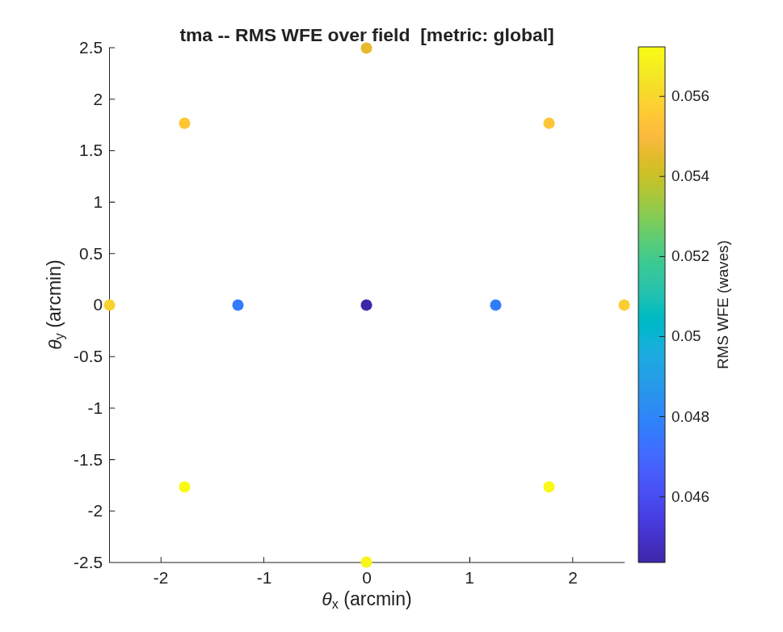

### `tma_centered`: centered (obscured) Korsch TMA: the A/B answer + the buildable folded variant

The centered three-mirror anastigmat — concave M1, **convex** M2 on axis
(central obscuration accepted), concave M3 behind the primary — versus its
off-axis-section cousin, and then the packaging problem the coaxial form
hides: **the focal plane lands on the axis in the middle of the beam.**
This directory carries the full arc from parent choice to a buildable,
clearance-verified, focus/tilt-aligned folded design.

**Run it.**

```matlab
cd('<path-to>/mmacos/templates/10_telescopes/tma_centered');
run(fullfile(pwd,'tma_centered.m'));
```

**The knobs** (`tma_centered.m`):

<!-- transcript: p2_tma_centered_knobs -->

**What it prints:**

<!-- transcript: p2_tma_centered_run -->



**FIGURE 30** The centered design's RMS wavefront error over its 5' circular field at 1 µm (`tma_centered_wfe.png`).

**The number it reproduces.** Over a 5' circular field at 1 µm the centered (obscured) design's worst field is %pin:p2_tma_centered_centered% waves, diffraction-limited; the unobscured section of the same mirrors reads %pin:p2_tma_centered_section% waves, and the A/B table shows where it goes: field astigmatism, the price of the clear pupil.

**Adapt it.** *"Using templates/10_telescopes/tma_centered, take my centered TMA (radii and spacings below) and score it against its unobscured section over a 4' circular field at 1.6 µm, with the same A/B table."*

