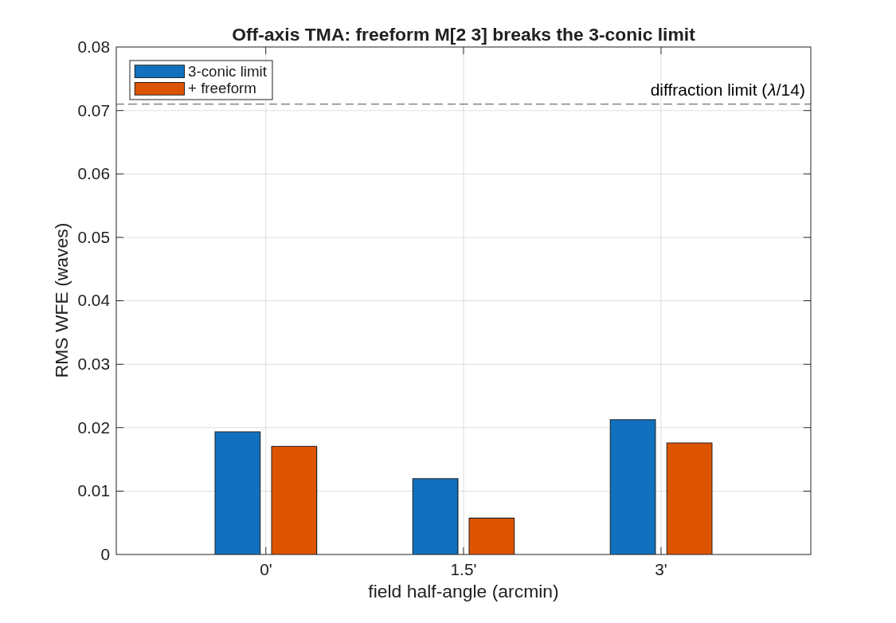

### `tma_freeform`: Off-axis unobscured three-mirror freeform designer

The companion to wf2_freeform, where freeform genuinely earns its keep. Pick the knobs below; the script seeds a coaxial Korsch TMA (3 conics null 3rd-order S_I/II/III), takes an UNOBSCURED off-axis section (eccentric pupil), refigures the 3 conics + rigid bodies to the best a 3-mirror can do over the field, then layers freeform Zernike departures on M2 + M3 -- holding every radius and conic -- and re-optimizes. Verifies it is unobscured and saves the deliverable (.in + .mat + figures).

**Run it.**

```matlab
cd('<path-to>/mmacos/templates/10_telescopes/tma_freeform');
run(fullfile(pwd,'tma_freeform.m'));
```

**The knobs** (`tma_freeform.m`):

<!-- transcript: p2_tma_freeform_knobs -->

**What it prints:**

<!-- transcript: p2_tma_freeform_run -->



**FIGURE 27** Per-field wavefront error at 0, 1.5′ and 3′, the three-conic limit against the freeform design (`tma_freeform_fields.png`).

**The number it reproduces.** Taken off axis by %pin:p2_tma_freeform_dec% m to clear its beams, the three-conic design reaches %pin:p2_tma_freeform_lim% waves at its worst field over ±3′; freeform departures on M2 and M3, every radius and conic held, take it to %pin:p2_tma_freeform_ff% waves. On this field the conic limit is already diffraction-limited, so the freeform's gain is small; `wf2_freeform` shows why a third mirror is what makes the freeform useful at all.

**Adapt it.** *"Using templates/10_telescopes/tma_freeform, widen the half-field to 6 arcmin and rerun, and tell me how much the freeform M2 and M3 buy over the three-conic limit there."*

