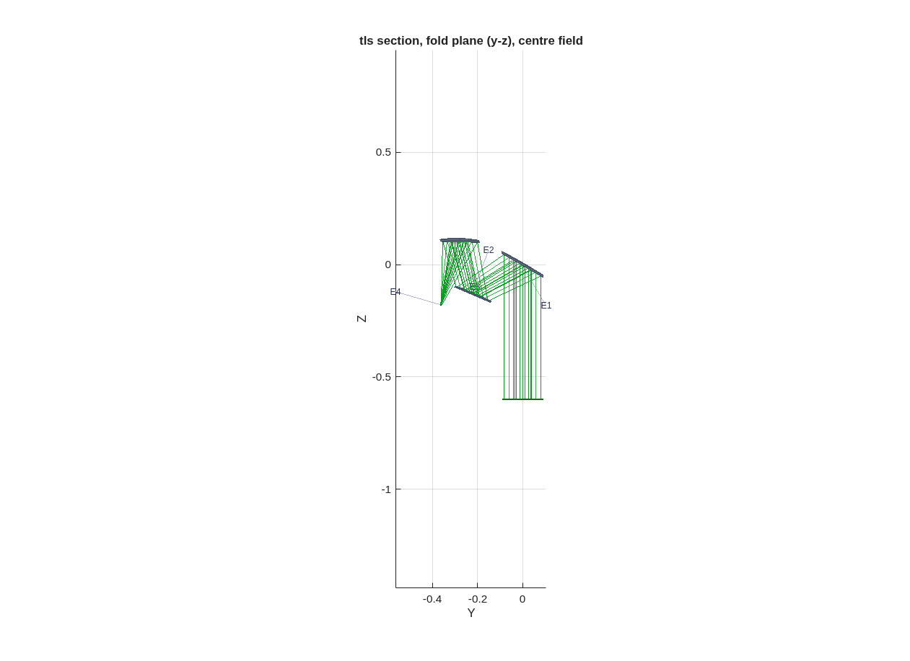

### `tma_longslit`: the long-slit TMA front end for a slit-fed spectrometer

A parameterized design flow for a three-mirror telescope that feeds a
**long slit**:
- a wide strip of sky imaged onto a straight slit;
- **telescentric** at the slit, so the spectrometer behind it sees every field the same way;
- with a bounded **cone**: no marginal ray faster than the spectrometer accepts, the F/# the same in both directions;
- and a long working distance behind the last mirror, so the spectrometer fits in it.

The form is the **SBG VSWIR zig-zag TMA** (Bradley et al., *Finalized optical
design of the SBG VSWIR Wide Swath Imaging Spectrometer*, ICSO 2024, Proc. SPIE
13699, 1369945, Fig. 4b):
- a weak concave M1;
- a small convex M2 that is the **stop**;
- M3 carrying nearly all of the power;
- the slit 300 mm behind M3.

The beam turns the same way at M1 and M3 and back at M2. It is a zig-zag, not a
Korsch ring, and it has **no intermediate focus**.

The default run is the dyson5 3k front end at Joe's spec: f 330 mm, D 183 mm,
F/1.8, a ±4.7° strip onto a 54 mm slit.

**Run it.**

```matlab
cd('<path-to>/mmacos/templates/10_telescopes/tma_longslit');
OUT = tma_longslit_run({'first_order','section'});
```

**The knobs** (`tma_longslit_params.m`):

<!-- transcript: p2_tma_longslit_knobs -->

**What it prints:**

<!-- transcript: p2_tma_longslit_run -->



**FIGURE 36** The engine section, fold plane, center field (`tls_section_layout.png`): the input beam rises to the weak concave M1 (E1), turns to the small convex M2 (E2), the stop, then to M3, which brings it to the slit (E4).

**The number it reproduces.** The first order is closed-form: with the stop at M2, the slit is telecentric when M3's focal length is the M2-to-M3 leg, and each mirror must carry R_t/R_s = 1/cos^2 i at its chief, which an off-axis paraboloid does natively. Traced in the engine, the three off-axis sections hold the spec: a plate scale of %pin:p2_tma_longslit_plate% mm against 330.0, the strip imaged onto %pin:p2_tma_longslit_strip% mm of the 54.0 mm slit, and every leg clear of every body by at least %pin:p2_tma_longslit_clear% mm, with a 5 mm mount allowance. The image quality is the figure stage's job, not this page's: the section is the seed, with 2 mm rms spots.

**Adapt it.** *"Using templates/10_telescopes/tma_longslit, run the first-order and section stages for a 250 mm focal length, 125 mm aperture long-slit TMA with a +-3 degree strip onto a 26 mm slit, and tell me whether every leg clears."*

