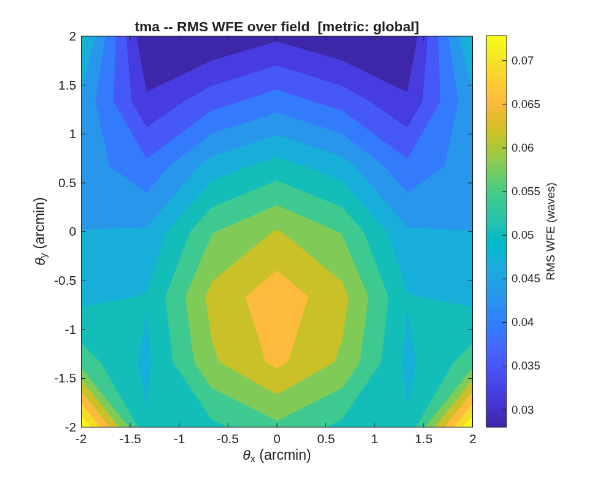

### `tma_offaxis`: Unobscured off-axis convex-secondary TMA

j18mono-geometry 3-mirror anastigmat (M1 concave, M2 CONVEX, M3 concave, f/20): exercise the convex-secondary seidel_seed fix (K=0 seed + correct unfolded focus), conic-optimize to a diffraction-limited on-axis anastigmat, then take it OFF-AXIS as an eccentric-pupil section, clear the beam, and re-balance over a 2-D field.

**Run it.**

```matlab
cd('<path-to>/mmacos/templates/10_telescopes/tma_offaxis');
run(fullfile(pwd,'tma_offaxis.m'));
```

**What it prints:**

<!-- transcript: p2_tma_offaxis_run -->



**FIGURE 30** RMS wavefront error over the ±2′ field of the delivered off-axis design at 2.3 µm (`tma_offaxis_wfe.png`).

**The number it reproduces.** The convex-secondary seed conic-optimizes on axis to %pin:p2_tma_offaxis_ax% waves; taken off axis by %pin:p2_tma_offaxis_dec% m and re-balanced over a 3 x 3 grid on the ±2′ field, its worst field is %pin:p2_tma_offaxis_area% waves at 2.3 µm, just outside λ/14, which the run prints as a residual. Its all-sphere baseline line reads 0 waves, which an uncorrected sphere cannot be; not traced.

**Adapt it.** *"Using templates/10_telescopes/tma_offaxis, rebalance the off-axis design over a ±1.5 arcmin field and tell me whether it becomes diffraction-limited at 2.3 µm."*

