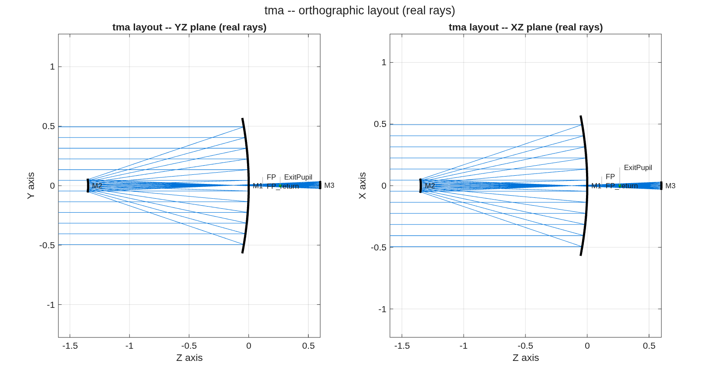

### `tma_onaxis`: on-axis three-mirror anastigmat designer (Korsch / j18mono form)

A parameterized Korsch TMA — concave M1, **convex** secondary (convex by geometry:
it sits before the M1 focus, `KrElt=-|R|`), concave M3 behind M1 — with the three
j18mono features:

1. a **real intermediate focus BETWEEN M1 and M2** (the field-stop / metrology-
   injection plane);
2. a **slight off-axis bias** that tips the focal plane OUT of the M2→M3 beam
   (the j18 "slightly off-axis detector"); the M2 central obscuration remains —
   this is the *obscured* baseline, whose unobscured eccentric-pupil cousin is
   `../tma_offaxis`;
3. the **exit pupil after M3 is ASSESSED** (FEX), not constrained.

**Run it.**

```matlab
cd('<path-to>/mmacos/templates/10_telescopes/tma_onaxis');
run(fullfile(pwd,'tma_onaxis.m'));
```

**The knobs** (`tma_onaxis.m`):

<!-- transcript: p2_tma_onaxis_knobs -->

**What it prints:**

<!-- transcript: p2_tma_onaxis_run -->



**FIGURE 30** The recommended design, the YZ and XZ planes with real rays (`tma_onaxis_layout.png`): the convex secondary before the primary's focus, the tertiary behind the primary, the focal plane biased out of the beam.

**The number it reproduces.** The least off-axis bias that clears the focal plane, %pin:p2_tma_onaxis_bias%, is diffraction-limited at %pin:p2_tma_onaxis_wfe% waves rms at 633 nm. (The README's own table, from an earlier engine, reads 0.0074 waves at the same bias; the sweep's shape is the same.)

**Adapt it.** *"Using templates/10_telescopes/tma_onaxis, design an on-axis Korsch TMA with a 2 m aperture, an f/1.2 primary and an f/10 system at 633 nm, sweep the off-axis bias from 0.5' to 4', and build the least bias that clears the focal plane and is diffraction-limited."*

