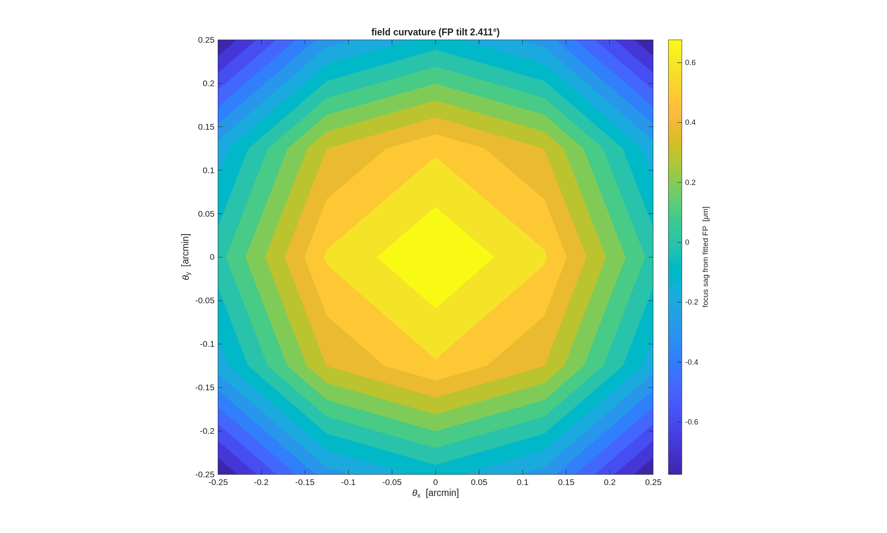

### `tma_unobscured`: visible-band unobscured TMA: the coronagraph / imager / spectrometer front end

An eccentric-pupil (unobscured) three-mirror anastigmat for a **visible
telescope** — 500 nm center wavelength — built with the same
finder-then-demo approach as `../tma_centered`: a
constraint finder chooses the geometry against the packaging and
polarization rules, and the demo runs the visible correction ladder,
aligns the true focal plane, places the exit pupil, and emits the design
report.

The brief (Dave, 2026-07-06):

- **Slower M1** than the centered j18's f/1.2: a slower primary makes the
  section's per-mirror **AOI spread** gentler — the coronagraph
  polarization preference is **< 15° across the beam on every mirror** —
  and shrinks the clearing decenter. The price is tube length.
- **M2 close to the source→M1 beam** (launch-shroud packaging): the
  minimal-clearance eccentric section (`set_offaxis('all')`) *is* this
  rule — the decenter stops the moment every body clears with margin.
- The deliverable is a **front end**: unobscured pupil + accessible exit
  pupil (`PropType=FarField` — PSF/Strehl metrics live) for the
  coronagraph, and a flat, correctly-tilted focal plane for the imager
  and spectrometer pickoffs.

**Run it.**

```matlab
cd('<path-to>/mmacos/templates/10_telescopes/tma_unobscured');
run(fullfile(pwd,'tma_unobscured_search.m')); run(fullfile(pwd,'tma_unobscured.m'));
```

**The knobs** (`tma_unobscured_search.m`):

<!-- transcript: p2_tma_unobscured_knobs -->

**What it prints:**

<!-- transcript: p2_tma_unobscured_run -->



**FIGURE 35** Field curvature on the fitted focal plane (`tma_unobscured_fpmap.png`): the sag of the best focus from the tilted, refocused plane, over ±0.25'.

**The number it reproduces.** The correction ladder reaches %pin:p2_tma_unobscured_ffm1% waves rms at the field center at 500 nm with the freeform primary, and the field ladder stays diffraction-limited out to the 1' ring (%pin:p2_tma_unobscured_ring1% waves, tilt removed). The template's closing design report (step [6], not printed) reads NaN on every field ring on this run, the open questions list has it.

**Adapt it.** *"Using templates/10_telescopes/tma_unobscured, run the finder and the demo for a 4 m unobscured visible TMA with an f/3 primary, keeping every mirror's AOI spread under 15 degrees, and report the field ladder to 1'."*

