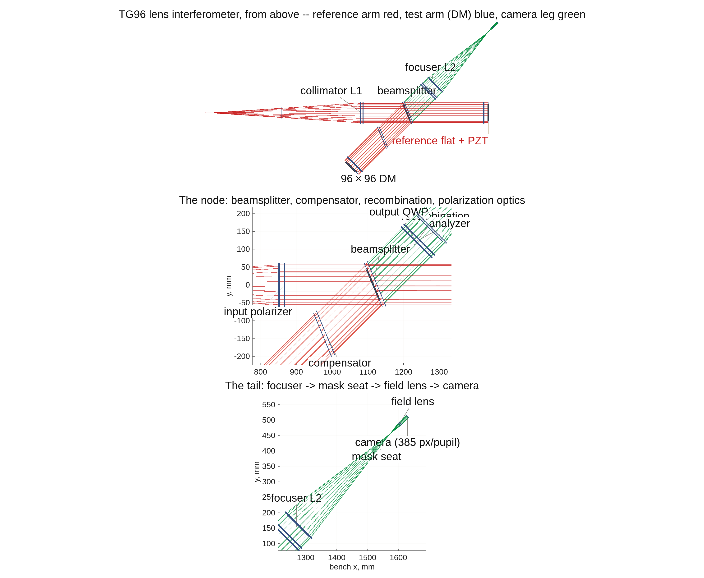

### `tg_psi_dm96_oap`: the 96×96 Twyman–Green DM gauge, all-reflective (OAP) variant

The reflective sibling of `../tg_psi_dm96`: the two lenses of
the polarization phase-shifting Twyman–Green DM surface gauge (L1 collimator,
L2 focuser) become **off-axis parabolas** (OAPs). The refractive rig in
`../tg_psi_dm96` is the untouched record; this directory is the variant beside
it, driven by the **same** builder (`macos.design.twyman_green`, new option
`'optics'`) and **one** parameterized runner that runs *both* rigs.

**Run it.**

```matlab
cd('<path-to>/mmacos/templates/40_benches/tg_psi_dm96_oap');
out = tg96_run('stages',{'bench','figs'});
```

The bench stages only (`bench`, `figs`); the default also runs the actuator battery (`battery`), which is the campaign's hours-long product. The manual copies the template with its `dm_gauge_lib` sibling and `90_polarization/tg_psi_dm` (for `dm_influence_map`), which the runner adds to the path by relative location.

**The knobs** (`tg96_params.m`):

<!-- transcript: p2_tg_psi_dm96_oap_knobs -->

**What it prints:**

<!-- transcript: p2_tg_psi_dm96_oap_run -->

{height=7in}

**FIGURE 32** The lens rig from above (`runs/lens/lens_vlayout.png`): the whole interferometer, then the node (beamsplitter, compensator, recombination and the polarization optics) and the tail (focuser, mask seat, field lens, camera). The title's legend reads "test arm (DM) blue", but the figure draws the reference and test arms both in red; the open questions list has it.

**The number it reproduces.** The bench stage measures what the build needs before any reading: Stage A's clearances (the beamsplitter at %pin:p2_tg_psi_dm96_oap_aoi% degrees, pinned by Dave's 2026-09-15 ruling; the compensator, the tightest node part, clears by %pin:p2_tg_psi_dm96_oap_comp% mm, under the 25 mm spec, as the report says), the sampling budget (a detector Nyquist margin of %pin:p2_tg_psi_dm96_oap_nyq%x against the DM's), and the stations check: the polarization four-step recovers the engine's own field on a 30 nm working surface with gain %pin:p2_tg_psi_dm96_oap_gain% (%pin:p2_tg_psi_dm96_oap_resid% pm residual), the PZT four-step exactly. The run committed in `runs/lens/` (2026-09-12) predates the pin and shows the Stage-A solve's 7 degrees.

**Adapt it.** *"Using templates/40_benches/tg_psi_dm96_oap, run the bench stages for the all-reflective rig (bench.optics 'oap') and compare its clearances, sampling budget and four-step gain with the lens rig's."*

