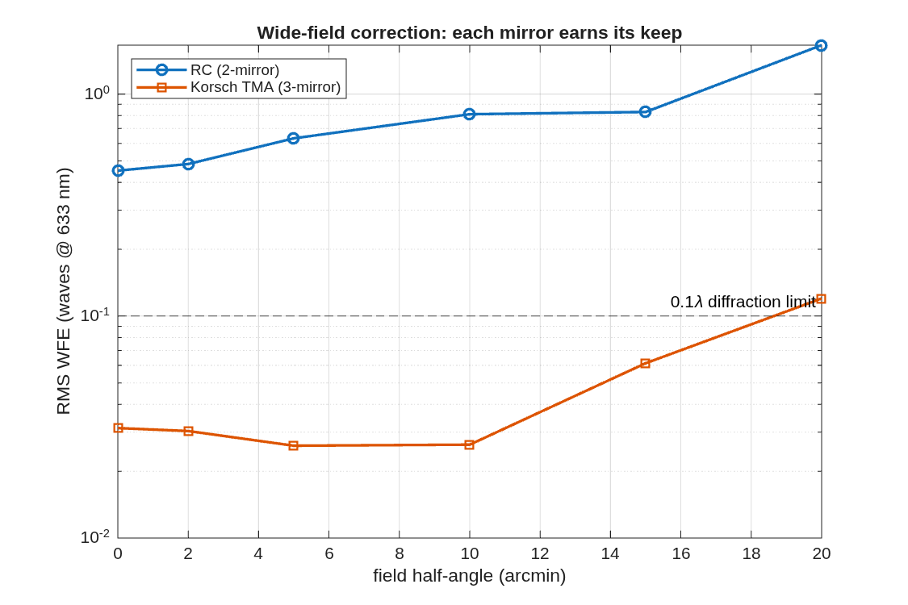

### `tma_widefield`: Does each mirror earn its keep? Wide-field 2-mirror (Ritchey-Chretien) vs 3-mirror (Korsch TMA)

Multi-mirror telescopes exist to widen the corrected field of view. This example makes that quantitative: it builds a 2-mirror RC and a 3-mirror TMA at the same aperture and f/#, optimises BOTH over the same wide field, and compares the residual wavefront error vs field. The physics: an RC nulls 3rd-order spherical AND coma with its two conics, so it is excellent on-axis -- but it has NO degree of freedom left for field astigmatism, which grows ~field^2. A TMA's third conic supplies exactly that DOF (a Korsch anastigmat nulls spherical + coma + astigmatism). So as the field opens up the 2-mirror hits a "wall" and the 3-mirror sails past it.

**Run it.**

```matlab
cd('<path-to>/mmacos/templates/10_telescopes/tma_widefield');
run(fullfile(pwd,'example_tma_widefield.m'));
```

**What it prints:**

<!-- transcript: p2_tma_widefield_run -->



**FIGURE 32** Residual RMS wavefront error against field for the 2-mirror RC and the 3-mirror Korsch, both optimized over the same 0 to 20′ field (`tma_widefield_wfe.png`).

**The number it reproduces.** Optimized over the same 20′ field at f/8, the 3-mirror design holds %pin:p2_tma_widefield_tma15% waves at 15′ (%pin:p2_tma_widefield_tma20% at 20′), while the 2-mirror, its two conics spent across the whole field, sits at %pin:p2_tma_widefield_rc0% waves even on axis: the third conic is what buys the field.

**Adapt it.** *"Using templates/10_telescopes/tma_widefield, rerun the RC-against-TMA comparison over a 10 arcmin field at f/12 and tell me where each one stops being well corrected."*

