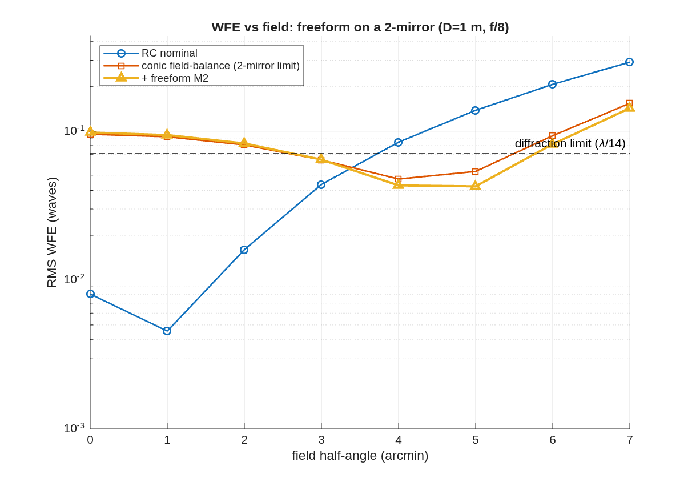

### `wf2_freeform`: Wide-field 2-mirror freeform designer

Pick the knobs below; the script builds an aplanatic Ritchey-Chretien and shows what a freeform Zernike departure on the secondary buys -- in two views, holding every radius and conic (the layout) FIXED: A. PER-FIELD POWER. At a single off-axis field, freeform NULLS the astigmatism the 2-mirror conics leave behind -- ~25x, to diffraction-limited. B. WIDE-FIELD REALITY. Over a symmetric +-FOV field, freeform extends the diffraction-limited field only modestly: a 2-mirror has just ONE surface away from the pupil, so its departure gives field-LINEAR astigmatism control, which cannot cancel the field- SQUARED astigmatism across a wide field. That is exactly what a THIRD mirror buys (-> the off-axis 3-mirror freeform driver).

**Run it.**

```matlab
cd('<path-to>/mmacos/templates/10_telescopes/wf2_freeform');
run(fullfile(pwd,'wf2_freeform.m'));
```

**The knobs** (`wf2_freeform.m`):

<!-- transcript: p2_wf2_freeform_knobs -->

**What it prints:**

<!-- transcript: p2_wf2_freeform_run -->



**FIGURE 33** RMS wavefront error against field for the nominal RC, the conic field-balance (the 2-mirror limit) and the freeform M2 (`wf2_freeform_fieldcurve.png`).

**The number it reproduces.** At a single off-axis field (7′) a freeform departure on the secondary nulls the conics' residual, %pin:p2_wf2_freeform_one0% to %pin:p2_wf2_freeform_one1% waves; over the whole ±7′ field it buys almost nothing (worst %pin:p2_wf2_freeform_wide% waves, the diffraction-limited field unchanged at 5′), because a 2-mirror has one surface away from the pupil. The header's "~25x" per-field figure reads 34x on this run.

**Adapt it.** *"Using templates/10_telescopes/wf2_freeform, add the freeform modes to M1 as well as M2 and rerun, and tell me whether the diffraction-limited field over ±7 arcmin grows."*

