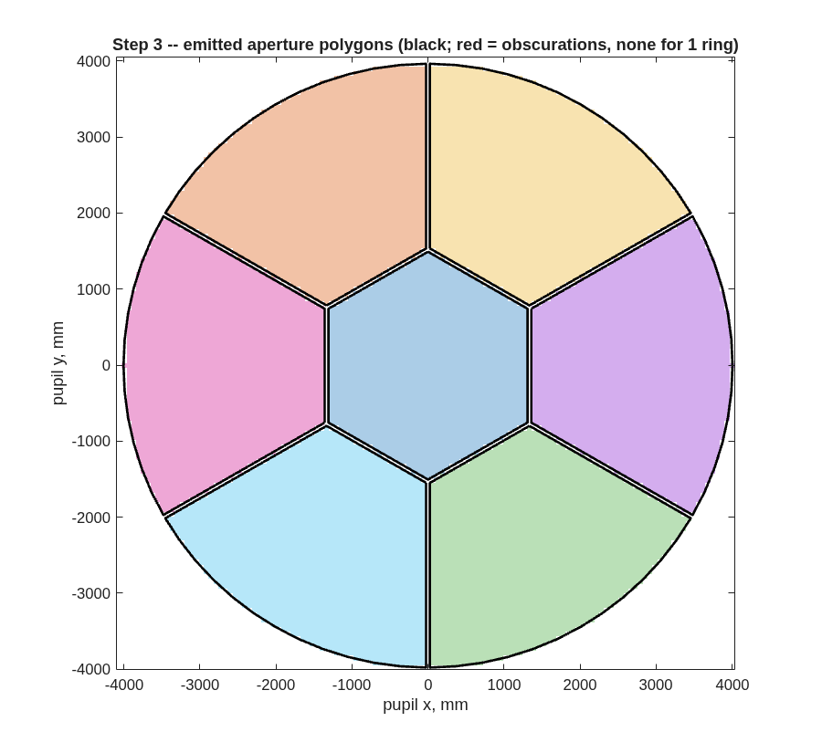

### `e5_pie`: pie segmentation with physical polygonal apertures

A segmented prescription built by `macos.design.segment_rx` carries
segment-ness in the SOURCE tiling only: every segment element is a
full mathematical surface with no aperture, and rays are assigned to
segments by the tiling.  That is trace-exact at nominal but
physically dishonest under perturbation — a ray can walk off its
segment and keep tracing against a surface that has no glass there.
This example declares each segment's PHYSICAL boundary as a polygonal
aperture in the Rx, and then uses those declared polygons as the basis
for MET launcher placement — the general case, which also covers
segmentations imported from .in files (Dave 2026-07-16).

**Run it.**

```matlab
cd('<path-to>/mmacos/templates/20_segmentation/e5_pie');
run(fullfile(pwd,'e5_pie.m'));
```

**The knobs** (`e5_pie.m`):

<!-- transcript: p2_e5_pie_knobs -->

**What it prints:**

<!-- transcript: p2_e5_pie_run -->



**FIGURE 34** The apertures step 3 emits (`e5pie_step3_apertures.png`): the center hexagon and six chorded wedges, each a convex polygon, with the 50 mm gaps as uniform slots; one ring needs no obscurations.

**The number it reproduces.** Declared in the prescription, the polygons clip the %pin:p2_e5_pie_clipped% gap rays the source tiling had placed where there is no glass (of %pin:p2_e5_pie_src%), and under a 100 mm wedge decenter the aperture-less trace keeps %pin:p2_e5_pie_kept% rays that the apertured one loses at the segment's edge. The template's committed `findings.txt` (August) reads 502 clipped and 403 kept, of 12520 source rays, and the README says about 400: the live source grid is smaller, the same change as Part I's pie (finding (fff)).

**Adapt it.** *"Using templates/20_segmentation/e5_pie, segment the e5 primary into a 2-ring pie with a 30 mm gap, emit the physical apertures, and tell me how many rays the gaps clip and how many the aperture-less trace wrongly keeps under a 100 mm decenter."*

