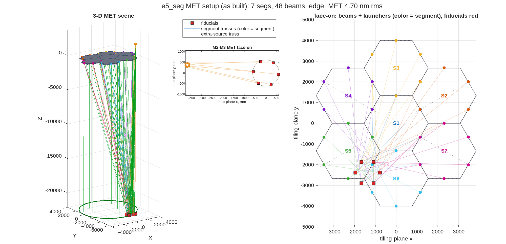

### `e5_seg`: segmented primary + edge sensors + laser-MET truss

One modifiable runner (`e5_seg.m`): `e5mono.in` (monolithic parent) →
segmented `.in` **including the MET points** → `dedx` (SegMirMaker Hx),
`dldx` (FD over the engine METcalc), `dwdx` → **MET metric
performance** = post-control wavefront residual
`trace(dwdx·P_δx·dwdxᵀ)` vs the prior baseline `W = dwdx·X·dwdxᵀ`,
with a Monte-Carlo estimate/control cross-check.

Pipeline: `macos.design.segment_rx` → `macos.design.add_met` (Stewart
trusses: 6 launchers/segment + 6 around the aft body → hub fiducials)
→ `macos.design.edge_sensors` + `macos.design.dmet_dx` + a local dwdx
FD block (column convention [rot|trans] per body in its LOCAL triad,
SI units, identical across all three Jacobians by construction).

Knobs at the top: rings/grid/gap, edge-sensor config, truss geometry
(nf, radii), prior X (deploy tolerances), sensor noises R, MC draws.

Reference output (rings=1 Hex, 7 segs + m2 + fpa = 54 DOF, 20 edge +
48 MET measurements, 1 µrad/1 µm priors, 1 nm sensors) under the
PHYSICAL mounting constraints (Dave 2026-07-16): launchers at the
segment edges + 5 mm clearance, 6 fiducials mounted ON M2 ~25 mm
inside its 615 mm rim, aft ("M3") launcher ring hugging that body
(100 mm — it has no structure at larger radius):

Monte-Carlo (200 draws) 229 nm vs analytic 232 nm (1.3%).

The dominant residual is the AFT-BODY (fpa) uncertainty: its ring
shrank to the physically-mountable 100 mm radius, so its rotational
lever arms are weak.  (An earlier, unphysical configuration with
free-floating 300 mm fiducial/aft rings scored 4.3 nm — mounting
reality costs real performance and is exactly what the layout
optimizer must work within.)  The tier-3 optimizer
(`e5_seg_metopt.m`) currently optimizes the SEGMENT truss only (its
merit covers the 42 segment DOFs; hub/aft analytic rows are the
queued follow-on) and reaches 3.36 nm on that sub-merit,
engine-validated to 0.00%.

Artifacts land beside the script: `e5_seg_met.in` (+ `flat.txt` it
needs in the cwd at load), `e5_segHx.m`, `e5_seg.mat` (all Jacobians),
`e5_seg_metric.png`, and two layout views:

- `e5_seg_met_layout.png` — `macos.design.met_view`: 3-D MET scene
  (segment hex tiles, launchers, hub fiducials, gauge beams, hub disc,
  real-ray envelope from the engine trace) + face-on launcher layout
  with per-segment radial centerlines.
- `e5_seg_view_rx.png` — the same system through the GENERAL viewer
  `macos.view_rx` (works on ANY loaded Rx: traced beam + per-element
  ray-footprint patches + MET paths via `macos.met_geom`).

The optimizer runner (`e5_seg_metopt.m`) additionally writes
`e5_seg_metopt_layout.png`: the optimized launcher/fiducial layout with
the baseline edge ring overlaid as open circles and the 5 mm
edge-clearance hex dashed.

Notes: the engine MET model is straight-line point-to-point length
(no LOS/obscuration check); `macos.modify()` after each poke is
load-bearing (cached trace/OPD otherwise reads unchanged); OPD is in
WaveUnits (mm here).  Next step (recorded in the plan): optimize the
MET layout against this metric — see PLAN_DESIGN_LAYER §6.6 tier 3.

**Run it.**

```matlab
cd('<path-to>/mmacos/templates/20_segmentation/e5_seg');
run(fullfile(pwd,'e5_seg.m'));
```

The template finds the library's `segmirmaker` folder four levels above itself, so the manual runs its copy under a scratch `mmacos/` folder with `segmirmaker` linked beside it; that is the only difference from running it in place.

**The knobs** (`e5_seg.m`):

<!-- transcript: p2_e5_seg_knobs -->

**What it prints:**

<!-- transcript: p2_e5_seg_run -->



**FIGURE 36** The MET setup as built (`e5_seg_met_layout.png`, `macos.design.met_view`), its title carrying this run's edge+MET residual: left, the 3-D scene, the seven hex segments, the launchers at their edges and the gauge beams down to the six fiducials (red); center, the aft truss's beams face-on in the hub plane; right, the launchers and beams face-on over the tiling, colored by segment.

**The number it reproduces.** Sensing the 54 rigid-body degrees of freedom (seven segments, the secondary, the aft body) against a 1 urad / 1 um deployment prior, the post-control wavefront residual is %pin:p2_e5_seg_prior% nm rms with no sensing, %pin:p2_e5_seg_edge% nm with the edge sensors alone, %pin:p2_e5_seg_met% nm with the metrology truss alone, and %pin:p2_e5_seg_both% nm with both; a 200-draw Monte-Carlo gives %pin:p2_e5_seg_mc% nm, the same model computed the other way. The README's table (9577 / 3641 / 450 / 232 nm) predates the edge-sensor rework, as its banner says, and the banner's prediction holds: with the in-plane motions now edge-observable, the combined residual drops by a factor of about fifty. The prior moved too (%pin:p2_e5_seg_prior% against 9577 nm), so the wavefront sensitivities themselves are not the README's; that part is not traced here.

**Adapt it.** *"Using templates/20_segmentation/e5_seg, rerun the edge-plus-metrology sensing study for the 2-ring, 19-segment hex primary with the same priors and noises, and tell me which body dominates the residual."*

