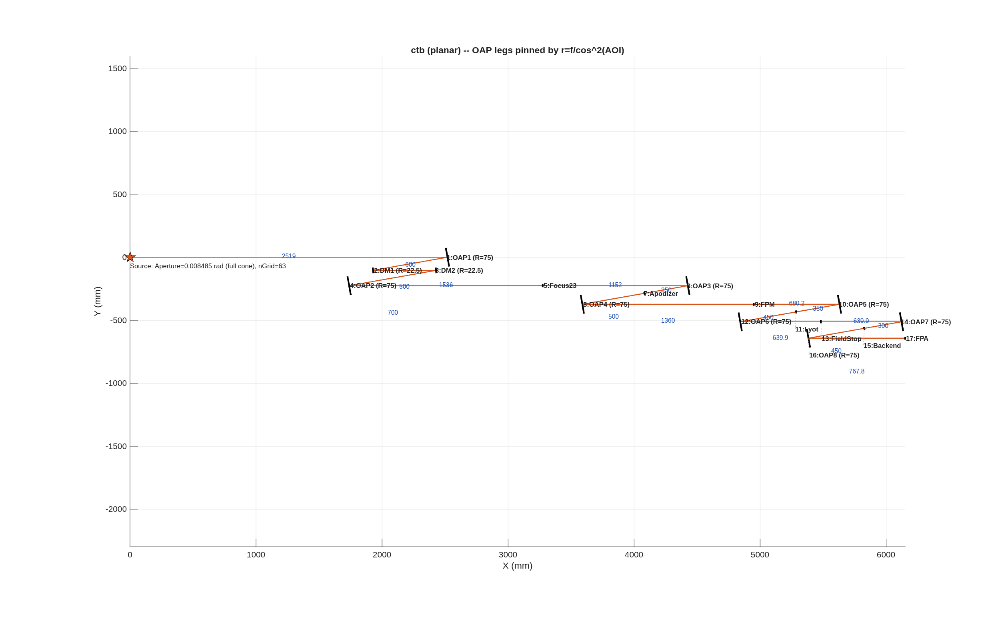

### `bench_ctb`: coronagraph-testbed Bench example

A worked `macos.design.Bench` example: build a **DST2R-like, all-reflective
coronagraph relay** sequentially, then optimize it in physically-staged steps.
Teaching example — every block in the runner states its **parameters**, the
**add-optic call**, the **objective** (form a pupil here, focus there), and the
**test** that confirms it.

**Run it.**

```matlab
cd('<path-to>/mmacos/templates/30_instruments/bench_ctb');
run(fullfile(pwd,'example_ctb.m'));
```

**The knobs** (`example_ctb.m`):

<!-- transcript: p2_bench_ctb_knobs -->

**What it prints:**

<!-- transcript: p2_bench_ctb_run -->



**FIGURE 36** The bench in its plane (`ctb_planar_params.png`), drawn from the parameter block: the source, eight off-axis parabolas (R = 75 mm) and the two DMs, with the pupil and focus markers between them, every OAP leg set by r = f/cos^2(AOI) at AOI 5 degrees; the blue numbers are the leg lengths in mm.

**The number it reproduces.** Built and optimized in physically staged steps (each conjugate on its own plane, in light order), the relay reaches %pin:p2_bench_ctb_wfe% waves rms at the detector at 500 nm, the README's 0.0014, with all %pin:p2_bench_ctb_rays% rays traced at every element and a median zone spot of %pin:p2_bench_ctb_spot% um. The builder's chief ray and the engine's agree to the floor of the arithmetic (printed as a bound). The first line of the printout is the README's fill finding: the source's `Aperture` is a full cone angle, so the beam lands on the DMs 21.38 mm in diameter, filling 47 percent of their 22.5 mm clear radius where the sheet intends 95.

**Adapt it.** *"Using templates/30_instruments/bench_ctb, rebuild the bench with a 42.75 mm beam on the DMs (the intended 95 percent fill) at the same OAP focal lengths, and report the staged optimization's final wavefront error and whether any beam overfills."*

