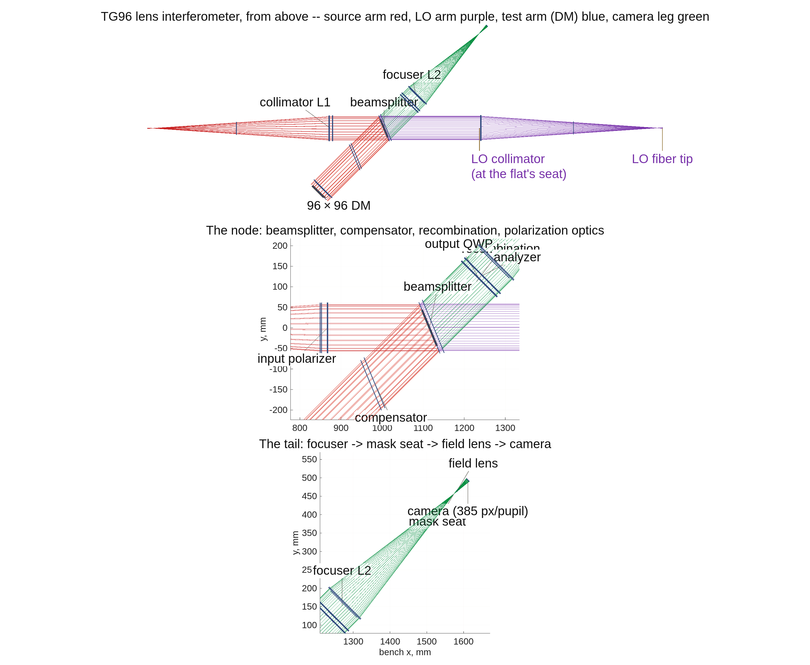

### `cophi_dm96`: COPHI, the heterodyne camera interferometer, as the fifth DM gauge

The campaign plan is `macos/BRIEF_cophi_campaign.md` (Dave's rulings in its §7);
Feng Zhao's proposal is `~/dev/MACOS_sandbox/DM_gauge/COPHI_for_DM_gauge.pptx`
(purpose: HOLD — each DM in a local control loop); the first look is
`macos/NOTE_cophi_first_look.md`; the cameras `macos/NOTE_detectors_survey.md`.

**Run it.**

```matlab
cd('<path-to>/mmacos/templates/40_benches/cophi_dm96');
out = cophi_run('stages',{'bench','figs'});
```

The bench stage with its figures, the README's `cophi_run('stages',{'bench','figs','clearance'})` without the clearance table. The manual copies the template with the siblings it reads by relative location: `tg_psi_dm96_oap` (the runner it builds on), `dm_gauge_lib`, and `90_polarization/tg_psi_dm`.

**The knobs** (`cophi_params.m`):

<!-- transcript: p2_cophi_dm96_knobs -->

**What it prints:**

<!-- transcript: p2_cophi_dm96_run -->

{height=7in}

**FIGURE 38** The COPHI bench from above (`runs/cophi/cophi_vlayout.png`, drawn by `tg96_run`): the TG96 lens rig with the reference flat's seat taken by the traced, fiber-fed local-oscillator arm (purple), the camera leg green. The title says the test arm (DM) is blue; it is drawn red, like the source arm, the mislabel `tg_psi_dm96_oap`'s figure carries too (the open questions list).

**The number it reproduces.** The bench stage registers the LO arm on the test arm before any reading, and gates it: the chief rays land on the same pixel, the LO overfills the test pupil's image by %pin:p2_cophi_dm96_overfill% px, the two arms' magnifications agree to a ratio of %pin:p2_cophi_dm96_magratio%, and the fringe contrast over the pupil is %pin:p2_cophi_dm96_contrast% (median). The report's last line is the gate: REGISTRATION PASS.

**Adapt it.** *"Using templates/40_benches/cophi_dm96, run the bench stage on the mirror rig of record (bench.optics 'oap') and tell me whether the LO arm registers, with its overfill and fringe contrast."*

