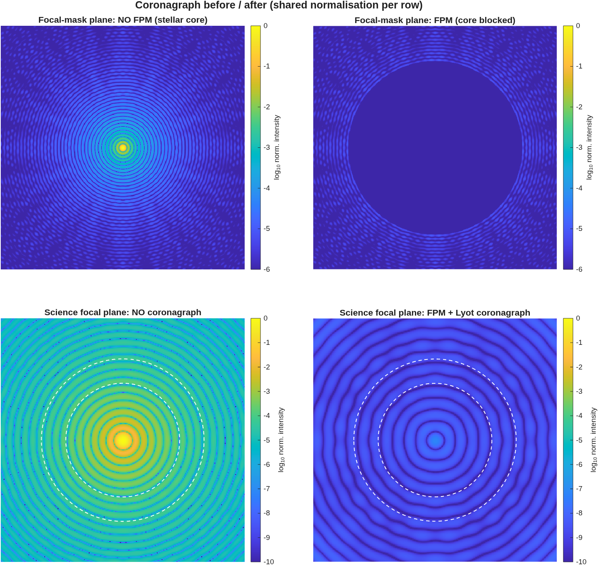

### `coro_walkthrough`: Coronagraph walkthrough (illustrated manual example)

A fully-illustrated end-to-end propagation through the HCIT-style Lyot
coronagraph (`Rx_Coro_FPM.in`), with MATLAB figures at the **key
surfaces** of the relay.  Intended as the manual's worked coronagraph
example; reproducible from one script.

**Run it.**

```matlab
cd('<path-to>/mmacos/templates/30_instruments/coro_walkthrough');
coro_walkthrough();
```

**What it prints:**

<!-- transcript: p2_coro_walkthrough_run -->



**FIGURE 38** The before/after panel the walkthrough draws (`figures/coro_beforeafter.png`), shared normalization per row; the dashed rings are the 7 and 10 lambda/D edges of the dark zone. The focal mask (top right) covers nearly the whole computed field, and the science-plane image with the coronagraph (bottom right) is the bare image's ring pattern, scaled down: no dark hole.

**The number it reproduces.** This page prints what the template does today, which is not what its README describes. The dark-zone mean contrast it reports, %pin:p2_coro_walkthrough_dzmean%, comes from a focal mask that covers nearly the whole computed field: the coronagraph image is the bare image scaled down everywhere, with no dark hole between 7 and 10 lambda/D, and the Lyot-plane panel is a filled disk rather than the bright edge ring. The README's surfaces are right in kind; the deck and the template have not changed in git since June, so something under them did. That is finding (ccc), open, and Part I's coronagraph example (Section 2) uses `coro_planet_demo`'s surfaces page instead.

**Adapt it.** *"Using templates/30_instruments/coro_walkthrough on Rx_Coro_FPM.in, find why the focal-plane mask covers the whole computed field, by printing the mask's radius in lambda/D against the field of view at the mask plane, before changing anything."*

