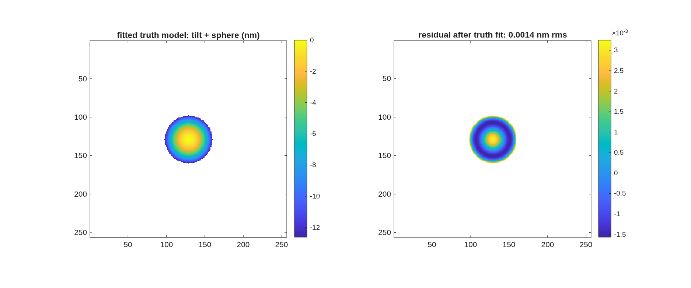

### `bench_ifo`: Twyman-Green interferometer on a bench, with phase-shifting (de Groot) data processing

A generic Twyman-Green IFO built with the macos.design.Bench add-optic utilities, then RUN as an instrument: simulate 7 phase-shifted interferograms and recover the test-optic surface with windowed phase-shifting-interferometry (PSI) processing -- the full simulate -> detect -> process -> compare-to-truth loop.

**Run it.**

```matlab
cd('<path-to>/mmacos/templates/40_benches/bench_ifo');
run(fullfile(pwd,'example_bench_ifo.m'));
```

**What it prints:**

<!-- transcript: p2_bench_ifo_run -->



**FIGURE 38** The surface the interferometer recovers (`ifo_surface_recovery.png`): the fitted truth model (tilt plus sphere) and the residual after the fit, in nm.

**The number it reproduces.** With the test optic a flat (the injected sphere radius is effectively infinite), the phase-shifted interferometer recovers it to a post-fit residual of %pin:p2_bench_ifo_resid% nm rms surface, at a median fringe visibility of %pin:p2_bench_ifo_vis%; the two phase-recovery algorithms (de Groot 7-frame and Hariharan 5-frame) agree to the floor of the arithmetic, printed as a bound.

**Adapt it.** *"Using templates/40_benches/bench_ifo, make the test optic a 5 m radius sphere with 20 urad of tilt and rerun, and tell me the recovered radius and tilt errors and the post-fit residual."*

