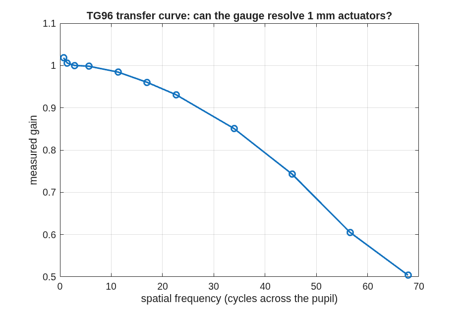

### `tg_psi_dm96`: the optimized-plate gauge for a Xinetics 96×96 DM

The shallow-plate (option-3) polarization-PSI Twyman–Green, laid out
for a 96×96-actuator, 1.0 mm-pitch DM (96 mm beam — the aperture class
where a PBS cube goes custom).  `tg96.m` is the whole campaign: Stage A
clearance solve (margins printed as numbers), Stage A2 sampling budget
(asserted — Dave 2026-09-03: sampling is part of the design), Stage B
scaled build, Stage C battery, Stage D actuator-lattice transfer curve.

**Run it.**

```matlab
cd('<path-to>/mmacos/templates/40_benches/tg_psi_dm96');
out = tg96();
```

The script runs whole (Stages A to E, about ten minutes at model 1024). The manual copies it with `90_polarization/tg_psi_dm`, which it adds to the path by relative location.

**The knobs** (`tg96.m`):

<!-- transcript: p2_tg_psi_dm96_knobs -->

**What it prints:**

<!-- transcript: p2_tg_psi_dm96_run -->



**FIGURE 39** The transfer curve Stage D draws (`tg96_transfer.png`): the gauge's measured gain for each checkerboard mode on the 96 x 96 actuator lattice against its spatial frequency, out to past the DM's Nyquist (48 cycles across the pupil).

**The number it reproduces.** Run unchanged, the campaign script reproduces its committed report line for line (only Stage D's wall time differs, masked here): the null with nothing aligned is %pin:p2_tg_psi_dm96_null% nm rms, the README's run-10 0.1345, and a 10 nm single-actuator deviation reads to %pin:p2_tg_psi_dm96_dflat% nm rms (correlation %pin:p2_tg_psi_dm96_dcorr%) about the flat and %pin:p2_tg_psi_dm96_dbase% nm about a 30 nm working surface, the README's 0.021 and 0.024. The 1 mm actuators are resolved, with roll-off: the gain at 33.9 cycles across the pupil is %pin:p2_tg_psi_dm96_nyqgain%. By the README's own reckoning these map-space numbers are 20-50x above the 1 pm target; the campaign's road to it continues in the parameterized runner, `tg_psi_dm96_oap`.

**Adapt it.** *"Using a copy of templates/40_benches/tg_psi_dm96, rerun tg96 for a 48 x 48 actuator DM at 2 mm pitch (the same 96 mm aperture), and compare its transfer curve and differential rows with the 96 x 96 run."*

