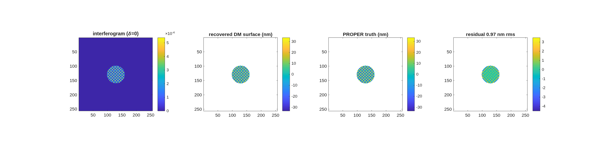

### `bench_ifo_dm`: Twyman-Green IFO testbed, phase 1: measure a DM (PROPER model)

Follow-on to templates/40_benches/bench_ifo (read that first): the same compensated Twyman-Green rig -- now built in ONE call with macos.design.twyman_green -- with the test optic replaced by a DEFORMABLE MIRROR carrying random actuator pokes. The DM surface comes from the PROPER DM model (proper.prop_dm influence functions, |command| < POKE_NM), is loaded into MACOS as a GridData surface in the optic's own local frame, and the 7-frame de Groot PSI pipeline recovers the surface map, which is then compared point-by-point against the PROPER truth map.

*This template has no README; the text above is generated from its entry script's header (`docs/mmacos-manual/part2/bench_ifo_dm.md`, `tools/gen_readme_part2.py`).*

**Run it.**

```matlab
cd('<path-to>/mmacos/templates/40_benches/bench_ifo_dm');
run(fullfile(pwd,'example_bench_ifo_dm.m'));
```

**What it prints:**

<!-- transcript: p2_bench_ifo_dm_run -->



**FIGURE 39** The DM recovery (`ifo_dm_recovery.png`): the interferogram, the recovered DM surface, the PROPER truth carried through the ray map, and the residual, in nm.

**The number it reproduces.** A DM surface of %pin:p2_bench_ifo_dm_truth% nm rms, made with PROPER, is recovered through the traced pupil map with correlation %pin:p2_bench_ifo_dm_corr% and a residual of %pin:p2_bench_ifo_dm_resid% nm rms; the phase-shifting itself is exact (the PSI against the direct field phase reads in the 1e-5 pm range), so the residual is the pupil imaging: its magnification, its distortion, and the registration the run refines.

**Adapt it.** *"Using templates/40_benches/bench_ifo_dm, turn on the aberration phase (DO_ABERR=1) and rerun, and tell me how much the DM recovery's residual grows."*

