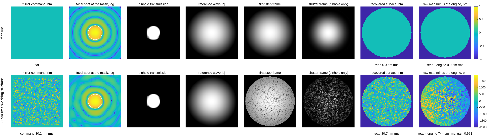

### `pdi_dm96`: the point-diffraction DM surface gauges (P, PF), same DM truth

The point-diffraction readings of the DM-gauge campaign, split out of
`../zwfs_dm96/` on 2026-09-13 (Dave's ruling: the PDI gets its own
directory).  **The code stays shared** — `zwfs_run` and
`../dm_gauge_lib`, nothing is copied; this directory holds the
parameter sheet, the runner, the P/SRI bench decks and figures, and the
records.  Records taken before the move (`pdi193*`, `ploop193`,
`pcam193*`) are still in `../zwfs_dm96/runs/`, where `deck_pdi` cites
them; everything from 2026-09-13 is in `runs/` here.

Two readings, both point-diffraction interferometers, both scored in the
campaign's one currency (actuator-space rows on a 96×96 DM at a 30 nm
working surface, photons per measurement, the closed-loop hold, the
capture range to 10%):

- **P** — the **stepped pinhole**, common path: a pinhole substrate with
  an attenuating surround in the mask seat at the internal focus, its
  phase stepped.  Same bench as the Zernike sensor; the plate is the
  only difference.
- **PF** — the **P/SRI** of Dube, Nejadriahi, Sidick, Jewell, Redding,
  Lou and Basinger, *Proc. SPIE* **13092**, 130926F (2024): the
  reference is the mode of a single-mode waveguide in its own arm,
  phase-shifted thermo-optically, recombined with the unfiltered beam.
  Two benches: the reference **synthesized** on the ZWFS test arm (the
  record through 2026-09-12), and, since 2026-09-13, the reference
  **traced** through a buildable two-arm bench
  (`macos.design.psri_bench`; `pdi.bench 'psri'`).

**Run it, as it stands today.**

```matlab
cd('<path-to>/mmacos/templates/40_benches/pdi_dm96');
out = pdi_run('stages',{'bench'});
```

**It refuses:**

<!-- transcript: p2_pdi_dm96_refusal -->

**Run it with the README's own value.**

```matlab
cd('<path-to>/mmacos/templates/40_benches/pdi_dm96');
out = pdi_run('stages',{'bench'}, 'bench.coat_oap','none');
```

As on `zwfs_dm96`'s page (finding (nnn)): `pdi_run` runs through `zwfs_run`, so its bare call refuses the same way, and the page runs the sheet's own `bench.coat_oap 'none'`. The bench stage only. The manual copies the template with `zwfs_dm96`, `dm_gauge_lib` and `90_polarization/tg_psi_dm`.

**What it prints:**

<!-- transcript: p2_pdi_dm96_run -->



**FIGURE 41** The stations of the stepped-pinhole reading P (`runs/pdi/pdi_stations_P.png`), the flat DM and a 30 nm rms working surface: the mirror command, the focal spot, the pinhole, the reference wave, the first step frame, the shutter frame, the recovered surface, and the recovered map minus the engine's own field (pm).

**The number it reproduces.** The stepped pinhole reads the 30 nm rms working surface with gain %pin:p2_pdi_dm96_pgain% and a residual of %pin:p2_pdi_dm96_pres% pm against the engine's own field; on 100 nm single-actuator pokes its gate G5 reads %pin:p2_pdi_dm96_g5% pm rms error. The P/SRI reading PF passes the same gate with its error at the floor of the printout, its reference's shape fixed by the waveguide mode.

**Adapt it.** *"Using templates/40_benches/pdi_dm96, rerun the bench stage with a 1.0 lam/D pinhole ('pdi.DIA_LAMD',1.0) and 'bench.coat_oap','none', and compare P's gain and G5 error with the 2 lam/D record."*

