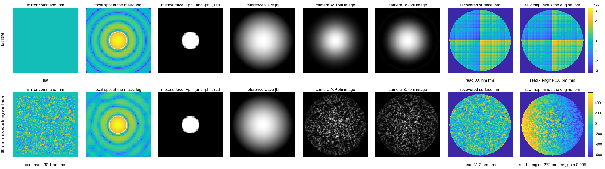

### `zwfs_dm96`: a Zernike wavefront sensor against the PSI gauge, same DM truth

The ZWFS campaign (plan: `macos/BRIEF_zwfs_campaign.md`).  Question:
does a Zernike sensor beat the TG96 polarization-PSI gauge on the
differential benchmark (10 nm actuator deviation read to 0.021 nm,
base-independent — tg_psi_dm96 run 10)?

**Run it.**

```matlab
cd('<path-to>/mmacos/templates/40_benches/zwfs_dm96');
out = zwfs_run('stages',{'bench'});
```

The bench stage of the bare call: the sheet's `bench.coat_oap 'auto'` resolves to none on the lens rig (protected aluminum on the OAP rig; finding (nnn)). The default also runs the reading battery and the figures. The manual copies the template with `dm_gauge_lib` and `90_polarization/tg_psi_dm`, which the runner adds to the path by relative location.

**What it prints:**

<!-- transcript: p2_zwfs_dm96_run -->



**FIGURE 45** The vector reading's stations (`runs/run/run_stations_V.png`), the flat DM and a 30 nm rms working surface: the mirror command, the focal spot at the mask, the metasurface, the reference wave, the two camera images, the recovered surface, and the recovered map minus the engine's own field (pm).

**The number it reproduces.** On a 30 nm rms working surface the vector reading (the polarized dimple's +phi and -phi images at once) recovers the engine's own field with gain %pin:p2_zwfs_dm96_vgain% and a residual of %pin:p2_zwfs_dm96_vres% pm, where the single phase-stepped scalar reading S reads gain %pin:p2_zwfs_dm96_sgain%. Every bench gate passes (the mask sandwich and the reference surrogate at the floor of the arithmetic); the sampling budget's 96 x 96 line is NOT MET at 1.66 detector px per actuator, a warning by the sheet's own `enforce = warn`.

**Adapt it.** *"Using templates/40_benches/zwfs_dm96, rerun the bench stage with NGRID 385 (the 1 Mpix-class detector) and tell me whether the 96x96 sampling line is met and how the V and S gains change."*

