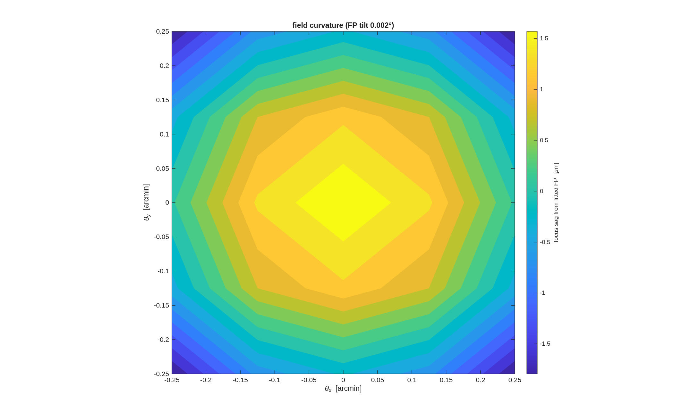

### `e2e`: the complete end-to-end worked example

Design → instrument → segmentation → sensitivities → MET → compare →
simulator, built from the parameterized design-layer runners and
utilities, **for users to hack for their own systems** (Dave
2026-07-17).  Every stage runner produces a **thorough design report**
(saved `sN_report.txt`) **and graphics** (`macos.view_std` standard
views + the stage's metric figures) beside this file.

**The product is the general stage runners** (Dave 2026-07-19), which
live in `design/runners/` (see its README for the pipeline and the
`.in`-plus-declared-sidecars handoff contract); the `sN_*.m` scripts
here are thin narrative drivers over them.  s3–s6 already work this
way (`run_segmentation`/`run_sensitivities`/`run_met`/`run_compare`);
s1–s2 promote to `run_design` in a later recast pass.

All user knobs live in **`e2e_params.m`** — one file, commented.  Each
stage consumes the previous stage's saved artifacts (`.in` + `.mat` +
sidecars), so a knob change re-runs from the first stage it affects.

**Run it.**

```matlab
cd('<path-to>/mmacos/templates/80_end_to_end/e2e');
run(fullfile(pwd,'s1_telescope.m'))   % then s2_instrument ... s7_simulate, in order
```

**What it prints:** Part I is this template's run: Sections 1 to 6 follow its seven stages, each run unchanged in one thread directory, every listing and number generated (Section 1 prints stage 1's design report; Section 7 steps off the thread for the budget). This page adds the one stage-1 figure Part I did not print.



**FIGURE 49** Stage 1's field-curvature map (`s1_fpmap.png`, from the Section 1 run): the sag of each field point's best focus from the fitted, tilted focal plane over the ±0.25′ map, in micrometres.

**The number it reproduces.** Stage 1 delivers an effective focal length of %pin:ch01_efl_m% (%pin:ch01_fno%), λ/D %pin:ch01_lamD_mas%, with the fold cleared at a %pin:ch01_bias_arcmin% field bias and a primary hole %pin:ch01_hole_r_m% in radius (Section 1). The thread's later numbers are Sections 2 to 6's; its committed outputs are stale against these live runs, finding (bbb).

**Adapt it.** *"Using templates/80_end_to_end/e2e, change e2e_params for a 6 m f/16 version of the telescope and rerun stages 1 and 2, telling me the delivered f-number, the field ladder and whether the fold still clears."*

