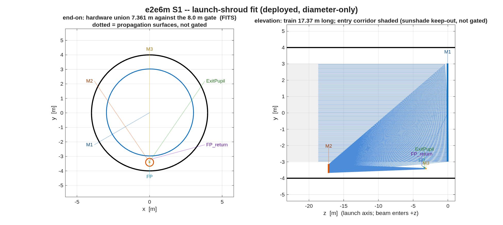

### `e2e6m`: the 6 m unobscured coronagraph end-to-end example

Design an unobscured 6 m visible telescope, segment its primary, hang an
imager and an APLC coronagraph off it with `macos.design.Bench`, harvest
the linear-model sensitivities, and play a random time series through the
engine — the Keysight end-to-end use case, built entirely from the
committed stage runners.

Every knob lives in **`e2e6m_params.m`**.  Each stage consumes the
previous stage's saved `.in` + `.mat`, so a knob change re-runs from the
first stage it affects.  The narrative — every question raised, every
decision and its result, every gate outcome — is in
**`e2e6m_LOG.md`**; read that first if you are picking this up.

**Run it.**

```matlab
cd('<path-to>/mmacos/templates/80_end_to_end/e2e6m');
s1_layout_search(); s1_telescope(); s2_segmentation();
```

The README's three calls, run in order on a copy: the layout search (whose 216-row table is not printed here; it ends, as committed, with no geometry meeting all three gates), the telescope, and the segmentation. The page prints the telescope stage.

**What it prints:**

<!-- transcript: p2_e2e6m_run -->



**FIGURE 46** The launch-shroud fit the telescope stage draws (`s1_shroud.png`): end-on, every body's radial extent about the incoming-beam axis against the 8.0 m deployed shroud (black); in elevation, the 17.37 m train with the entry corridor shaded (the sunshade keep-out, not gated).

**The number it reproduces.** The flow's three hard numbers are 500 nm, an OTA f/# of 12 to 20, and an 8 m shroud. Today's run starts where the committed one did, the same all-sphere layout and the same center-field correction (S0, %pin:p2_e2e6m_s0% waves), and then parts from it: the inner-field stage ends at %pin:p2_e2e6m_s1% waves against the committed 0.0200, the full-field solve at %pin:p2_e2e6m_s2% (committed 0.0355, both inside the 0.071-wave bar), the dense 7 x 7 map at %pin:p2_e2e6m_dense% waves raw, which fails the bar the committed 0.0502 passed, and the corrected telescope at f/%pin:p2_e2e6m_fno% against the committed f/25.39. Both f-numbers miss the 12 to 20 band, which is why the flow has `s1_close_fno`. The template's own files have not changed in git since 2026-08-25; the library under them has, and which change moved this is not traced (the open questions list has it). The segmentation stage runs on the live telescope, %pin:p2_e2e6m_segs% segments, and its one-segment poke gate passes.

**Adapt it.** *"Using templates/80_end_to_end/e2e6m, run s1_telescope and then s1_close_fno to bring the corrected f/# into the 12-20 band, and report the dense-map maximum and the shroud fit at the closed f/#."*

