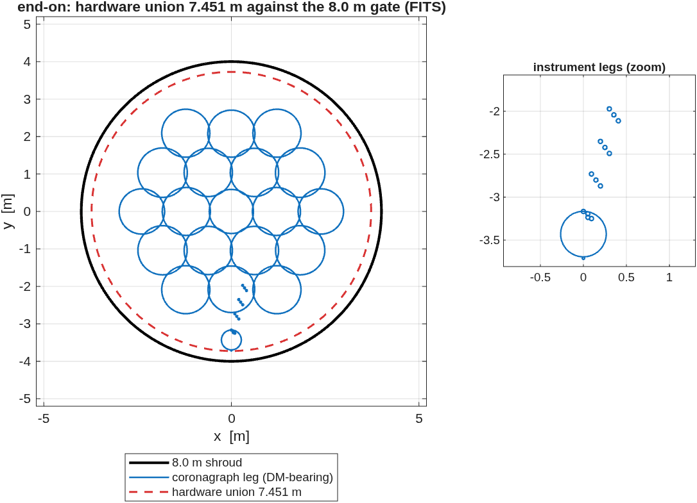

### `e2e6m_r2`: e2e6m round 2, R1: the DM-bearing coronagraph back end

Round 1's back end carried apodizer / FPM / Lyot only; its close-out named the missing capability and called the extension parameter work. This runner does that work: the CTB topology (8 OAPs + two flat-fold DMs, DST2R-class near-normal folds) instanced at observatory scale behind the 6 m telescope, built in METRES with `macos.design.Bench` and spliced with `macos.design.append_rx` so ONE train carries a telescope perturbation to a contrast number.

**Run it.**

```matlab
cd('<path-to>/mmacos/templates/80_end_to_end/e2e6m_r2');
r1_backend();
```

The first round-2 stage only (`r1_backend`); the rest of the round (`r2_*` to `r4_*`, and the `cf*` coronagraph-family studies) builds on it. It reads round 1's committed telescope from `../e2e6m`, which the manual copies beside it.

**What it prints:**

<!-- transcript: p2_e2e6m_r2_run -->



**FIGURE 47** The shroud fit on the full train (`r1_seg_shroud.png`): end-on, the 19-segment primary, the coronagraph leg's bodies and the hardware union against the 8.0 m shroud, with a zoom on the instrument legs.

**The number it reproduces.** Round 2 hangs the coronagraph testbed's topology (8 OAPs, two DMs) at observatory scale off round 1's segmented telescope: the spliced train is %pin:p2_e2e6m_r2_nelt% elements, all of the telescope's %pin:p2_e2e6m_r2_pass% passing rays reach the science focus, and the whole train fits a %pin:p2_e2e6m_r2_shroud% m union inside the 8.0 m shroud. It reads round 1's committed telescope, the f/25.39 design, not the live one of the previous page (finding (qqq)).

**Adapt it.** *"Using templates/80_end_to_end/e2e6m_r2, rerun r1_backend with 48 mm DMs and 1.0 m relay OAPs, and tell me whether every pupil still fits its DM and the train still fits the shroud."*

