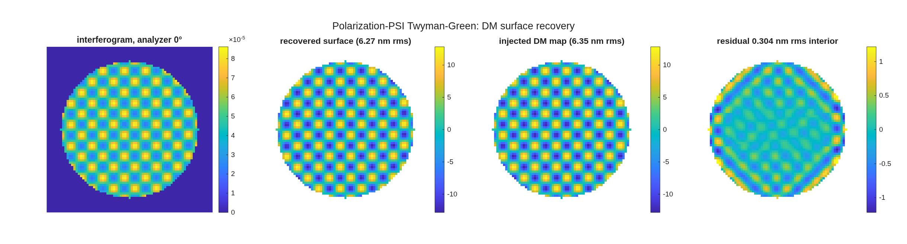

### `tg_psi_dm`: a DM surface gauge

A surface-figure gauge built end to end in MACOS: a compensated
Twyman-Green interferometer with a **deformable mirror as the test optic**,
whose fringe phase is stepped by **rotating an analyzer** rather than by
translating a reference mirror.  Four analyzer angles are a standard
four-step PSI; the recovered map is compared against the DM map that was
injected.

| file | what it is |
|---|---|
| `example_tg_psi_dm.m` | the full, gated measurement — five gates, the closure, all the numbers |
| `demo_tg_psi.m` | the same measurement as seven narrated beats, one PNG each |
| `dm_influence_map.m` | actuator influence-function DM surfaces (`checker` / `random` / `single`) |
| `tg_*.in`, `demo_*.in` | the emitted prescriptions (both arms) |
| `dm_*.txt`, `demo_flat.txt` | the DM grid maps — **gitignored**, ~1 MB each; run either script once to recreate the files the decks reference |
| `tg_psi_dm.mat` | every result struct, the recovered map, the sweep cube |
| `tg_psi_dm_*.png`, `demo_beat*.png` | figures, and the pre-rendered demo backups |

Gates live in `mmacos/tests/tTgPol.m` (9 tests, model 128, `SUITE_FAST`).

```
cd <this dir>
matlab -batch "run('example_tg_psi_dm.m')"     # gated, ~2 min
matlab -batch "run('demo_tg_psi.m')"           # the beats + PNGs
demo_tg_psi                                    # interactive: pauses per beat,
                                               # and animates the analyzer sweep
```

**Run it.**

```matlab
cd('<path-to>/mmacos/templates/90_polarization/tg_psi_dm');
run(fullfile(pwd,'example_tg_psi_dm.m'));
```

On 2026-10-24 this page was a refusal (gate 2's centroid read NaN, finding (ooo)); the engine fix, macos c6c83d55, made it run, and the page now prints the run.

**What it prints:**

<!-- transcript: p2_tg_psi_dm_run -->



**FIGURE 48** The DM surface recovery (`tg_psi_dm_recovery.png`): an interferogram at analyzer 0 degrees, the recovered surface, the injected DM map, and the residual (nm).

**The number it reproduces.** The bench measures its own polarization defect before it measures the DM: the beamsplitter's diattenuation rotates the test arm %pin:p2_tg_psi_dm_rot% degrees from orthogonal, so the unaligned gauge reads %pin:p2_tg_psi_dm_ungain% times the true surface (11.7 percent high); turning the arm's waveplate nulls it. Aligned, the four-step polarization PSI recovers the injected DM map with correlation %pin:p2_tg_psi_dm_corr% and a residual of %pin:p2_tg_psi_dm_resid% nm rms in the interior, and the four-step agrees with a 64-angle least-squares fit to the floor of the arithmetic.

**Adapt it.** *"Using templates/90_polarization/tg_psi_dm, run the example with an uncoated beamsplitter and tell me how far the arms rotate from orthogonal and what the unaligned gain becomes."*

