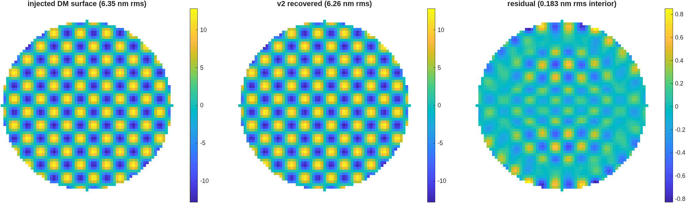

### `tg_psi_dm_v2`: the MacNeille cube (TG v2)

The v1 rig carries the polarization **conceptually**: the
splitter is a perfect-conductor plate plus a compensator, and each arm opens
with an *ideal* `TrPolarizer` at normal incidence.  That model earned its
keep — it found a real defect, the beamsplitter rotating the test arm 7.479°
and the gauge reading **11.7% high**.

v2 replaces the concept with the **component**: a cemented **MacNeille
polarizing cube**, one coated interface at 45° between two prisms of the same
glass, built out of ordinary coated engine surfaces.  Then it asks what is
left of the v1 error, and what has taken its place.

**Nothing here is new engine capability.**  MACOS has carried trustworthy
coated s/p physics at arbitrary AOI since 2026-07-27/28 (the `r_p` sign fix,
the incident-medium fix, the transmission radiometric factor, anchored to
published Mueller data at ~1e-14).  So a PBS is coating physics: no ray
splitting, no `RfPolarizer` element, still two decks — the engine does not
split rays.

New builder pieces, all in `mmacos/src/+macos/+design/`:

Gates: `mmacos/tests/tTgPol2.m` (9 tests, model 128, `SUITE_FAST`, ~6 s).
v1's `tTgPol` (9 tests) is **unchanged and still green** — v2 is a sibling,
not a replacement, and v1 remains the rehearsed demo default.

```
cd <this dir>
matlab -batch "run('example_tg_psi_dm_v2.m')"    # gated, ~4 min
matlab -batch "run('demo_tg_psi_v2.m')"          # the beats + PNGs, ~40 s
demo_tg_psi_v2                                   # interactive: pauses per beat
```

---

**Run it.**

```matlab
cd('<path-to>/mmacos/templates/90_polarization/tg_psi_dm_v2');
run(fullfile(pwd,'example_tg_psi_dm_v2.m'));
```

On 2026-10-24 this page was a refusal (gate 1, the same cause as `tg_psi_dm`'s, finding (ooo)); the engine fix, macos c6c83d55, made it run. The manual copies it with its sibling `tg_psi_dm`, which it reads for `dm_influence_map`.

**What it prints:**

<!-- transcript: p2_tg_psi_dm_v2_run -->



**FIGURE 53** The v2 rig's DM surface recovery (`tg_psi_dm_v2_recovery.png`): the injected DM surface, the recovered surface, and the residual (nm).

**The number it reproduces.** With the coated cube in place of v1's plate, the gauge's scale is right as designed, gain %pin:p2_tg_psi_dm_v2_gain% against v1's 1.11661, because the cube's reflecting arm is cleaned to pure s; an arm-waveplate error now costs contrast, not scale. It recovers the same DM map with correlation %pin:p2_tg_psi_dm_v2_corr% and a residual of %pin:p2_tg_psi_dm_v2_resid% nm rms in the interior.

**Adapt it.** *"Using templates/90_polarization/tg_psi_dm_v2, sweep the arm-waveplate azimuth error to 20 degrees and tell me where the fringe contrast falls below 0.99 and whether the gain moves."*

