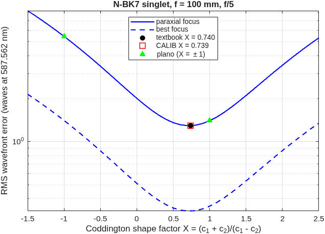

### `singlet`: best-form singlet: the bending that minimizes spherical aberration

A singlet of given focal length, f-number and glass can still be *bent*: the two radii trade at constant power, and the spherical aberration depends on the split.  Coddington's shape factor X = (c1 + c2)/(c1 − c2) names the bending (+1 convex-plano with the curved face toward the object, 0 equi-convex, −1 plano-convex the other way round), and thin-lens third-order theory puts the minimum at X = −2(n² − 1)p/(n + 2), with p = (m + 1)/(m − 1) the position factor of the conjugates (p = −1 for a distant object; Kingslake & Johnson, *Lens Design Fundamentals*, 2nd ed., Sec. 4.3; Smith, *Modern Optical Engineering*, 4th ed., Sec. 6.3).  The runner builds the plano singlet the benches use (both ways round), the textbook best form, then lets the engine find the bending — MACOS CALIB on both radii from an equi-convex start — and compares the two shape factors over a bending scan.

The lens is a `macos.design.Lens`; its deck comes from `macos.design.lens_emit`, its first-order layout from `macos.design.lens_pupils`, and its score from `macos.design.lens_eval`.  These are the IODC 2010 evaluator's tools generalized to any lens.  The test `tLensSinglet` holds them to that evaluator, which is gated against an independent ray tracer.

**Run it.**

```matlab
cd('<path-to>/mmacos/templates/35_lenses/singlet');
out = singlet();
```

**The knobs** (`singlet.m`):

<!-- transcript: p2_singlet_knobs -->

**What it prints:**

<!-- transcript: p2_singlet_run -->



**FIGURE 61** RMS wavefront error against Coddington's shape factor for N-BK7 singlets at f = 100 mm, f/5, at the paraxial focus and at best focus, with the textbook bending, CALIB's and the two plano orientations marked (`singlet_bending.png`).

**The number it reproduces.** Coddington's minimum-aberration bending is X = %pin:p2_singlet_xtb%; CALIB on both radii, started from an equi-convex lens, lands at X = %pin:p2_singlet_xcal%. The best form's RMS wavefront error at f/5 is %pin:p2_singlet_rmstb% waves against %pin:p2_singlet_rmscp% for the benches' convex-plano lens.

**Adapt it.** *"Using templates/35_lenses/singlet, find the best-form N-SF6 singlet for f = 50 mm at f/4 imaging an object 200 mm away, and tell me its shape factor, the engine's, and how much it beats the plano-convex lens."*

