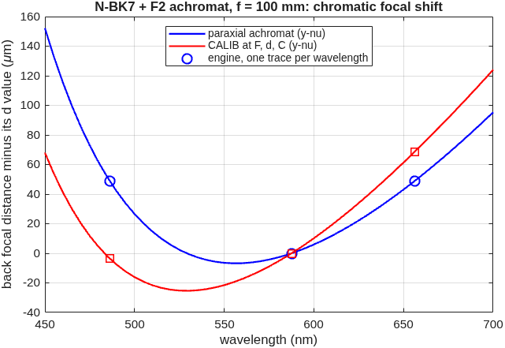

### `doublet`: cemented achromat from its glass pair, and vendor achromats from a catalog

Two glasses of different dispersion bring two wavelengths to one focus.  With Abbe numbers V = (n_d − 1)/(n_F − n_C), the thin-lens element powers that join the F and C foci at total power φ are φ1 = φV1/(V1 − V2) and φ2 = −φV2/(V1 − V2).  What is left, the d focus off the common F/C focus, is the **secondary spectrum** f(P1 − P2)/(V1 − V2), where P = (n_d − n_C)/(n_F − n_C) is the partial dispersion (Kingslake & Johnson, *Lens Design Fundamentals*, 2nd ed., Sec. 5.3; Smith, *Modern Optical Engineering*, 4th ed., Sec. 6.5).  A cemented pair has three radii: power and color fix two, and the third, the **bending**, sets the spherical aberration.

The runner:

1. takes the powers from the Abbe numbers (catalog glasses from the engine's own table);
2. solves the **thick** lens paraxially (y-nu): EFL exact at d, the F and C foci coincident, with an equi-convex crown;
3. lets the **engine** find the bending: MACOS CALIB on the three radii with F, d and C all in the solve (`OptWaveLen=`), holding the image plane;
4. measures the focal shift at F, d and C from three engine traces, one wavelength per trace, and compares the secondary spectrum with the textbook;
5. loads a vendor achromat from the lens catalog and checks its EFL against the vendor's.

**Run it.**

```matlab
cd('<path-to>/mmacos/templates/35_lenses/doublet');
out = doublet();
```

**The knobs** (`doublet.m`):

<!-- transcript: p2_doublet_knobs -->

**What it prints:**

<!-- transcript: p2_doublet_run -->



**FIGURE 64** Chromatic focal shift of the N-BK7 + F2 achromat from 450 to 700 nm, the paraxial achromat (F and C joined) and the CALIB lens, with the engine's three single-wavelength traces at F, d and C marked (`doublet_focus.png`).

**The number it reproduces.** On the paraxial achromat, the d focus minus the common F/C focus is %pin:p2_doublet_sse% mm, measured on three engine traces; the thin-lens secondary spectrum predicts -%pin:p2_doublet_sstb% mm. CALIB at F, d and C holds the worst RMS across the band at %pin:p2_doublet_worstcal% waves against %pin:p2_doublet_worstpar%. The catalog's Newport PAC095AR.14 traces to an EFL of %pin:p2_doublet_vefl% mm against the vendor's 250.

**Adapt it.** *"Using templates/35_lenses/doublet, design a cemented N-BK7 / SF2 achromat for f = 200 mm at f/6, tell me its secondary spectrum against the textbook value, then add my vendor part to the lens catalog and put it on a bench with add_optic."*

