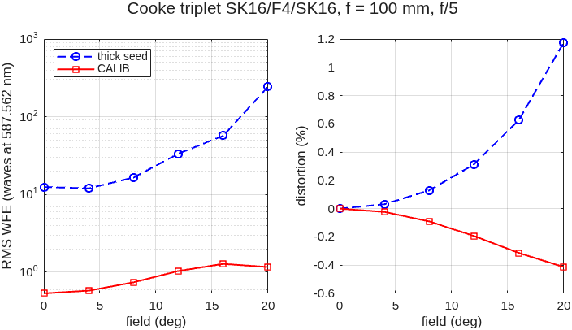

### `triplet`: Cooke triplet: the first lens that carries a field

A singlet or a cemented doublet corrects the axis.  Off axis, their field is set by astigmatism and the Petzval curvature, which no bending removes.  H. Dennis Taylor's triplet (Cooke, 1893) spreads the power over a positive–negative–positive train with air spaces.  The separation lets the negative element flatten the Petzval sum while the outer pair keep the power, and the near-symmetry about the central stop cancels coma, distortion and lateral color to first order.

The runner:

1. solves the textbook **thin-lens seed** (Kingslake & Johnson, *Lens Design Fundamentals*, 2nd ed., Ch. 12; Smith, *Modern Optical Engineering*, 4th ed., Sec. 12.6): outer crowns of equal power, a central flint at the stop, two equal air spaces, chosen for the total power, zero axial color (Σ y²φ/V = 0) and a chosen Petzval sum (Σ φ/n = PETZVAL/f), with lateral color and distortion vanishing by the symmetry;
2. builds the **thick seed**: crowns equi-convex, flint equi-concave, at their centre thicknesses, scaled to the EFL;
3. runs **MACOS CALIB** in alternating rounds, one on the six radii, then one on the axial positions of surfaces 3–6, at three fields (0, 0.7 and 1 times the semi-field, d light), with the image plane held and the EFL restored after every round;
4. scores the field: RMS wavefront error and distortion from 0 to the semi-field.

**Why alternating rounds.**  The engine cannot take a radius DOF and a position DOF on the *same* element in one solve: `calib_run` fails at its first step (the evidence is in `~/dev/MACOS_sandbox/calib_pist_roc_2026-11-01/`, queued as an engine item).  Its WFE merit also does not charge lost rays, so a free spacing can collapse an air gap onto its neighbour and "win" on the few rays left (measured: 1412 of 1437 rays lost, reported WFE ≈ 0).  So each round is **accepted** only when all four checks hold:

- every axial gap clears `FLOOR_MM` (a spacing round's gap below the floor is clamped to it first, the IODC 2010 rule);
- every edge thickness at the clear radius is positive;
- the full field loses no ray;
- the merit has gone down, measured independently by `macos.design.lens_eval` (RMS over the CALIB fields).

These are the lessons of `challenges/iodc2010`.  Its other lesson stands too: CALIB has no distortion row, so distortion is **reported, not fitted**.

**Run it.**

```matlab
cd('<path-to>/mmacos/templates/35_lenses/triplet');
out = triplet();
```

**The knobs** (`triplet.m`):

<!-- transcript: p2_triplet_knobs -->

**What it prints:**

<!-- transcript: p2_triplet_run -->



**FIGURE 63** RMS wavefront error (log scale) and distortion against field for the SK16 / F4 / SK16 Cooke triplet at f = 100 mm, f/5: the thick seed from the textbook thin-lens solve, and the lens after the alternating CALIB rounds (`triplet_field.png`).

**The number it reproduces.** From the textbook thin-lens seed, the alternating CALIB rounds take the merit (the RMS over 0, 14 and 20 degrees) from %pin:p2_triplet_m0% to %pin:p2_triplet_m1% waves; at the 20-degree edge the RMS is %pin:p2_triplet_rmsedge% waves and the distortion, reported and never fitted, is %pin:p2_triplet_distedge% %.

**Adapt it.** *"Using templates/35_lenses/triplet, design a Cooke triplet for f = 50 mm at f/4 over +/-25 degrees in N-SK4 / SF2, and tell me the field curve, the distortion at the edge and which CALIB rounds were accepted."*

