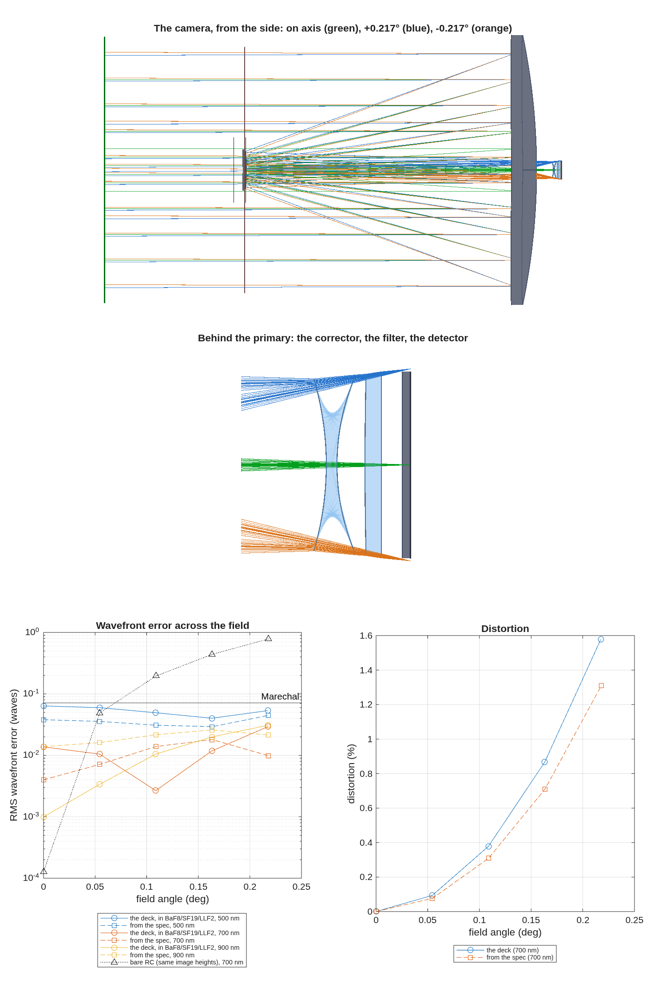

### `small_camera`: the small dedicated imager: a Cassegrain with a refractive field corrector

A single-purpose remote sensing camera whose telescope and instrument are one design: two mirrors, a corrector behind the primary's hole, a filter and one detector.  The relay's power is part of the camera's focal length.  That is what sets this family apart from an observatory front end feeding a `Bench` (the mmacos manual's chapter 2 thread).

The worked case is the deck beside the runner, `small_camera.in`: a 350 mm, f/10 Ritchey–Chrétien imager with a 2048-pixel line array of 13 µm pixels (3.7 µrad per pixel, a 0.44° field) and a 500–900 nm band.  These design values are the runner's defaults, and the deck is checked against them.

The design layer under it is `macos.design.cass_camera` and `macos.design.camera_emit`.  The mirrors come from `Telescope`'s closed form, or are given outright.  Relay elements are `macos.design.Lens` objects.  The y-nu trace runs through the folded train, and the deck is scored with `macos.design.lens_eval`.

The runner has five stages:

1. **The deck.**  The builder rebuilds `small_camera.in` from the deck's own numbers, and the two decks trace alike.  The stage then reports the field at the design wavelength, the clear apertures the beam needs, and whether the primary's hole clears.
2. **The glasses.**  The deck's fixed indices are matched to the engine's catalog (`macos_glass_list.txt`), and the band is traced with the matched glasses' dispersion.
3. **The bare telescope.**  This is the closed-form Ritchey–Chrétien with the same m and β and no relay, which shows what the corrector is for.
4. **The camera from its spec** (aperture, focal length, pixel, band):
   - the RC closed form;
   - the deck's corrector, scaled and in catalog glass;
   - the first-order solve that sets the focal length and puts the focus behind the filter;
   - CALIB rounds over the band and the field.
5. **The sampling**: λN/p at each wavelength.  The camera is undersampled by design, and the stage says by how much.

**Why rounds, and why "best kept".**  CALIB has no focal-length row.  Its corrector radii move the relay's magnification, so each round ends with the first-order re-solve: the two-mirror f-number and back focal distance, by two nested 1-D solves, put the focal length and the focus back on the spec.

The first re-solves shift m and undo part of the balance.  The rounds settle as the re-solve's move shrinks.  The design kept is the best one seen by an independent merit: the worst `lens_eval` RMS over the band at the CALIB fields and the full field, among designs that lose no ray beyond the shadow.  The LM merit does not charge lost rays, as the lens templates found.  A failed CALIB, a failed re-solve, or a round that loses rays ends the rounds.

**Run it.**

```matlab
cd('<path-to>/mmacos/templates/36_cameras/small_camera');
out = small_camera();
```

**The knobs** (`small_camera.m`):

<!-- transcript: p2_small_camera_knobs -->

**What it prints:**

<!-- transcript: p2_small_camera_run -->



**FIGURE 64** The small dedicated imager. Top: the deck small_camera.in drawn from the side by macos.view_rx, with the on-axis bundle (green) and the two field-edge bundles at +/-0.217 deg (blue, orange): the source plane, the secondary and its spider plane, the primary, and the corrector behind it. Middle: behind the primary, the corrector, the filter and the detector, where the edge bundles land 13.5 mm off axis. Bottom: RMS wavefront error (log scale) and distortion against field for the deck in its matched catalog glasses at 500, 700 and 900 nm, the camera re-designed from its spec, and the bare Ritchey-Chretien without its corrector (`small_camera_field.png`).

**The number it reproduces.** As shipped, the deck's worst RMS at 700 nm is %pin:p2_small_camera_rms700% waves, at the edge of its 0.44 deg field.  Re-designed from its spec (D 350 mm, f 3500 mm, 500-900 nm), the camera's worst RMS over the band and the field is %pin:p2_small_camera_merit% waves, and at 700 nm the pixel samples the image at Q = lambda N / p = %pin:p2_small_camera_q700%, under Nyquist by design.

**Adapt it.** *"Using templates/36_cameras/small_camera, design the camera for a 250 mm aperture at f = 2500 mm with 10 um pixels over 450-850 nm, and tell me the field curve at each wavelength, the distortion at the edge, which CALIB rounds were kept and how undersampled the detector is."*

