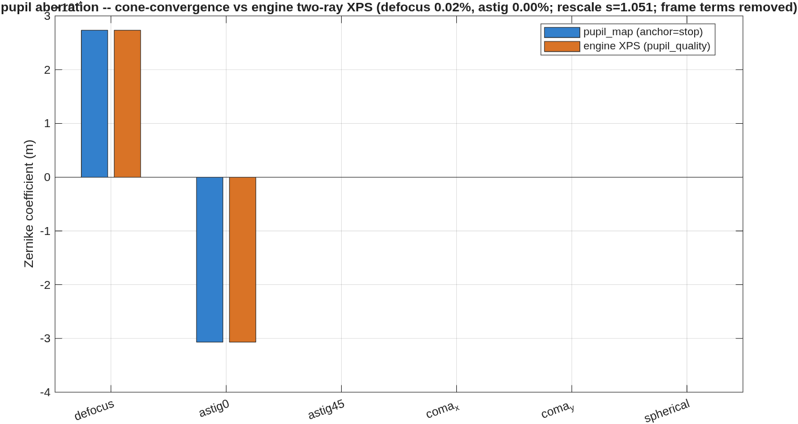

### `pupil_id`: beyond FEX: the exit pupil as a SURFACE

`tma_onaxis`'s own note is that *"the exit pupil after M3 is
**ASSESSED (FEX), not constrained**."* This template is the next chapter. FEX
reduces the exit pupil to a **single chief-ray conjugate sphere** — one field
point, forced `Kc=0`, one radius. It gives the XP location and the far-field
propagation distance and **nothing about pupil-imaging quality**: no pupil
spherical aberration, no pupil astigmatism, no pupil **walk** across field.

It is a **general-purpose driver**: give it any telescope Rx (defaults to
`tma_onaxis`), it runs the grid-of-cone-sources method to find the exit pupil
as a fitted **surface**, writes a **revised Rx** (the XP reference sphere
re-placed at the fitted-surface / chief-ray crossing -- an on-chief vertex at
the measured pupil station, with the radius following the vertex so the sphere
center stays on the propagation-target plane), cross-checks against the
engine's two-ray XPS, reports how sharply the
EP images to the XP, and tracks the pupil walk vs field.

It **composes existing, test-gated tools** — `design/src/pupil_map.m`
(cone convergence), `macos.pupil_quality` (engine XPS), `macos.pupil_zone_map`
(zone spots), `macos.fex`/`macos.set_xp` (the XP sphere). **No new engine or
veneer code.**

**Run it.**

```matlab
cd('<path-to>/mmacos/templates/10_telescopes/pupil_id');
run_pupil_id('tma_onaxis');
```

The runner's one-case form on the bundled `tma_onaxis` deck; the manual copies the template with its `tma_onaxis` sibling, which the runner reads.

**What it prints:**

<!-- transcript: p2_pupil_id_run -->



**FIGURE 58** The exit pupil's own aberration (`results/tma_onaxis/pupil_id_zernikes.png`): the cone-convergence pupil map against the engine's two-ray XPS command, term by term. The axis multiplier (×10⁻⁴ m) sits under the title, cut off by it.

**The number it reproduces.** The pupil, found as a surface from the convergence of ray cones rather than from one chief ray, departs from a sphere by %pin:p2_pupil_id_dep% m rms, and its aberration agrees with the engine's own pupil-quality command: defocus %pin:p2_pupil_id_df% against %pin:p2_pupil_id_dfe%, 0.02 percent, astigmatism to the printed digit. The revised prescription carries the exit pupil the method finds.

**Adapt it.** *"Using templates/10_telescopes/pupil_id, run pupil_id on the sz_tma deck with a 4 arcmin field, and tell me the exit pupil's departure from a sphere and whether it agrees with the engine's pupil_quality."*

